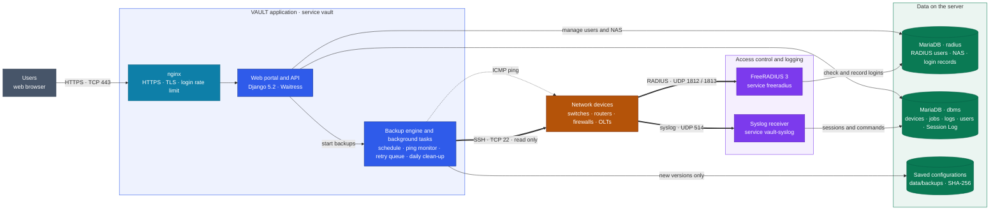

<div align="center">

# BdREN VAULT

**Network configuration backup and RADIUS / AAA access control, in one web portal.**


-blue)

[Features](#features) ·
[Technology](#technology-stack) ·
[Pages](#pages-in-the-portal) ·
[Installation](#installation) ·
[Updating](#updating) ·
[Security](#security) ·
[Operations](#operations) ·
[Documentation](#documentation)

</div>

<details>
<summary><b>Contents</b></summary>

1. [Overview](#overview)
2. [Features](#features)
3. [Technology stack](#technology-stack)
4. [Pages in the portal](#pages-in-the-portal)
5. [Architecture](#architecture)
6. [Requirements](#requirements)
7. [Ports and services](#ports-and-services)
8. [Installation](#installation)
9. [Updating](#updating)
10. [Configuration](#configuration)
11. [Data and retention](#data-and-retention)
12. [Roles](#roles)
13. [Security](#security)
14. [Operations](#operations)
15. [Project structure](#project-structure)
16. [Documentation](#documentation)
17. [Author](#author)

</details>

---

## Overview

BdREN VAULT gives a network team one place for two jobs that normally need separate tools:

| | |
|---|---|
| **Configuration backup** | Connects to switches, routers, firewalls and OLTs over SSH, saves the running configuration on a schedule or on demand, keeps every version and shows exactly what changed. |
| **RADIUS / AAA access control** | Decides who may log in to those devices, at which access level and on which devices. FreeRADIUS answers every device login against these rules. |

The web application **manages** the data; **FreeRADIUS** answers device logins on its own, so logins keep
working while the web application restarts or is updated.

> VAULT only **reads** device configuration. It never sends a command that changes a device.

Tested with **20,000+ devices** and **30,000+ RADIUS users / NAS clients** on generated data.

---

## Features

### Configuration backup
- Scheduled backups (selected days of the month, daily, every N days or every N minutes) and on-demand
  backups of one device, a selection or the whole inventory
- A new version is saved only when the configuration actually changed; every version is kept with a
  SHA-256 checksum
- Line-by-line comparison of any two versions, and **Change Reports** for a period (CSV / PDF)
- Patient SSH with an automatic retry queue for devices that were offline or slow
- Up to 200 parallel SSH sessions (`DBMS_MAX_WORKERS`, default 50)
- **Retention:** one setting keeps every log (Activity Logs, saved configurations, Session Log, accepted
  logins) for Forever, 12, 24 or 48 months. The newest configuration of every device is always kept.
  Rejected (failed) logins are kept for 24 hours only; Forever deletes no other log.

**Supported platforms:** Cisco IOS / IOS-XE, NX-OS and ASA · Huawei VRP and SmartAX OLTs · Juniper Junos ·
MikroTik RouterOS · Fortinet FortiOS · Arista EOS · HPE Comware · TP-Link Omada / JetStream · BDCOM ·
V-SOL · any other device through generic SSH

### RADIUS / AAA
- Device login accounts with three access levels: **super-admin**, **read-write**, **read-only**, mapped
  per vendor (Cisco privilege, Huawei level, Juniper class, MikroTik group, Fortinet profile)
- Limit a user to specific devices or to a device type; new devices of that type are covered automatically
- New NAS devices work immediately, with no FreeRADIUS restart
- A NAS device added without a name gets the name it sends in its syslog (for example Cisco
  `logging origin-id hostname`); the name is kept on NAS Clients and every page reads it from there
- User passwords are stored only as salted SHA-256, never in clear text
- **Authentication Audit:** every login attempt, with the device it went to and the address it came from
- **Session Log:** every device login as a session (who, which device, from where, how long) and,
  by device or by user, each session from login through every command and configuration change to logout; read from the devices' own
  syslog (Huawei, Cisco, Juniper, MikroTik, Fortinet) and the RADIUS logins; search, filter and export to CSV.
  Each warning on the page (receiver stopped, messages ignored or dropped) has a **What to do** button with the
  steps, and **Done, dismiss** where it can be cleared
- Copy-ready configuration commands per vendor on the **Device Setup** page

### Monitoring and operations
- Continuous ICMP reachability monitoring (fping for large inventories) with an uptime dashboard
- **Dashboard:** devices online and average ping time, 24-hour uptime, last backup result and last run,
  the automatic schedule, a **Needs attention** list (devices offline now, devices whose last backup failed
  with the error), recent configuration changes, device logins of the last 24 hours (administrators), and
  system health (disk, database, backup storage, log retention, Session Log receiver)
- Backup Jobs page with live progress, Activity Logs and one audit trail of every administrative action (panel and RADIUS)
- Notification bell for failed backups and other problems
- Responsive interface for desktop, tablet and phone, with light and dark themes

---

## Technology stack

| Layer | Technology | Used for |
|---|---|---|
| Language and framework | Python 3.10+, Django 5.2 | Pages, JSON API, database access, sessions, CSRF protection, password hashing |
| Web serving | nginx (HTTPS) in front of Waitress; WhiteNoise | TLS, the application server, static files |
| Device access | Netmiko, Paramiko 4.0.0 (pinned for older SSH algorithms) | SSH login, read-only commands, host-key checking |
| Encryption | `cryptography` (Fernet) | Saved device passwords |
| Databases | MariaDB / MySQL with PyMySQL | `dbms` (application) and `radius` (shared with FreeRADIUS) |
| AAA | FreeRADIUS 3 with the SQL module | Device logins and accounting |
| Reports | ReportLab; browser print to PDF | Weekly / monthly summary PDF; change and session reports |
| Browser | Plain JavaScript and CSS, SVG charts | No front-end framework, no build step, no third-party script or font |
| System | systemd, ufw, fail2ban, fping, unattended-upgrades | Services, firewall, brute-force protection, ping, security updates |

Python packages and their version limits are in [requirements.txt](requirements.txt).

---

## Pages in the portal

| Menu | Page | What it is for |
|---|---|---|
| Overview | **Dashboard** | Everything at a glance: reachability, backup results, what needs attention, recent changes, logins, system health |
| Inventory | **Device Inventory** | Add, edit and delete devices; live ping; back up one, a selection or all; filter by online, offline or failed. Each device has its own page with its backups |
| Configuration | **Configuration Backups** | Every saved version per device and date: view, compare two versions, download (one or all as zip) |
| | **Change Reports** | What changed on each device over a period, version by version; export CSV or PDF |
| Operations | **Backup Jobs** | Every backup run with live progress, result counts, duration and the devices that need attention |
| | **Activity Logs** | Every backup attempt with its result and reason, plus the audit trail of every administrative change |
| Access Control > RADIUS / AAA | **Users** | Device login accounts, their access level and the devices they may log in to |
| | **NAS** | Devices allowed to ask FreeRADIUS to authenticate a login, with their shared secret |
| | **Authentication Audit** | Every device login attempt: user, device, source address, accepted or rejected |
| | **Session Log** | Each device login as a session, with every command and configuration change, from the devices' syslog |
| | **Device Setup** | Copy-ready RADIUS, syslog and backup-account commands for each vendor |
| Administration | **User Management** | Portal users, their roles, and the sign-in history of the portal |
| | **System Settings** | Backup schedule, parallel SSH sessions, log retention, notifications |

RADIUS / AAA, User Management and System Settings are for administrators; see [Roles](#roles).

---

## Architecture



**How the parts work together**

1. **Portal:** people use the portal over HTTPS; nginx passes requests to the VAULT application, which keeps
   its data in the `dbms` database and manages RADIUS users and NAS clients in the `radius` database.
2. **Backups:** the backup engine signs in to each device over SSH, reads the configuration (never changes
   it) and saves a new file only when the configuration changed. It also pings every device for the Dashboard.
3. **Device logins:** devices ask FreeRADIUS whether a user may log in; FreeRADIUS answers from the `radius`
   database and records every attempt. This keeps working while the web application restarts.
4. **Session Log:** devices send their syslog to the receiver, which turns logins, commands and changes into
   sessions in the `dbms` database.

Colours: grey = people, teal = web server, blue = VAULT application, purple = access control and logging,
orange = network devices, green = data. Thick arrows carry device traffic; the dotted arrow is the ping monitor.

| Layer | Technology |
|---|---|
| Language / framework | Python 3.10+, Django 5.2 LTS |
| Application server | Waitress, run by systemd (`vault.service`) |
| Syslog receiver | `manage.py syslog_receive`, run by systemd (`vault-syslog.service`) |
| Web server | nginx (HTTPS, login rate limit) |
| Database | MariaDB / MySQL: `dbms` for the application, `radius` for FreeRADIUS |
| AAA | FreeRADIUS 3 with the rlm_sql module |
| Device access | Netmiko / Paramiko over SSH |
| Encryption | `cryptography` (Fernet) for device passwords, SHA-256 for backup integrity |
| Front end | Django templates, plain JavaScript and CSS, no external CDN |

The code has eight apps (`accounts`, `devices`, `backups`, `scheduling`, `monitoring`, `radius`, `commandlog`,
`core`)
that follow strict layers, **models → selectors → services → views**, checked by
`python manage.py check_architecture`. See [docs/ARCHITECTURE.md](docs/ARCHITECTURE.md).

---

## Requirements

| | |
|---|---|
| Server | Ubuntu 22.04 / Debian 12 or newer (64-bit; Python 3.10+), with internet access during installation |
| Network | The server reaches devices on **SSH (TCP 22)** and **ICMP**; devices reach the server on **UDP 1812 / 1813** for RADIUS and **UDP 514** for Session Log (syslog) |
| Browser | Any current browser; users reach the server on **TCP 443** |

Everything else (Python packages, MariaDB, FreeRADIUS, nginx, fping, fail2ban) is installed by the installer.

---

## Ports and services

| Port | Direction | Used by | Open to |
|---|---|---|---|
| TCP 443 (and 80 for the certificate) | users → server | nginx, the portal | users |
| TCP 22 | server → devices | SSH backups (read only) | the devices |
| ICMP | server → devices | reachability monitor | the devices |
| UDP 1812 / 1813 | devices → server | FreeRADIUS logins and accounting | NAS Clients only (firewall) |
| UDP 514 | devices → server | Session Log syslog receiver | NAS Clients only (firewall and receiver) |

| systemd service | What it runs |
|---|---|
| `vault` | the web application (Waitress) and its background tasks: schedule, ping monitor, retry queue, daily clean-up |
| `vault-syslog` | the Session Log syslog receiver |
| `freeradius` | device logins (RADIUS), independent of the web application |
| `nginx` | HTTPS in front of the application |
| `mariadb` | the `dbms` and `radius` databases |

---

## Installation

### 1. Get the code

```bash
sudo apt update && sudo apt install -y git
git clone https://github.com/ahsanulhaqueromman/BdREN-VAULT.git
cd BdREN-VAULT
```

> If the repository is private, Git asks for a username and a **personal access token** (GitHub →
> Settings → Developer settings → Personal access tokens), not your GitHub password.

### 2. Run the installer

```bash
sudo bash deploy/install.sh
```

On a new server it asks a few questions once:

| Question | Notes |
|---|---|
| Address people will use | Public or private IP address, or a domain name; both kinds of address keep working |
| Database password | Press Enter to generate one |
| First administrator | Username and password (12 characters or more) |
| Install FreeRADIUS, HTTPS, firewall? | Each defaults to yes |

It then does the rest on its own:

1. System packages, a `vault` service user and the program in `/opt/vault`
2. Python virtual environment and dependencies
3. MariaDB with the `dbms` database, migrations and the first administrator
4. FreeRADIUS with its own `radius` database, the SQL module and VAULT's policies
5. RADIUS extras: device and source-address logging for logins, instant new NAS devices and a
   firewall that opens UDP 1812/1813 only for NAS clients
6. nginx on HTTPS (self-signed certificate until a domain is set), the `vault` systemd service
7. Hardening: login rate limit, fail2ban, automatic security updates
8. A final health check

Passwords that the installer generates are stored only in `/opt/vault/.env`.

The program folder and the service user can be changed with two variables (the defaults are
`/opt/vault` and `vault`). Use the same values for every later update:

```bash
sudo APP_DIR=/opt/dbms SVC_USER=dbms bash deploy/install.sh
```

### 3. Open the portal

```
https://<server-address>/
```

Sign in with the administrator you created. The browser warns about the self-signed certificate until a
domain is configured (next step).

### 4. Optional: a domain name with a free certificate

```bash
sudo bash /opt/vault/deploy/set-domain.sh backup.example.com you@example.com
```

Needs a DNS A record pointing at the server and ports 80 / 443 reachable. A Let's Encrypt certificate is
issued and renewed automatically; the IP address keeps working.

### 5. Prepare the devices

- Create a backup account on each device that can **view the full configuration but not change it**.
  A plain read-only level often returns only part of the configuration; see the per-vendor commands in
  [docs/DEPLOY.md](docs/DEPLOY.md#backup-account-on-the-devices).
- Add the devices under **Device Inventory** (one IP, several IPs separated by commas, or an imported IP list).
- For RADIUS, add each device under **NAS Clients** and apply the commands from **Device Setup**.
- **Keep one local administrator account on every device**, so you are never locked out if RADIUS is
  unreachable.

---

## Updating

```bash
cd BdREN-VAULT
git pull
sudo bash deploy/install.sh
```

An update keeps `.env`, `data/` (saved configurations and keys) and both databases. It replaces the program
files, migrates the database and restarts the service. The previous version is saved in
`/var/backups/vault/` and restored automatically if the update fails. Afterwards, reload the portal once
with **Ctrl+F5**.

The history of changes is the Git log (`git log --oneline`).

---

## Configuration

Settings live in `/opt/vault/.env`; [.env.example](.env.example) documents every option. The most common:

| Setting | Default | Purpose |
|---|---|---|
| `DJANGO_ALLOWED_HOSTS` | set by installer | Addresses and domains the portal answers on |
| `DBMS_DB_*` | set by installer | Application database connection |
| `RADIUS_DB_*` | set by installer | FreeRADIUS database connection |
| `DBMS_MAX_WORKERS` | `50` | Maximum parallel SSH sessions (up to 200) |
| `DBMS_SESSION_MINUTES` | `15` | Idle sign-out time |
| `DBMS_PING_SECONDS` | `300` in `.env.example` | Reachability monitor interval in seconds (`0` turns it off) |
| `SYSLOG_PORT` | `514` | UDP port of the Session Log syslog receiver (run `deploy/enable_syslog.sh` after a change) |

Backup schedule, parallel sessions and retention are changed in the portal under **System Settings**.
After editing `.env`, run `sudo systemctl restart vault`.

---

## Data and retention

| What | Where |
|---|---|
| Saved configurations | `/opt/vault/data/backups/<device>/<year>/<month>/<day>/`, each file with a SHA-256 checksum |
| Encryption key for device passwords | `/opt/vault/data/secret.key` (never in Git; back it up) |
| Application data (devices, logs, users, Session Log) | MariaDB database `dbms` |
| RADIUS users, NAS clients, login records | MariaDB database `radius` |
| Settings and generated passwords | `/opt/vault/.env` |

**System Settings > Keep logs and backup files for** sets one period for every log: **Forever**, 12, 24 or
48 months. A daily clean-up then deletes, older than that period:

- Activity Logs entries
- saved configuration versions (the newest version of every device is always kept)
- Session Log entries
- accepted logins in Authentication Audit

Rejected (failed) logins are kept for **24 hours** only. **Forever deletes none of the other logs.**

---

## Roles

| Role | Can do |
|---|---|
| **Viewer** | See devices, backups, reports, jobs and logs; cannot change anything or open saved configurations |
| **Operator** | Viewer rights, plus add and edit devices and run backups (typing the device password; saved logins are for administrators) |
| **Administrator** | Everything, including deleting, RADIUS / AAA, users and settings |

---

## Security

| Area | Protection at a glance |
|---|---|
| Transport and browser | HTTPS, HSTS and secure cookies when served over HTTPS, strict Content Security Policy |
| Sign-in | Hashed passwords, lockout after 5 failures, rate limit, fail2ban, idle sign-out |
| Authorisation | Viewer / Operator / Administrator, checked on the server for every page and API call |
| Device access | Backup sends read-only commands only (allow-list); SSH host keys are checked |
| Stored secrets | Device passwords encrypted (key kept outside the database and Git); RADIUS passwords salted SHA-256 |
| Network | RADIUS and syslog ports open only for registered devices (NAS Clients) |
| Traceability | Portal audit trail, Authentication Audit, Session Log |

**Portal**
- HTTPS with HSTS, secure cookies, a strict Content Security Policy, no-sniff and clickjacking protection
- Passwords hashed by Django, minimum 12 characters
- 5 wrong passwords lock that address and username for 5 minutes; nginx rate-limits the login page;
  fail2ban bans addresses that keep failing
- Idle sign-out after 15 minutes (configurable)
- Role-based access; RADIUS / AAA and user management are for administrators only
- CSRF protection on every form; every sign-in and change is recorded with time, user and IP

**Device credentials and backups**
- Device SSH passwords are encrypted with Fernet; the key (`data/secret.key`) never leaves the server and
  is never in Git
- Saved passwords and RADIUS shared secrets are hidden until **Show** is pressed, and revealing one is logged
- Every saved configuration has a SHA-256 checksum

**RADIUS**
- UDP 1812 / 1813 is open only to devices on the NAS Clients list; the firewall is updated by a root-owned
  script that takes no arguments, so the website cannot choose a firewall rule
- User passwords are stored only as salted SHA-256 (`SSHA2-256-Password`), so the `radius` database and its
  backups hold no readable password. The installer converts passwords left in clear text by older versions
  (`manage.py radius_hash_passwords`), keeping the same passwords. Logins use PAP, which SSH / Telnet logins on
  network devices use; CHAP / MS-CHAP need the clear text (or an NT hash) and do not work, which includes the
  management login of current MikroTik RouterOS (MS-CHAPv2); MikroTik backup and Session Log still work
- Shared secrets are 24 random characters per device
- BlastRADIUS (CVE-2024-3596): the installer sets `require_message_authenticator = auto` and
  `limit_proxy_state = auto` in FreeRADIUS (`deploy/radius/enable_blastradius.sh`); needs FreeRADIUS 3.2.5 or a
  package with the fix, otherwise the installer says to update it. Keep RADIUS on a management network or VPN
  where you can, and update device firmware so devices send and check Message-Authenticator
- Every device login is recorded in Authentication Audit
- Accepted logins are kept as long as **System Settings > Keep logs and backup files for** (Forever, 12, 24 or 48 months); rejected ones are kept for 24 hours only (an hourly clean-up)

**Session Log (syslog)**
- The receiver runs as the unprivileged `vault` user; systemd gives it only the right to use port 514
- UDP 514 is open in the firewall only for NAS Clients, and the receiver also drops every message from any
  other address, so nobody else can write into the history
- Each device may send at most 200 messages a second; the rest are dropped and counted
- Cisco: the event manager applet from Device Setup catches view commands only (show, ping, configure, ...),
  so a password typed in a configuration command never leaves the device in clear text; configuration
  commands come from the archive log with `hidekeys`
- Kept as long as **System Settings > Keep logs and backup files for** (Forever, 12, 24 or 48 months; a daily clean-up)

**Server**
- Runs as an unprivileged `vault` user; automatic security updates are enabled
- `.env` and `data/` are excluded from Git, so a clone never contains secrets

**Known limitations** (plan around these)
- The installer's HTTPS certificate is self-signed; use `deploy/set-domain.sh` (a public domain) or your own
  certificate authority, and keep the portal on a management network or VPN
- RADIUS shared secrets must be readable by FreeRADIUS, so protect the `radius` database and its backups
- A read-write level on a device can delete configuration; rely on the Session Log and the saved versions
- Cisco view commands appear in the Session Log only on models whose software supports the event manager applet
- Where several people share one account and the device log carries no address, commands are attributed to the
  most recently active session
- One server is one point of failure: keep a local administrator account on every device

To report a security problem, see [SECURITY.md](SECURITY.md).

---

## Operations

| Task | Command |
|---|---|
| Service status | `systemctl status vault vault-syslog freeradius nginx --no-pager` |
| Syslog receiver log | `sudo journalctl -u vault-syslog -n 50 --no-pager` |
| Application log | `sudo journalctl -u vault -n 100 --no-pager` |
| Health check | `curl -k https://127.0.0.1/healthz` |
| RADIUS levels check | `sudo bash /opt/vault/deploy/radius/check_levels.sh` |
| FreeRADIUS capacity check | `sudo bash /opt/vault/deploy/radius/check_capacity.sh` |
| FreeRADIUS configuration | `sudo freeradius -XC` |

For problems, see **[docs/TROUBLESHOOTING.md](docs/TROUBLESHOOTING.md)**.

### Disaster-recovery backup

```bash
sudo bash /opt/vault/deploy/backup_vault.sh            # add --with-configs to include saved configurations
```

This dumps both databases and copies `secret.key`, `session.key` and the SSH host keys to
`/var/backups/vault-dr/`. **Copy that directory to another machine or off-site storage**, and schedule it
nightly with cron. Without `secret.key`, saved device passwords cannot be recovered.

---

## Project structure

```
BdREN-VAULT/
├── presentation/         TIER 1: what the user sees
│   ├── <area>/           views.py + urls.py of each area (JSON API, pages)
│   ├── core/             page registry, api() role check, security headers
│   ├── templates/        HTML pages and shared components
│   └── static/           css/, js/core/, js/pages/, img/
├── application/          TIER 2: rules and work
│   ├── <area>/           services.py, selectors.py, SSH engine, jobs, syslog parsers
│   ├── core/             background tasks, errors, alerts, architecture check
│   └── management/       manage.py commands (serve, syslog_receive, ...)
├── persistence/          TIER 3: data
│   ├── <area>/           models.py, migrations/, Django app config
│   └── core/             encryption of device passwords
├── config/               Django settings and URLs
├── deploy/               install.sh, update and health scripts
│   ├── systemd/          vault.service, vault-syslog.service
│   ├── nginx/            HTTPS site
│   ├── radius/           FreeRADIUS policies and setup scripts
│   └── build/            release zip and compiled build
├── docs/                 guides
└── manage.py
```

One feature is found in the same place in each tier, for example Devices:

| Tier | Folder | Files |
|---|---|---|
| 1. Presentation | `presentation/devices/` | `views.py`, `urls.py` (+ `presentation/templates/devices/`, `presentation/static/js/pages/devices.js`) |
| 2. Application | `application/devices/` | `services.py` (changes), `selectors.py` (reads), `vendors.py` |
| 3. Persistence | `persistence/devices/` | `models.py`, `migrations/`, `apps.py` |

A tier only calls the tier below it; `python manage.py check_architecture` enforces this. A file-by-file guide is in [docs/FILE_GUIDE.md](docs/FILE_GUIDE.md).

---

## Documentation

| Document | Contents |
|---|---|
| [docs/VAULT-Setup-and-Install-Guide.pdf](docs/VAULT-Setup-and-Install-Guide.pdf) | Step-by-step setup and installation guide |
| [docs/DEPLOY.md](docs/DEPLOY.md) | Install, update, domain, checks, disaster-recovery backup |
| [docs/TROUBLESHOOTING.md](docs/TROUBLESHOOTING.md) | Commands to find and fix common problems |
| [docs/GIT-INSTALL.md](docs/GIT-INSTALL.md) | Install and update from Git, moving data from an old server |
| [docs/ARCHITECTURE.md](docs/ARCHITECTURE.md) | How the parts fit together |
| [docs/BACKUP_RELIABILITY.md](docs/BACKUP_RELIABILITY.md) | SSH behaviour and the retry queue |
| [docs/FILE_GUIDE.md](docs/FILE_GUIDE.md) | Which file does what |
| [docs/CONTRIBUTING.md](docs/CONTRIBUTING.md) | Running locally, adding a page, API or vendor, release checklist |
| [SECURITY.md](SECURITY.md) | Security model and how to report a problem |

---

## Author

**Md Ahsanul Haque**<br>
Bangladesh Research and Education Network (BdREN)

Designed and developed BdREN VAULT: network configuration backup, RADIUS / AAA access control and
Session Log.

---

<div align="center">

**BdREN** · Network Infrastructure Management · *Backup Today… Ensure Tomorrow…*

</div>
