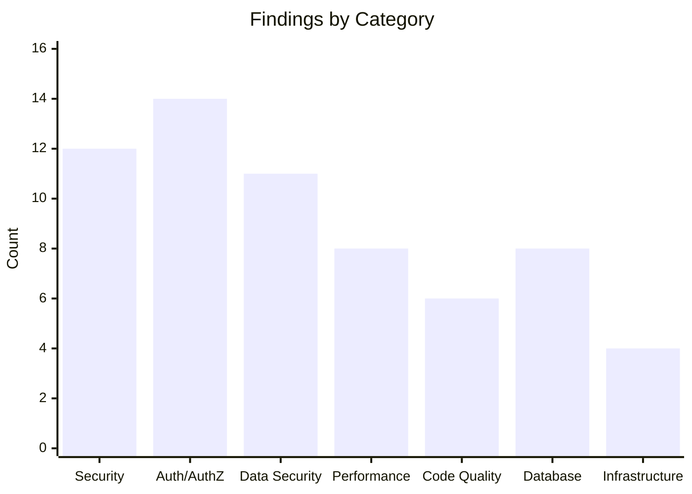
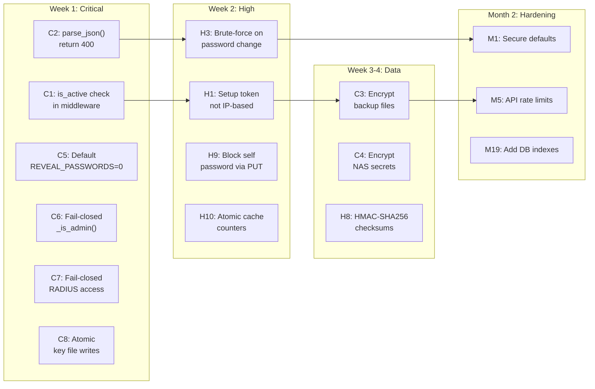

# 🔒 BdREN VAULT — Comprehensive Security & Quality Audit Report

**Date:** 2026-11-28  
**Auditor:** Senior System Analyst & Ethical Hacker (AI-Assisted)  
**Target:** BdREN-VAULT-NTier (Django 5.2 / Python 3.10+ / MariaDB)  
**Scope:** Security vulnerabilities, authentication/authorization, data security, performance, code quality, database integrity

> [!CAUTION]
> This audit identified **8 Critical**, **12 High**, **28 Medium**, and **15 Low** severity findings across 80+ source files. Immediate remediation of Critical and High findings is strongly recommended before any internet-facing deployment.

---

## Executive Summary

| Category | Critical | High | Medium | Low |
|---|:---:|:---:|:---:|:---:|
| **Security Gaps** | 2 | 3 | 5 | 2 |
| **Authentication & Authorization** | 2 | 4 | 6 | 2 |
| **Data Security** | 3 | 3 | 3 | 2 |
| **Performance** | 0 | 1 | 4 | 3 |
| **Code Quality** | 0 | 0 | 3 | 3 |
| **Database Integrity** | 1 | 1 | 4 | 2 |
| **Infrastructure** | 0 | 0 | 3 | 1 |

---

## 🔴 CRITICAL Findings (Fix Immediately)

### C1. Disabled Users Retain Active Sessions
**Files:** [core/views.py](file:///D:/Projects/bdren/BdREN-VAULT-NTier/core/views.py), [core/api.py](file:///D:/Projects/bdren/BdREN-VAULT-NTier/core/api.py), [business/accounts/services.py](file:///D:/Projects/bdren/BdREN-VAULT-NTier/business/accounts/services.py)

Neither `@login_required`, `@api(...)`, nor any middleware checks `request.user.is_active`. When an administrator disables a user, their existing session continues working across all pages and APIs. Combined with `SESSION_SAVE_EVERY_REQUEST = True`, the disabled user's session stays alive indefinitely.

**Impact:** Compromised or terminated user accounts cannot be effectively revoked.  
**Fix:** Add `is_active` check in middleware, delete all sessions for a user when `is_active` is set to `False`.

---

### C2. `parse_json()` Returns `{}` on Invalid JSON — Triggers Destructive Operations
**Files:** [core/utils.py](file:///D:/Projects/bdren/BdREN-VAULT-NTier/core/utils.py#L25-L31), [presentation/devices/views.py](file:///D:/Projects/bdren/BdREN-VAULT-NTier/presentation/devices/views.py)

`parse_json(request)` silently returns `{}` on malformed/non-dict JSON. This causes:
- **`bulk_delete`**: `ids = []` → **deletes EVERY device in the database**
- **`start_backup`**: `ids = []` → **starts full-inventory backup**
- **`settings_view PUT`**: `{}` → **overwrites scheduler settings with defaults**

**Impact:** Data destruction from malformed requests (intentional or accidental).  
**Fix:** Return `400 Bad Request` on invalid JSON instead of `{}`.

---

### C3. Unencrypted Backup Files Contain Network Secrets
**Files:** [data_access/backups/repositories.py](file:///D:/Projects/bdren/BdREN-VAULT-NTier/data_access/backups/repositories.py)

Router/switch/firewall configurations are saved as plaintext `.txt` files and exported as unencrypted ZIPs. These configs commonly contain SNMP community strings, BGP/OSPF auth keys, IPSec PSKs, local accounts, Cisco Type-7 passwords, and certificates/private keys.

**Impact:** Any disk access or backup leak exposes all network infrastructure secrets.  
**Fix:** Encrypt backup files at rest using envelope encryption; add optional password-protected ZIP exports.

---

### C4. Plaintext RADIUS Credentials & Weak Hashing
**Files:** [database/radius/models.py](file:///D:/Projects/bdren/BdREN-VAULT-NTier/database/radius/models.py), [business/radius/services.py](file:///D:/Projects/bdren/BdREN-VAULT-NTier/business/radius/services.py)

- `Nas.secret` stored in **plaintext** in DB (no encryption)
- `NT-Password` uses **unsalted MD4** (trivially crackable with rainbow tables)
- `SSHA2-256-Password` uses **single-iteration SHA-256** (no key stretching)
- Legacy `Cleartext-Password` rows can persist indefinitely

**Impact:** Database breach exposes all RADIUS shared secrets and user passwords.  
**Fix:** Encrypt `Nas.secret`, phase out NT-Password where possible, enforce immediate conversion of cleartext passwords.

---

### C5. Plaintext Device Passwords Returned to Browser
**Files:** [business/devices/services.py](file:///D:/Projects/bdren/BdREN-VAULT-NTier/business/devices/services.py#L209-L218)

`reveal_saved_password()` decrypts Fernet-encrypted device passwords and returns them in plaintext to the browser. `REVEAL_SAVED_PASSWORDS` defaults to `True`.

**Impact:** XSS, session hijack, or proxy logging exposes all saved network device credentials.  
**Fix:** Default `DBMS_REVEAL_PASSWORDS=0`; require step-up authentication for credential reveal.

---

### C6. Fail-Open Admin Authorization (`_is_admin(None) = True`)
**File:** [business/devices/services.py](file:///D:/Projects/bdren/BdREN-VAULT-NTier/business/devices/services.py#L83-L92)

`_is_admin(user)` returns `user is None or user.has_role("admin")`. All callers default `user=None`, bypassing admin-only guards for saved-credential handling and address-change protection.

**Impact:** Non-admin or system calls can redirect saved credentials to attacker-controlled hosts.  
**Fix:** Change to fail-closed: `bool(user is not None and user.has_role("admin"))`.

---

### C7. Fail-Open RADIUS Device Access (No Rows = All Devices)
**Files:** [business/radius/services.py](file:///D:/Projects/bdren/BdREN-VAULT-NTier/business/radius/services.py#L193-L199), [database/radius/models.py](file:///D:/Projects/bdren/BdREN-VAULT-NTier/database/radius/models.py#L58-L61)

Having zero rows in `dbms_user_nas` for a user grants access to **every NAS device**. If `UserDevice` rows are accidentally cleared during recalculation, the user silently gains access to all network equipment.

**Impact:** Silent privilege escalation to full network access.  
**Fix:** Invert to fail-closed: require explicit wildcard grant, wrap recalculation in `transaction.atomic()`.

---

### C8. TOCTOU Race in Key File Creation
**File:** [core/keys.py](file:///D:/Projects/bdren/BdREN-VAULT-NTier/core/keys.py#L7-L15)

Concurrent process startup can cause one process to read an empty/partial key file before another finishes writing, resulting in empty `SECRET_KEY` or corrupt Fernet key.

**Impact:** Predictable session signing key or service crash on startup.  
**Fix:** Use atomic write (temp file + fsync + rename), validate key length after read.

---

## 🟠 HIGH Findings

| # | Finding | File(s) |
|---|---|---|
| H1 | **Reverse-proxy bypass of `/setup` local-only guard** — `_is_local()` checks `REMOTE_ADDR` which is always `127.0.0.1` behind a proxy, allowing remote first-admin creation | [accounts/views.py](file:///D:/Projects/bdren/BdREN-VAULT-NTier/presentation/accounts/views.py#L46-L74) |
| H2 | **Any admin can reset first/superuser account password** — `update_user()` blocks role demotion but not password change on the protected first user | [accounts/services.py](file:///D:/Projects/bdren/BdREN-VAULT-NTier/business/accounts/services.py#L81-L100) |
| H3 | **Zero brute-force protection on `POST /api/me/password`** — no failure counter, lockout, or audit logging on current-password verification | [accounts/views.py](file:///D:/Projects/bdren/BdREN-VAULT-NTier/presentation/accounts/views.py#L157-L164) |
| H4 | **No global per-account lockout** — lockout is IP-based only; distributed attacks bypass all limits | [accounts/services.py](file:///D:/Projects/bdren/BdREN-VAULT-NTier/business/accounts/services.py#L114-L143) |
| H5 | **SSH Trust-On-First-Use without fingerprint verification** — MitM on first connection gets key silently trusted | [ssh_client.py](file:///D:/Projects/bdren/BdREN-VAULT-NTier/data_access/backups/ssh_client.py#L343-L376) |
| H6 | **Backup folder keyed on untrusted remote hostname** — compromised device returning another's hostname causes cross-device data leakage | [backups/services.py](file:///D:/Projects/bdren/BdREN-VAULT-NTier/business/backups/services.py#L157-L180) |
| H7 | **SSRF via private network access** — `netguard.py` allows RFC 1918 by default, DNS rebinding not prevented | [core/netguard.py](file:///D:/Projects/bdren/BdREN-VAULT-NTier/core/netguard.py#L39-L54) |
| H8 | **Unkeyed `.sha256` sidecars, never verified on read/export** — anyone who can alter `.txt` can recompute checksum | [repositories.py](file:///D:/Projects/bdren/BdREN-VAULT-NTier/data_access/backups/repositories.py#L262-L271) |
| H9 | **Admin self-password change bypasses current password check** via `PUT /api/users/<own_pk>` | [accounts/services.py](file:///D:/Projects/bdren/BdREN-VAULT-NTier/business/accounts/services.py#L87-L100) |
| H10 | **Non-atomic cache lockout counters** — race past 5-attempt limit under concurrent requests | [accounts/services.py](file:///D:/Projects/bdren/BdREN-VAULT-NTier/business/accounts/services.py#L125-L140) |
| H11 | **Background task race conditions** — no cross-process lock; duplicate scheduler/backup jobs possible | [scheduling/services.py](file:///D:/Projects/bdren/BdREN-VAULT-NTier/business/scheduling/services.py), [background.py](file:///D:/Projects/bdren/BdREN-VAULT-NTier/core/background.py) |
| H12 | **Retention command may delete newest backup** — sorts by `st_mtime` instead of filename timestamp | [backup_retention.py](file:///D:/Projects/bdren/BdREN-VAULT-NTier/core/management/commands/backup_retention.py#L31-L33) |

---

## 🟡 MEDIUM Findings

### Security & Configuration
| # | Finding | File(s) |
|---|---|---|
| M1 | HTTPS, secure cookies, HSTS all disabled by default | [base.py](file:///D:/Projects/bdren/BdREN-VAULT-NTier/config/settings/base.py#L209-L222) |
| M2 | Empty `production.py` — no production hardening enforced | [production.py](file:///D:/Projects/bdren/BdREN-VAULT-NTier/config/settings/production.py) |
| M3 | `BREACH` attack risk — `GZipMiddleware` on responses with CSRF tokens | [base.py](file:///D:/Projects/bdren/BdREN-VAULT-NTier/config/settings/base.py#L109-L111) |
| M4 | Weak CSP (`'unsafe-inline'` styles, `data:` images) | [middleware.py](file:///D:/Projects/bdren/BdREN-VAULT-NTier/core/middleware.py#L7-L9) |
| M5 | No API rate limiting anywhere | [core/api.py](file:///D:/Projects/bdren/BdREN-VAULT-NTier/core/api.py) |

### Authentication & Authorization
| # | Finding | File(s) |
|---|---|---|
| M6 | `setup()` TOCTOU — concurrent POSTs create multiple admin accounts | [accounts/views.py](file:///D:/Projects/bdren/BdREN-VAULT-NTier/presentation/accounts/views.py#L70-L85) |
| M7 | `UserAttributeSimilarityValidator` bypassed in 3 of 4 password flows | [accounts/services.py](file:///D:/Projects/bdren/BdREN-VAULT-NTier/business/accounts/services.py#L27-L40) |
| M8 | Whitespace-only passwords accepted; no history/rotation/complexity | [accounts/services.py](file:///D:/Projects/bdren/BdREN-VAULT-NTier/business/accounts/services.py) |
| M9 | `bool("false") = True` coercion bug on `active` flag | [accounts/services.py](file:///D:/Projects/bdren/BdREN-VAULT-NTier/business/accounts/services.py#L84) |
| M10 | Disabled-account credential oracle (distinct error messages) | [accounts/views.py](file:///D:/Projects/bdren/BdREN-VAULT-NTier/presentation/accounts/views.py#L126-L133) |
| M11 | `User.save()` silently reverts demotion of `is_superuser` accounts | [accounts/models.py](file:///D:/Projects/bdren/BdREN-VAULT-NTier/database/accounts/models.py#L26-L29) |

### Data Security
| # | Finding | File(s) |
|---|---|---|
| M12 | Backup files/dirs created with default umask (`0o644`/`0o755`) | [repositories.py](file:///D:/Projects/bdren/BdREN-VAULT-NTier/data_access/backups/repositories.py) |
| M13 | Raw exception text persisted in DB logs and sent in alerts | [ssh_client.py](file:///D:/Projects/bdren/BdREN-VAULT-NTier/data_access/backups/ssh_client.py), [backup_jobs.py](file:///D:/Projects/bdren/BdREN-VAULT-NTier/business/backups/backup_jobs.py) |
| M14 | Syslog log injection via unsanitized hostname in `name_nas_from_syslog()` | [radius/services.py](file:///D:/Projects/bdren/BdREN-VAULT-NTier/business/radius/services.py#L439-L446) |

### Performance
| # | Finding | File(s) |
|---|---|---|
| M15 | N+1 query: per-IP loop in `last_failure_messages` (every Dashboard load) | [backups/selectors.py](file:///D:/Projects/bdren/BdREN-VAULT-NTier/data_access/backups/selectors.py#L353-L360) |
| M16 | Unbounded device inventory — entire table loaded without pagination | [devices/views.py](file:///D:/Projects/bdren/BdREN-VAULT-NTier/presentation/devices/views.py#L28) |
| M17 | In-memory ZIP with no size cap — OOM risk on 20k+ devices | [backups/views.py](file:///D:/Projects/bdren/BdREN-VAULT-NTier/presentation/backups/views.py#L202-L217) |
| M18 | RADIUS views run 12+ queries per request with duplicate table scans | [radius/views.py](file:///D:/Projects/bdren/BdREN-VAULT-NTier/presentation/radius/views.py#L121-L123) |

### Database
| # | Finding | File(s) |
|---|---|---|
| M19 | Zero indexes on `BackupJob` (full table scan on every job check) | [backups/models.py](file:///D:/Projects/bdren/BdREN-VAULT-NTier/database/backups/models.py) |
| M20 | Missing composite indexes on `BackupLog` for common query patterns | [backups/models.py](file:///D:/Projects/bdren/BdREN-VAULT-NTier/database/backups/models.py) |
| M21 | Zero audit fields on all RADIUS models (no `created_at`/`updated_by`) | [radius/models.py](file:///D:/Projects/bdren/BdREN-VAULT-NTier/database/radius/models.py) |
| M22 | Overly permissive Django Admin — staff can forge/delete backup logs | [backups/admin.py](file:///D:/Projects/bdren/BdREN-VAULT-NTier/database/backups/admin.py) |

### Infrastructure
| # | Finding | File(s) |
|---|---|---|
| M23 | Telegram bot token exposed in URL path and logged with `exc_info` | [alerts.py](file:///D:/Projects/bdren/BdREN-VAULT-NTier/core/alerts.py#L17-L26) |
| M24 | Synchronous email alerts block backup job thread indefinitely | [alerts.py](file:///D:/Projects/bdren/BdREN-VAULT-NTier/core/alerts.py#L30-L31) |
| M25 | Syslog receiver — unauthenticated UDP, IP spoofing enables audit forgery | [syslog_receiver.py](file:///D:/Projects/bdren/BdREN-VAULT-NTier/business/commandlog/syslog_receiver.py) |

---

## 🔵 LOW Findings

| # | Finding | File(s) |
|---|---|---|
| L1 | No key rotation support (single Fernet, no MultiFernet) | [core/crypto.py](file:///D:/Projects/bdren/BdREN-VAULT-NTier/core/crypto.py) |
| L2 | Fernet metadata leaks encryption timestamp and password length bucket | [core/crypto.py](file:///D:/Projects/bdren/BdREN-VAULT-NTier/core/crypto.py) |
| L3 | Unbounded login password length before PBKDF2 (CPU DoS) | [accounts/views.py](file:///D:/Projects/bdren/BdREN-VAULT-NTier/presentation/accounts/views.py#L112) |
| L4 | No absolute maximum session lifetime (sliding expiry extends forever) | [base.py](file:///D:/Projects/bdren/BdREN-VAULT-NTier/config/settings/base.py#L197-L200) |
| L5 | Device inventory cached in `localStorage`, not cleared on logout | [devices.js](file:///D:/Projects/bdren/BdREN-VAULT-NTier/presentation/static/js/pages/devices.js#L92-L95) |
| L6 | RADIUS secrets cached in JS memory after "Hide" button clicked | [radius.js](file:///D:/Projects/bdren/BdREN-VAULT-NTier/presentation/static/js/pages/radius.js#L280) |
| L7 | Internal server paths disclosed in admin diagnostic banners | [radius.js](file:///D:/Projects/bdren/BdREN-VAULT-NTier/presentation/static/js/pages/radius.js#L53) |
| L8 | Latent XSS in `brandMark()` fallback (mitigated by CSP + 3-char slice) | [devices.js](file:///D:/Projects/bdren/BdREN-VAULT-NTier/presentation/static/js/pages/devices.js#L12) |
| L9 | `.env` parser silently truncates passwords containing ` #` | [base.py](file:///D:/Projects/bdren/BdREN-VAULT-NTier/config/settings/base.py#L39-L42) |
| L10 | `verify_backups.py` exits 0 on checksum mismatches | [verify_backups.py](file:///D:/Projects/bdren/BdREN-VAULT-NTier/core/management/commands/verify_backups.py) |
| L11 | Shared NAT/proxy IP lockout DoS — 20 failures locks all users | [accounts/services.py](file:///D:/Projects/bdren/BdREN-VAULT-NTier/business/accounts/services.py#L125-L132) |
| L12 | DRY violations — `_when()`, CSV boilerplate duplicated across views | Multiple views |
| L13 | Nginx missing `server_tokens off`, TLS cipher hardening | [nginx-dbms.conf](file:///D:/Projects/bdren/BdREN-VAULT-NTier/deploy/nginx/nginx-dbms.conf) |
| L14 | `radius_hash_passwords.py` prints cleartext passwords to stdout | [radius_hash_passwords.py](file:///D:/Projects/bdren/BdREN-VAULT-NTier/core/management/commands/radius_hash_passwords.py) |
| L15 | Missing DB constraints (port range, enum choices, singleton) across models | Multiple models |

---

## ✅ Positive Findings (What's Done Right)

| Area | Assessment |
|---|---|
| **SQL Injection** | ✅ **No SQL injection found** — All 80+ files use Django ORM exclusively; zero `.raw()`, `.extra()`, or `cursor.execute()` |
| **CSRF Protection** | ✅ All forms include ``; JS sends `X-CSRFToken` on API calls |
| **Clickjacking** | ✅ `X-Frame-Options: DENY` + CSP `frame-ancestors 'none'` |
| **Open Redirect** | ✅ `_safe_next()` validates redirect targets properly |
| **Template Injection** | ✅ No `|safe`, `mark_safe`, or `` found |
| **XSS (Templates)** | ✅ Django autoescaping + `|json_script` + strict CSP (`script-src 'self'`) |
| **N-Tier Architecture** | ✅ Clean separation enforced by `check_architecture` command |
| **Device Access** | ✅ Read-only SSH commands with allow-list validation |
| **Credential Encryption** | ✅ Device passwords encrypted with Fernet (improvement: key rotation) |
| **Role-Based Access** | ✅ Every API endpoint uses `@api()` decorator with role checks |
| **Audit Trail** | ✅ Comprehensive logging of logins, changes, and device access |

---

## 🎯 Prioritized Remediation Roadmap

### Immediate (Week 1)
1. **Add `is_active` middleware check** + flush sessions on deactivation
2. **Fix `parse_json()`** to return 400 on invalid/non-dict JSON
3. **Default `DBMS_REVEAL_PASSWORDS=0`**, require re-auth for credential reveal
4. **Fix `_is_admin(None)`** to return `False` (fail-closed)
5. **Invert RADIUS device access** to fail-closed (no rows = no access)
6. **Atomic key file creation** with temp file + fsync + rename

### Short-Term (Week 2-4)
7. Replace `/setup` IP check with one-time setup token
8. Add brute-force protection on `POST /api/me/password`
9. Block self-password change via `PUT /api/users/<own_pk>`
10. Use atomic `cache.incr()` for lockout counters (or Redis)
11. Enforce production hardening in `production.py`
12. Add cross-process lock for background scheduler

### Medium-Term (Month 2)
13. Encrypt backup files at rest
14. Encrypt `Nas.secret` in database
15. Add HMAC-SHA256 for backup integrity verification
16. Add database indexes on `BackupJob`, `BackupLog`, `AuditEvent`, `RadPostAuth`
17. Implement API rate limiting
18. Lock down Django Admin (read-only logs, restricted fields)
19. Add `updated_at`/`updated_by` audit fields to all models

### Long-Term (Quarter)
20. Implement Fernet key rotation (`MultiFernet`)
21. Phase out NT-Password / MS-CHAPv2 where possible
22. Add pagination to all list endpoints
23. Migrate to streaming ZIP generation
24. Add database `CheckConstraint`s for data integrity
25. Consolidate duplicate audit models (`AuditEvent` + `AuditLog`)

---

---

# Detailed Technical Findings by Audit Area
================================================================================

---

## Detailed Findings: Security Settings Analyst

# Security Audit Report — BdREN-VAULT-NTier

Below is the comprehensive security analysis of all nine requested files, covering vulnerabilities, cryptographic weaknesses, hardcoded secrets, insecure default configurations, missing security headers, rate limiting gaps, and input validation issues.

---

## 1. [base.py](file:///D:/Projects/bdren/BdREN-VAULT-NTier/config/settings/base.py)

### Hardcoded Secrets
- **No hardcoded secrets** were found in `base.py`; credentials and keys are loaded from environment variables, `.env`, or files in `DATA_DIR`.

### Cryptographic & Key-Management Weaknesses
- **Fallback `SECRET_KEY` stored on disk alongside data/backups ([L76-L80](file:///D:/Projects/bdren/BdREN-VAULT-NTier/config/settings/base.py#L76-L80))**: When `DJANGO_SECRET_KEY` is unset, `SECRET_KEY` is generated into `DATA_DIR / "session.key"` in the same `DATA_DIR` directory as `secret.key` (Fernet key) and `backups/`. Neither `DATA_DIR` nor `session.key` is validated for non-empty content or minimum length (`load_or_create_key` returning empty or corrupted bytes yields an empty/weak `SECRET_KEY`), and multi-instance deployments without a shared `DATA_DIR` will silently generate different `SECRET_KEY` values.
- **Unencrypted database and SMTP connections ([L140-L170](file:///D:/Projects/bdren/BdREN-VAULT-NTier/config/settings/base.py#L140-L170), [L295-L301](file:///D:/Projects/bdren/BdREN-VAULT-NTier/config/settings/base.py#L295-L301))**: Neither `DATABASES["default"]` nor `DATABASES["radius"]` configures MySQL TLS (`OPTIONS["ssl"]`). SMTP defaults to port `25` with `EMAIL_USE_TLS = False` and `EMAIL_USE_SSL = False`.

### Insecure Default Configurations & Vulnerabilities
- **HTTPS, Secure Cookies, and HSTS disabled by default ([L209-L222](file:///D:/Projects/bdren/BdREN-VAULT-NTier/config/settings/base.py#L209-L222))**:
  - `DBMS_SECURE_COOKIES` defaults to `False`, leaving `SESSION_COOKIE_SECURE = False` and `CSRF_COOKIE_SECURE = False` (session and CSRF cookies can be intercepted over cleartext HTTP).
  - `DBMS_FORCE_HTTPS` defaults to `False` (`SECURE_SSL_REDIRECT = False`).
  - `SECURE_HSTS_SECONDS` (`31536000`) is only enabled when `SECURE_COOKIES` is true, and `SECURE_HSTS_INCLUDE_SUBDOMAINS` / `SECURE_HSTS_PRELOAD` are omitted while `SILENCED_SYSTEM_CHECKS = ["security.W005", "security.W021"]` suppresses Django's security warnings.
- **`REVEAL_SAVED_PASSWORDS` defaults to `True` ([L275](file:///D:/Projects/bdren/BdREN-VAULT-NTier/config/settings/base.py#L275))**: Administrators can decrypt and retrieve saved device passwords in plaintext in the browser by default, increasing blast radius if an admin session is hijacked or XSS occurs.
- **`ALLOWED_DEVICE_NETWORKS` defaults to `[]` ([L278](file:///D:/Projects/bdren/BdREN-VAULT-NTier/config/settings/base.py#L278))**: Unset by default, allowing SSH and ICMP ping targets in RFC 1918 private networks (`10.0.0.0/8`, `172.16.0.0/12`, `192.168.0.0/16`), CGNAT, or any public IP (SSRF/internal pivoting risk).
- **`DATABASES["radius"]` lacks password enforcement and strict SQL mode ([L161-L170](file:///D:/Projects/bdren/BdREN-VAULT-NTier/config/settings/base.py#L161-L170))**: Unlike `DATABASES["default"]` (which exits if `DBMS_DB_PASSWORD` is empty at [L155-L156](file:///D:/Projects/bdren/BdREN-VAULT-NTier/config/settings/base.py#L155-L156)), `DATABASES["radius"]` allows an empty `RADIUS_DB_PASSWORD` (`""`) and omits `init_command` (`STRICT_TRANS_TABLES,NO_ENGINE_SUBSTITUTION`), risking unauthenticated DB usage in misconfigured setups or silent data truncation in MySQL.
- **Global `GZipMiddleware` on sensitive HTML/JSON responses ([L109-L111](file:///D:/Projects/bdren/BdREN-VAULT-NTier/config/settings/base.py#L109-L111))**: Compressing dynamic responses over HTTPS alongside secrets (CSRF tokens, revealed device passwords) exposes the application to BREACH compression side-channel attacks.
- **Unrestricted `X-Forwarded-Host` and `X-Forwarded-Proto` trust when `BEHIND_PROXY` is enabled ([L210](file:///D:/Projects/bdren/BdREN-VAULT-NTier/config/settings/base.py#L210), [L220-L222](file:///D:/Projects/bdren/BdREN-VAULT-NTier/config/settings/base.py#L220-L222))**: `USE_X_FORWARDED_HOST = True` and `SECURE_PROXY_SSL_HEADER = ("HTTP_X_FORWARDED_PROTO", "https")` trust forwarded headers unconditionally without a trusted proxy IP allow-list; if the WSGI server is reachable directly or a proxy forwards client-supplied headers, this enables Host header injection and SSL-state spoofing.
- **`CSRF_COOKIE_HTTPONLY = False` ([L204](file:///D:/Projects/bdren/BdREN-VAULT-NTier/config/settings/base.py#L204))**: Allows JavaScript to read the CSRF cookie, increasing impact if XSS is introduced.
- **`.env` loaded unconditionally in production ([L18-L47](file:///D:/Projects/bdren/BdREN-VAULT-NTier/config/settings/base.py#L18-L47))**: Combined with [__init__.py](file:///D:/Projects/bdren/BdREN-VAULT-NTier/config/settings/__init__.py#L9-L14) (which imports `.base` before inspecting `DJANGO_ENV`), a `.env` file on a server can set `DJANGO_ENV=development`, `DJANGO_DEBUG=1`, `DBMS_SETUP_FROM_ANYWHERE=1`, or override `RADIUS_RELOAD_CMD` / `RADIUS_FIREWALL_CMD` ([L173](file:///D:/Projects/bdren/BdREN-VAULT-NTier/config/settings/base.py#L173), [L179](file:///D:/Projects/bdren/BdREN-VAULT-NTier/config/settings/base.py#L179)).
- **SSH Host Key Checking uses TOFU ([L282-L283](file:///D:/Projects/bdren/BdREN-VAULT-NTier/config/settings/base.py#L282-L283))**: Trust-on-first-use allows MITM on the first connection and can be disabled via `DBMS_SSH_HOSTKEY_CHECK=0`.

### Rate Limiting Gaps
- **No authentication or request rate limiting configured**: No brute-force protection, login attempt throttling, or account lockout middleware/configuration is present in `MIDDLEWARE` or settings.

### Input Validation Issues
- **`.env` parser comment-stripping bug ([L39-L42](file:///D:/Projects/bdren/BdREN-VAULT-NTier/config/settings/base.py#L39-L42))**: Unquoted values are split on `" #"`, silently truncating passwords/secrets containing ` #` (e.g., `DBMS_DB_PASSWORD`, `DJANGO_SECRET_KEY`).
- **Inconsistent boolean parsing for `EMAIL_USE_TLS` / `EMAIL_USE_SSL` ([L299-L300](file:///D:/Projects/bdren/BdREN-VAULT-NTier/config/settings/base.py#L299-L300))**: Uses `== "1"` instead of `env_flag(...)`, so setting `DBMS_EMAIL_USE_TLS=true` or `yes` silently leaves TLS disabled.
- **`LOG_LEVEL` unvalidated ([L291](file:///D:/Projects/bdren/BdREN-VAULT-NTier/config/settings/base.py#L291))**: Arbitrary string values cause `logging.config.dictConfig` failures on startup.

---

## 2. [production.py](file:///D:/Projects/bdren/BdREN-VAULT-NTier/config/settings/production.py)

### Insecure Default Configurations & Missing Guardrails
- **Empty production settings file ([L1-L6](file:///D:/Projects/bdren/BdREN-VAULT-NTier/config/settings/production.py#L1-L6))**: Contains only a docstring and enforces **zero** production hardening overrides or startup assertions over `base.py`:
  - **Does not enforce `DEBUG = False`**: If `DJANGO_DEBUG=1` is left in `.env` or the process environment, Django runs with `DEBUG = True` in production, exposing full stack traces, local variables, settings, database passwords, and `SECRET_KEY`.
  - **Does not enforce `DJANGO_SECRET_KEY`**: Allows production to fall back to the auto-generated `DATA_DIR / "session.key"`.
  - **Does not enforce HTTPS/cookie/HSTS protections**: `SESSION_COOKIE_SECURE`, `CSRF_COOKIE_SECURE`, `SECURE_SSL_REDIRECT`, and `SECURE_HSTS_SECONDS` all remain `False`/unset unless explicitly configured in `.env`.
  - **Does not validate `ALLOWED_HOSTS`**: Allows running in production with the default `localhost,127.0.0.1` or misconfigured `*` wildcards.
  - **Does not restrict `REVEAL_SAVED_PASSWORDS`, `SETUP_FROM_ANYWHERE`, or `ENABLE_ADMIN_SITE`**.

### Other Categories
- **Hardcoded secrets / SQLi / XSS / CSRF / Crypto / Rate limiting / Headers / Input validation**: No additional code beyond the docstring; inherits all weaknesses and missing headers/rate-limits from `base.py`.

---

## 3. [development.py](file:///D:/Projects/bdren/BdREN-VAULT-NTier/config/settings/development.py)

### Insecure Default Configurations & Vulnerabilities
- **Unconditional `DEBUG = True` ([L6](file:///D:/Projects/bdren/BdREN-VAULT-NTier/config/settings/development.py#L6))**: Because `config/settings/__init__.py` imports `base.py` (which loads `.env`) before checking `DJANGO_ENV`, placing `DJANGO_ENV=development` in `.env` forces `DEBUG = True` even on a server, leaking sensitive tracebacks, environment variables, and credentials.
- **No isolation from production `.env` / databases ([L3](file:///D:/Projects/bdren/BdREN-VAULT-NTier/config/settings/development.py#L3))**: As documented in the module docstring, development mode still reads database credentials from `.env` without warning or preventing `DEBUG = True` from running against non-local database hosts or non-local `ALLOWED_HOSTS`.

### Other Categories
- **Hardcoded secrets / Crypto / Rate limiting / Headers / Input validation**: None defined directly in this 8-line file; inherits `base.py`.

---

## 4. [crypto.py](file:///D:/Projects/bdren/BdREN-VAULT-NTier/core/crypto.py)

### Cryptographic Weaknesses
- **No key rotation support (`Fernet` vs `MultiFernet`) ([L10-L12](file:///D:/Projects/bdren/BdREN-VAULT-NTier/core/crypto.py#L10-L12))**: Uses a single `Fernet` instance rather than `MultiFernet`, making live key rotation impossible without re-encrypting all stored device passwords simultaneously.
- **Unprotected plaintext symmetric key on local disk ([L12](file:///D:/Projects/bdren/BdREN-VAULT-NTier/core/crypto.py#L12))**: The Fernet key (`data/secret.key`) is stored unencrypted in `DATA_DIR` alongside backups and `session.key` with no KEK, HSM/KMS, or passphrase wrapping. Read access to `DATA_DIR` (or host backups) compromises all device credentials.
- **Indefinite process-lifetime caching ([L10-L12](file:///D:/Projects/bdren/BdREN-VAULT-NTier/core/crypto.py#L10-L12))**: `@lru_cache(maxsize=1)` caches `_fernet()` for the entire lifetime of the process; replacing `secret.key` on disk does not take effect until every worker/service process restarts.
- **Metadata leakage inherent to Fernet ([L17](file:///D:/Projects/bdren/BdREN-VAULT-NTier/core/crypto.py#L17))**: Fernet tokens include an unencrypted 64-bit creation timestamp and AES-CBC 16-byte block padding, revealing when each password was last encrypted and its approximate length bucket. (Fernet also uses AES-128-CBC + HMAC-SHA256 rather than AES-256.)

### Input Validation & Error Handling Issues
- **Unhandled decryption/key exceptions ([L12](file:///D:/Projects/bdren/BdREN-VAULT-NTier/core/crypto.py#L12), [L20-L22](file:///D:/Projects/bdren/BdREN-VAULT-NTier/core/crypto.py#L20-L22))**: `decrypt()` does not catch `cryptography.fernet.InvalidToken` (or `ValueError`/`TypeError`), so corrupted, truncated, or tampered tokens—or a mismatched/corrupted `secret.key`—raise unhandled exceptions causing 500 errors or crashing background jobs.
- **No type/null normalization beyond truthiness ([L15-L22](file:///D:/Projects/bdren/BdREN-VAULT-NTier/core/crypto.py#L15-L22))**: `if value else ""` collapses `None` and `""` to `""`, and passing non-`str` values (such as `bytes` or `int`) raises `AttributeError` on `.encode()`.

### Hardcoded Secrets / Rate Limiting / Headers
- No hardcoded secrets, security headers, or rate limiting logic applicable.

---

## 5. [keys.py](file:///D:/Projects/bdren/BdREN-VAULT-NTier/core/keys.py)

### Security Vulnerabilities & Cryptographic Key-Management Weaknesses
- **TOCTOU Race Condition / Empty Key Read on Concurrent Startup ([L7-L15](file:///D:/Projects/bdren/BdREN-VAULT-NTier/core/keys.py#L7-L15))**:
  - When `path` does not exist and two worker processes start concurrently, Process A wins `os.open(path, os.O_WRONLY | os.O_CREAT | os.O_EXCL, 0o600)` (creating an empty 0-byte file on disk) before writing `make()`.
  - Process B hits `FileExistsError` on [L12](file:///D:/Projects/bdren/BdREN-VAULT-NTier/core/keys.py#L12) and immediately executes `return path.read_bytes()` on [L13](file:///D:/Projects/bdren/BdREN-VAULT-NTier/core/keys.py#L13) **before Process A finishes writing**, returning `b""` (or a partial key).
  - Impact: `SECRET_KEY` becomes `""` (empty/predictable signing key or Django startup crash) or `Fernet(b"")` crashes with `ValueError`, and workers can end up with inconsistent keys. Atomic creation requires writing to a temporary `0o600` file, flushing/fsyncing, and atomically linking/renaming (with locking or `os.link`).
- **Silent Failure on Permission Enforcement & No Existing-File Permission Check ([L7](file:///D:/Projects/bdren/BdREN-VAULT-NTier/core/keys.py#L7), [L16-L20](file:///D:/Projects/bdren/BdREN-VAULT-NTier/core/keys.py#L16-L20))**:
  - `except OSError: pass` silently ignores `os.chmod(path, 0o600)` failures. On Windows (where POSIX mode `0o600` does not restrict NTFS ACLs), `session.key` and `secret.key` inherit parent directory permissions and may be readable by other local users without any warning or error.
  - If `path` already exists with overly permissive permissions (e.g., `0o644` or `0o666`), [L7](file:///D:/Projects/bdren/BdREN-VAULT-NTier/core/keys.py#L7) skips the creation block and returns the key without checking mode bits or failing/warning.
- **Symlink Following ([L7](file:///D:/Projects/bdren/BdREN-VAULT-NTier/core/keys.py#L7), [L13](file:///D:/Projects/bdren/BdREN-VAULT-NTier/core/keys.py#L13), [L20](file:///D:/Projects/bdren/BdREN-VAULT-NTier/core/keys.py#L20))**: `path.exists()` and `path.read_bytes()` follow symlinks; if an attacker can place a symlink in `DATA_DIR` (whose directory permissions are not checked/restricted), `load_or_create_key` will read the symlink target.

### Input Validation Issues
- **No validation of loaded key material ([L13](file:///D:/Projects/bdren/BdREN-VAULT-NTier/core/keys.py#L13), [L20](file:///D:/Projects/bdren/BdREN-VAULT-NTier/core/keys.py#L20))**: Does not verify that the returned bytes are non-empty, valid length, or free of accidental trailing newlines when pre-provisioned externally.

---

## 6. [middleware.py](file:///D:/Projects/bdren/BdREN-VAULT-NTier/core/middleware.py)

### Missing & Weak Security Headers
- **Weak CSP (`'unsafe-inline'` styles and `data:` images) ([L7-L9](file:///D:/Projects/bdren/BdREN-VAULT-NTier/core/middleware.py#L7-L9))**:
  - `style-src 'self' 'unsafe-inline'` permits inline `<style>` blocks and `style` attributes, weakening defense-in-depth against CSS injection / attribute-selector data exfiltration if HTML injection exists.
  - `img-src 'self' data:` permits `data:` URI images.
  - Missing `upgrade-insecure-requests` directive (when served over HTTPS).
- **Static files served by WhiteNoise bypass `SecurityHeadersMiddleware` (see [base.py L112-L119](file:///D:/Projects/bdren/BdREN-VAULT-NTier/config/settings/base.py#L112-L119))**: Because `WhiteNoiseMiddleware` is ordered before `XFrameOptionsMiddleware` and `SecurityHeadersMiddleware`, responses served directly by WhiteNoise (including static HTML/SVG/JS assets) do **not** receive `Content-Security-Policy`, `X-Frame-Options`, `Permissions-Policy`, `Cross-Origin-Opener-Policy`, `Cross-Origin-Resource-Policy`, `X-Permitted-Cross-Domain-Policies`, `X-Robots-Tag`, or `Server` header stripping.
- **Incomplete `Cache-Control` for legacy/proxy caches ([L29](file:///D:/Projects/bdren/BdREN-VAULT-NTier/core/middleware.py#L29))**: Sets only `Cache-Control: no-store` without `no-cache, must-revalidate, private` or `Pragma: no-cache`.
- **Use of `setdefault` allows header weakening ([L23-L28](file:///D:/Projects/bdren/BdREN-VAULT-NTier/core/middleware.py#L23-L28))**: `CSP`, `Permissions-Policy`, `COOP`, and `CORP` use `h.setdefault(...)`, so if any view sets a permissive header beforehand, the middleware preserves the weaker value.
- **Missing headers**:
  - `Strict-Transport-Security` is not enforced here (it is conditionally set in `base.py` only when `DBMS_SECURE_COOKIES=1`, and without `includeSubDomains`/`preload`).
  - `Cross-Origin-Embedder-Policy` (`COEP`) is not set.
- **`Server` header stripping limitation ([L30](file:///D:/Projects/bdren/BdREN-VAULT-NTier/core/middleware.py#L30))**: `h.pop("Server", None)` only strips headers added inside Django; reverse proxies or WSGI servers (unless configured otherwise, e.g. Waitress `ident=""`) may re-inject `Server` afterward.

### Rate Limiting Gaps
- No rate limiting or request throttling middleware exists here.

---

## 7. [netguard.py](file:///D:/Projects/bdren/BdREN-VAULT-NTier/core/netguard.py)

### Security Vulnerabilities (SSRF & DNS Rebinding)
- **Private/Internal Networks Allowed by Default ([L39-L42](file:///D:/Projects/bdren/BdREN-VAULT-NTier/core/netguard.py#L39-L42))**: `forbidden` checks only `is_loopback`, `is_link_local`, `is_multicast`, `is_unspecified`, and `is_reserved`. It deliberately does **not** block `is_private` (RFC 1918 `10.0.0.0/8`, `172.16.0.0/12`, `192.168.0.0/16`, IPv6 ULA `fc00::/7`), `is_site_local`, or non-global ranges (`not a.is_global`, such as CGNAT `100.64.0.0/10` depending on Python version). Because `ALLOWED_DEVICE_NETWORKS` defaults to `[]` in `base.py`, any reachable internal host (database servers, internal admin panels, internal APIs) can be targeted via SSH/ping unless `DBMS_ALLOWED_NETWORKS` is explicitly configured.
- **Incomplete IPv6 Transition / Embedding Checks ([L38](file:///D:/Projects/bdren/BdREN-VAULT-NTier/core/netguard.py#L38))**: Only `a.ipv4_mapped` (`::ffff:0:0/96`) is unwrapped. Other IPv6 addresses that embed or tunnel IPv4 addresses—such as **6to4 (`2002::/16`, via `a.sixtofour`)**, **Teredo (`2001::/32`, via `a.teredo`)**, and deprecated **IPv4-compatible IPv6 (`::/96`, e.g., `::127.0.0.1`)**—are not unwrapped or checked against `forbidden`.
- **DNS Rebinding / TOCTOU via `host_allowed()` ([L52-L54](file:///D:/Projects/bdren/BdREN-VAULT-NTier/core/netguard.py#L52-L54))**: `host_allowed(host)` calls `resolve_allowed_host(host)` and discards the pinned IP address, returning only a `bool`. Any caller that checks `host_allowed(host)` and then passes the original `host` string to `ping` or `ssh` performs a second DNS lookup, enabling DNS rebinding attacks (first lookup returns an allowed IP; second lookup resolves to `127.0.0.1` or `169.254.169.254`).

### Rate Limiting & DoS Gaps
- **Blocking DNS resolution with no timeout or rate limit ([L18-L20](file:///D:/Projects/bdren/BdREN-VAULT-NTier/core/netguard.py#L18-L20))**: `socket.getaddrinfo(host, None, type=socket.SOCK_STREAM)` has no configurable timeout and relies on OS resolver timeouts, enabling slow DNS responses to tie up worker threads (`WORKERS`/`PING_WORKERS`).

### Input Validation Issues
- **Missing validation on `host` input ([L13-L22](file:///D:/Projects/bdren/BdREN-VAULT-NTier/core/netguard.py#L13-L22))**: `_resolve(host)` does not validate that `host` is a non-empty `str`, lacks leading/trailing whitespace, control characters, excessive length, or a leading `-` (which could pose an argument-injection risk if passed to CLI utilities like `ping` without `--`). Also note `ipaddress.ip_address()` accepts integers (`0`, `2130706433`) if non-string values are passed, and `socket.getaddrinfo(None, None)` resolves the local host depending on platform.
- **Silent swallowing of DNS and network-config errors ([L21-L22](file:///D:/Projects/bdren/BdREN-VAULT-NTier/core/netguard.py#L21-L22), [L43-L46](file:///D:/Projects/bdren/BdREN-VAULT-NTier/core/netguard.py#L43-L46))**: Both `OSError` during DNS resolution and `ValueError` from malformed `ALLOWED_DEVICE_NETWORKS` return `None` without logging an alert/error.

---

## 8. [nthash.py](file:///D:/Projects/bdren/BdREN-VAULT-NTier/core/nthash.py)

### Cryptographic Weaknesses
- **Cryptographically broken, unsalted MD4 password hashing (`NT-Password`) ([L16-L65](file:///D:/Projects/bdren/BdREN-VAULT-NTier/core/nthash.py#L16-L65))**:
  - Computes `MD4(UTF-16LE(password))` with **no salt** and **no key stretching / work factor**. MD4 is cryptographically broken and orders of magnitude faster to brute-force on GPUs than bcrypt/Argon2/PBKDF2, and identical passwords produce identical NT hashes (enabling rainbow tables and cross-account correlation).
  - Anyone with read access to the `radius` DB (`radcheck` table) can rapidly crack weak/moderate passwords or perform Pass-the-Hash attacks where NT hashes are accepted.
  - Per `base.py` ([L180-L182](file:///D:/Projects/bdren/BdREN-VAULT-NTier/config/settings/base.py#L180-L182)), NT hashes are unconditionally generated and stored for every RADIUS user, even if a given user does not use MS-CHAPv2/MikroTik.
- **Plaintext password retention in pure Python memory ([L17-L53](file:///D:/Projects/bdren/BdREN-VAULT-NTier/core/nthash.py#L17-L53), [L65](file:///D:/Projects/bdren/BdREN-VAULT-NTier/core/nthash.py#L65))**: Password bytes in UTF-16LE are copied into Python `bytearray` and strings without zeroing after hashing.

### Input Validation Issues
- **`TypeError` caught broadly in `md4(data)` ([L56-L60](file:///D:/Projects/bdren/BdREN-VAULT-NTier/core/nthash.py#L56-L60))**:
  - `except (ValueError, TypeError): return _md4(data)` catches `TypeError` from `hashlib.new("md4", data)` and falls back to `_md4(data)` which calls `bytearray(data)` ([L17](file:///D:/Projects/bdren/BdREN-VAULT-NTier/core/nthash.py#L17)).
  - If a non-bytes object like an integer `n` is passed to `md4(n)`, `hashlib.new` raises `TypeError`, and `bytearray(n)` silently allocates `n` zero bytes and returns the MD4 of `b"\x00" * n` instead of failing! Should catch only `(ValueError, hashlib.UnsupportedAlgorithm)` (or check `isinstance(data, (bytes, bytearray, memoryview))`).
- **No validation on `password` in `nt_hash(password)` ([L63-L65](file:///D:/Projects/bdren/BdREN-VAULT-NTier/core/nthash.py#L63-L65))**: Accepts empty string `""` (producing the well-known empty NT hash `31D6CFE0D16AE931B73C59D7E0C089C0`) and does not explicitly validate `isinstance(password, str)` (non-strings fail with `AttributeError`).

*(Note: The pure-Python RFC 1320 `_md4` implementation on [L16-L53](file:///D:/Projects/bdren/BdREN-VAULT-NTier/core/nthash.py#L16-L53) matches the RFC 1320 padding, initialization constants, round functions, and rotations.)*

---

## 9. [api.py](file:///D:/Projects/bdren/BdREN-VAULT-NTier/core/api.py)

### Authentication, Authorization & Information Disclosure
- **Unauthenticated `405` + `Allow` header enumeration ([L32-L38](file:///D:/Projects/bdren/BdREN-VAULT-NTier/core/api.py#L32-L38))**: HTTP method checking (`if request.method not in allowed:`) runs **before** checking `if not user.is_authenticated:`. Unauthenticated callers receive `405 Method Not Allowed` with an `Allow: ...` header listing supported HTTP methods on protected endpoints, enabling pre-auth endpoint capability enumeration.
- **No explicit `user.is_active` check ([L36-L40](file:///D:/Projects/bdren/BdREN-VAULT-NTier/core/api.py#L36-L40))**: Checks `user.is_authenticated` and delegates role checking to `user.has_role(allowed[request.method])` without explicitly checking `user.is_active`. If a user account is deactivated (`is_active = False`) while holding an active session and `has_role` does not verify `is_active`, the deactivated user retains API access until session expiry.
- **No security audit logging for `401` / `403` denials ([L37-L40](file:///D:/Projects/bdren/BdREN-VAULT-NTier/core/api.py#L37-L40))**: Unauthorized and forbidden API access attempts are silently returned with no audit/security log entry.
- **No decorator-time validation of `method_roles` ([L26-L27](file:///D:/Projects/bdren/BdREN-VAULT-NTier/core/api.py#L26-L27))**: Does not validate that `method_roles` is non-empty or that each role value is a valid non-empty role string (e.g., passing `GET=None` or `GET=""` is forwarded directly to `user.has_role`).

### Rate Limiting Gaps
- **Complete absence of API rate limiting ([L26-L51](file:///D:/Projects/bdren/BdREN-VAULT-NTier/core/api.py#L26-L51))**: `@api` provides no per-user, per-IP, or per-endpoint rate limiting/throttling, leaving state-changing and expensive backend endpoints (e.g., SSH/backup/ping triggers) exposed to automated abuse and DoS.

### Input Validation & Error Handling Issues
- **No centralized `Content-Type` or JSON body validation ([L41-L42](file:///D:/Projects/bdren/BdREN-VAULT-NTier/core/api.py#L41-L42))**: Every decorated view must manually validate `Content-Type`, parse JSON safely, and enforce field/type schemas, increasing the risk of inconsistent validation or `Content-Type` confusion across endpoints.
- **Direct reflection of `ApiError` status/message ([L43-L44](file:///D:/Projects/bdren/BdREN-VAULT-NTier/core/api.py#L43-L44))**: `error_response(e.status, e.message)` trusts `e.status` and `e.message` verbatim; if any view wraps internal exception strings in `ApiError`, internal details leak to the client.
- **Raw `request.path` logged in `logger.exception` ([L48](file:///D:/Projects/bdren/BdREN-VAULT-NTier/core/api.py#L48))**: Logs unescaped `request.path` in the plain-text logger configured in `base.py`.

---

## Summary of Highest-Priority Remediations
1. **Fix `core/keys.py` race condition & permission checks**: Write keys to a `0o600` temp file, `fsync`, and atomically link/replace; validate non-empty key length and check file/directory permissions (including Windows ACL considerations).
2. **Harden `config/settings/production.py` & `base.py` defaults**: Enforce `DEBUG = False`, require `DJANGO_SECRET_KEY` and `RADIUS_DB_PASSWORD`, default `DBMS_SECURE_COOKIES=1`, `DBMS_FORCE_HTTPS=1`, and `DBMS_REVEAL_PASSWORDS=0`, enforce MySQL strict mode + TLS, and restrict `USE_X_FORWARDED_HOST` / `SECURE_PROXY_SSL_HEADER` to trusted proxy IPs.
3. **Close `core/netguard.py` SSRF & DNS rebinding gaps**: Block private/non-global IPs by default (or require `DBMS_ALLOWED_NETWORKS`), unwrap `sixtofour`/`teredo`/IPv4-compatible IPv6 addresses, deprecate/remove `host_allowed()` in favor of connecting strictly to the pinned IP from `resolve_allowed_host()`, and add input validation + DNS timeouts.
4. **Add authentication & API rate limiting**: Introduce login brute-force protection and per-user/per-IP throttling in `core/api.py`; check `user.is_authenticated` and `user.is_active` before returning `405` + `Allow` headers.
5. **Strengthen `core/middleware.py`, `core/crypto.py`, and `core/nthash.py`**: Remove `'unsafe-inline'` from `style-src` CSP, apply headers to WhiteNoise static responses where appropriate, adopt `MultiFernet` + `InvalidToken` handling in `crypto.py`, and restrict NT hash generation strictly to accounts requiring MS-CHAPv2 while fixing `TypeError` masking in `md4()`.
================================================================================

---

## Detailed Findings: Auth & Authorization Auditor

# Authentication & Authorization Security Audit

**Scope Analyzed:**
- [presentation/accounts/views.py](file:///D:/Projects/bdren/BdREN-VAULT-NTier/presentation/accounts/views.py)
- [business/accounts/services.py](file:///D:/Projects/bdren/BdREN-VAULT-NTier/business/accounts/services.py)
- [data_access/accounts/selectors.py](file:///D:/Projects/bdren/BdREN-VAULT-NTier/data_access/accounts/selectors.py)
- [database/accounts/models.py](file:///D:/Projects/bdren/BdREN-VAULT-NTier/database/accounts/models.py)
- [core/views.py](file:///D:/Projects/bdren/BdREN-VAULT-NTier/core/views.py)
- [core/pages.py](file:///D:/Projects/bdren/BdREN-VAULT-NTier/core/pages.py)
- [presentation/accounts/urls.py](file:///D:/Projects/bdren/BdREN-VAULT-NTier/presentation/accounts/urls.py)
- Supporting runtime context verified in [core/api.py](file:///D:/Projects/bdren/BdREN-VAULT-NTier/core/api.py), [config/settings/base.py](file:///D:/Projects/bdren/BdREN-VAULT-NTier/config/settings/base.py), and [core/management/commands/serve.py](file:///D:/Projects/bdren/BdREN-VAULT-NTier/core/management/commands/serve.py).

---

## 1. Authentication Bypass Vulnerabilities

### 1.1 Disabled Accounts (`is_active=False`) Retain Active Sessions (Critical)
- **Location:** [core/views.py](file:///D:/Projects/bdren/BdREN-VAULT-NTier/core/views.py#L38-L58), [core/api.py](file:///D:/Projects/bdren/BdREN-VAULT-NTier/core/api.py#L36-L40), [presentation/accounts/views.py](file:///D:/Projects/bdren/BdREN-VAULT-NTier/presentation/accounts/views.py#L107-L108), [business/accounts/services.py](file:///D:/Projects/bdren/BdREN-VAULT-NTier/business/accounts/services.py#L81-L100)
- **Mechanism:** Django's `ModelBackend.get_user()` loads a user by primary key without filtering on `is_active`, and `AbstractBaseUser.is_authenticated` is unconditionally `True`. Neither `@login_required` (`index`, `page_view`, `device_page`), `@api(...)`, nor `login_view` checks `request.user.is_active`. Furthermore, `update_user()` sets `target.is_active = active` without deleting the target user's sessions from `django_session`.
- **Impact:** When an administrator disables a compromised or terminated user, any existing session for that user continues to pass authentication checks across all pages and APIs. Because `SESSION_SAVE_EVERY_REQUEST = True` ([config/settings/base.py](file:///D:/Projects/bdren/BdREN-VAULT-NTier/config/settings/base.py#L200)), periodic client activity keeps the disabled user's session alive indefinitely. Additionally, `user_row()` ([data_access/accounts/selectors.py](file:///D:/Projects/bdren/BdREN-VAULT-NTier/data_access/accounts/selectors.py#L69)) computes `"online": user.is_active and str(user.pk) in online`, concealing live sessions of disabled accounts from administrators.
- **Remediation:** Delete all `Session` records belonging to `target` (or rotate a per-user session token / enforce `request.user.is_active` in middleware, `@api`, and page views) whenever `is_active` is set to `False`.

### 1.2 Reverse-Proxy Bypass of `/setup` Local-Only Guard (High)
- **Location:** [presentation/accounts/views.py](file:///D:/Projects/bdren/BdREN-VAULT-NTier/presentation/accounts/views.py#L46-L74), [config/settings/base.py](file:///D:/Projects/bdren/BdREN-VAULT-NTier/config/settings/base.py#L82), [config/settings/base.py](file:///D:/Projects/bdren/BdREN-VAULT-NTier/config/settings/base.py#L220-L222)
- **Mechanism:** `setup()` relies on `_is_local(request)`, which checks `remote.is_loopback and host in ("localhost", "127.0.0.1", "::1")`. By default, `ALLOWED_HOSTS` includes `"localhost,127.0.0.1"` and `DBMS_BEHIND_PROXY` defaults to `False`. If the app runs behind a local reverse proxy (nginx/Caddy) with `DBMS_BEHIND_PROXY=0`, or without `manage.py serve` (Waitress proxy header stripping in [core/management/commands/serve.py](file:///D:/Projects/bdren/BdREN-VAULT-NTier/core/management/commands/serve.py#L29-L34)), `REMOTE_ADDR` is `127.0.0.1` for every remote client. If the proxy passes a client-controlled `Host: localhost` (or `X-Forwarded-Host: localhost` when `BEHIND_PROXY=1` outside Waitress), `_is_local()` evaluates to `True`.
- **Impact:** Before the first administrator is created (or if all users are ever deleted), a remote unauthenticated attacker can bypass the local-only restriction and create an `admin` account.
- **Remediation:** Gate initial admin creation with a one-time setup token generated on the server/CLI rather than relying on `REMOTE_ADDR` and `Host` headers, or disable `/setup` in production behind a reverse proxy.

### 1.3 TOCTOU Race Condition in First-Admin `setup()` (Medium)
- **Location:** [presentation/accounts/views.py](file:///D:/Projects/bdren/BdREN-VAULT-NTier/presentation/accounts/views.py#L70-L85)
- **Mechanism:** `setup()` checks `selectors.any_user_exists()` at line 70 and creates the admin user at line 82 without a database transaction lock (`select_for_update()` or unique-first-admin constraint).
- **Impact:** Concurrent `POST /setup` requests arriving when zero users exist (locally or when `DBMS_SETUP_FROM_ANYWHERE=1`) can both pass the check and create multiple `admin` accounts.
- **Remediation:** Wrap `any_user_exists()` and `create_user()` in `transaction.atomic()` with locking or a singleton constraint.

---

## 2. Session Management Weaknesses

### 2.1 No Session Revocation on Account Disable (Critical)
- **Location:** [business/accounts/services.py](file:///D:/Projects/bdren/BdREN-VAULT-NTier/business/accounts/services.py#L81-L100), [data_access/accounts/selectors.py](file:///D:/Projects/bdren/BdREN-VAULT-NTier/data_access/accounts/selectors.py#L39-L58)
- **Mechanism:** Disabling a user via `PUT /api/users/<pk>` does not clear matching sessions in `django.contrib.sessions.models.Session`. Combined with Section 1.1, disabled users remain authenticated.
- **Remediation:** Purge sessions for `target.pk` inside `update_user()` and `delete_user()` and enforce `is_active` in middleware.

### 2.2 Insecure Cookie Flags by Default (Medium)
- **Location:** [config/settings/base.py](file:///D:/Projects/bdren/BdREN-VAULT-NTier/config/settings/base.py#L209-L211)
- **Mechanism:** `SECURE_COOKIES = env_flag("DBMS_SECURE_COOKIES")` defaults to `False`, setting `SESSION_COOKIE_SECURE = False` and `CSRF_COOKIE_SECURE = False` unless explicitly enabled in `.env`.
- **Impact:** If deployed over HTTP or mixed HTTP/HTTPS without setting `DBMS_SECURE_COOKIES=1`, session cookies (`dbms_session`) and CSRF cookies are exposed to passive network interception.
- **Remediation:** Default `DBMS_SECURE_COOKIES` to `True` in production or require explicit opt-out only for local `DEBUG` environments.

### 2.3 Sliding Expiry + Persistent "Remember Me" Cookie Window (Low/Medium)
- **Location:** [presentation/accounts/views.py](file:///D:/Projects/bdren/BdREN-VAULT-NTier/presentation/accounts/views.py#L122-L123), [config/settings/base.py](file:///D:/Projects/bdren/BdREN-VAULT-NTier/config/settings/base.py#L197-L200)
- **Mechanism:** `request.session.set_expiry(settings.SESSION_MINUTES * 60 if request.POST.get("remember") else 0)` sets a persistent cookie surviving browser closure for `SESSION_MINUTES` (configurable up to `24 * 60` = 24 hours). Combined with `SESSION_SAVE_EVERY_REQUEST = True`, any periodic poll (e.g., dashboard/live refresh `< 5 min` noted in [selectors.py](file:///D:/Projects/bdren/BdREN-VAULT-NTier/data_access/accounts/selectors.py#L36)) extends the session indefinitely with no absolute maximum session lifetime.
- **Remediation:** Enforce a hard maximum absolute session lifetime (e.g., via session creation timestamp check) regardless of sliding idle activity.

### 2.4 Full-Table Python Session Decoding on `/api/users` & Stale Hash-Invalidated Sessions (Low)
- **Location:** [data_access/accounts/selectors.py](file:///D:/Projects/bdren/BdREN-VAULT-NTier/data_access/accounts/selectors.py#L39-L58), [presentation/accounts/views.py](file:///D:/Projects/bdren/BdREN-VAULT-NTier/presentation/accounts/views.py#L163)
- **Mechanism:** `online_user_ids()` iterates over all `Session` rows with `expire_date__gt=used_after` and runs `session.get_decoded()` in Python on every `GET /api/users`. Also, `change_my_password` relies on `update_session_auth_hash` (which invalidates *other* sessions lazily on their next request) without removing old `Session` rows from DB, and `update_user` password resets do not call `update_session_auth_hash` at all (so an admin changing their own password via `PUT /api/users/<own_pk>` logs themselves out).
- **Remediation:** Index active user IDs in a lightweight cache/table or clean up invalidated `Session` rows explicitly on password change.

---

## 3. Password Policy Gaps

### 3.1 `UserAttributeSimilarityValidator` Silently Bypassed in 3 of 4 Creation/Reset Flows (Medium)
- **Location:** [business/accounts/services.py](file:///D:/Projects/bdren/BdREN-VAULT-NTier/business/accounts/services.py#L27-L40), [services.py](file:///D:/Projects/bdren/BdREN-VAULT-NTier/business/accounts/services.py#L62), [services.py](file:///D:/Projects/bdren/BdREN-VAULT-NTier/business/accounts/services.py#L95), [presentation/accounts/views.py](file:///D:/Projects/bdren/BdREN-VAULT-NTier/presentation/accounts/views.py#L79)
- **Mechanism:** `check_password(password, user=None)` passes `user=user` to Django's `validate_password()`. `UserAttributeSimilarityValidator` is configured in [config/settings/base.py](file:///D:/Projects/bdren/BdREN-VAULT-NTier/config/settings/base.py#L188), but `user` is omitted (`None`) in `setup()`, `create_validated_user()`, and `update_user()`. Only `change_own_password()` passes `user`.
- **Impact:** Administrators and initial setup users can set passwords identical or highly similar to their `username`.
- **Remediation:** Pass `user=User(username=username)` in `setup()` and `create_validated_user()`, and `user=target` in `update_user()`.

### 3.2 Whitespace-Only Passwords & Missing Complexity / History / Expiration Controls (Medium)
- **Location:** [business/accounts/services.py](file:///D:/Projects/bdren/BdREN-VAULT-NTier/business/accounts/services.py#L27-L40), [services.py](file:///D:/Projects/bdren/BdREN-VAULT-NTier/business/accounts/services.py#L68-L78), [config/settings/base.py](file:///D:/Projects/bdren/BdREN-VAULT-NTier/config/settings/base.py#L187-L192)
- **Findings:**
  - **Whitespace passwords accepted:** 12 or more space characters pass `MinimumLengthValidator(12)`, `CommonPasswordValidator`, `NumericPasswordValidator`, and `UserAttributeSimilarityValidator`.
  - **No character-class diversity:** Only length (`>= 12`), common-password exclusion, non-numeric, and attribute similarity are checked; single-class lowercase/character-repetitive passwords not in the common list are accepted.
  - **No password reuse check:** `change_own_password()` does not block reusing the current password (`new == current`) or historical passwords.
  - **No password max-age / rotation or forced change on admin-created/reset accounts.**
  - **Type validation missing in `check_password` / `update_user`:** Unlike `change_own_password()` (`isinstance(..., str)`), `create_validated_user()` and `update_user()` do not verify `password` is a `str`, causing unhandled `TypeError` (500) on non-string JSON inputs.

### 3.3 Unbounded Password Length in `login_view` (CPU DoS Vector) (Low)
- **Location:** [presentation/accounts/views.py](file:///D:/Projects/bdren/BdREN-VAULT-NTier/presentation/accounts/views.py#L112), [business/accounts/services.py](file:///D:/Projects/bdren/BdREN-VAULT-NTier/business/accounts/services.py#L53-L57)
- **Mechanism:** `check_password()` caps passwords at 128 chars, but `login_view()` passes raw `POST["password"]` (up to `DATA_UPLOAD_MAX_MEMORY_SIZE` = 2 MB) directly to `check_hash()` (PBKDF2-SHA256).
- **Impact:** Unauthenticated attackers can trigger expensive PBKDF2 hashing over multi-megabyte strings.
- **Remediation:** Reject login passwords exceeding 128 characters immediately before calling `check_hash()` (or reject with the generic invalid-credentials path after dummy constant-time work).

---

## 4. Role / Permission Escalation Vectors

### 4.1 Any Admin Can Overwrite the Password of the Protected First Account / Superuser (High)
- **Location:** [business/accounts/services.py](file:///D:/Projects/bdren/BdREN-VAULT-NTier/business/accounts/services.py#L81-L100), [presentation/accounts/views.py](file:///D:/Projects/bdren/BdREN-VAULT-NTier/presentation/accounts/views.py#L217-L223)
- **Mechanism:** `update_user()` blocks demoting or disabling `first_user_id()` (`services.py:89-90`), **but does not block changing `first_user_id()`'s password** (`services.py:94-99`). Similarly, there is no guard protecting `is_superuser=True` accounts from password resets by non-superuser `Role.ADMIN` users.
- **Impact:** Any secondary `admin` can reset the password of the primary/root administrator (or a Django `is_superuser`) and log in as that account—escalating to full Django superuser if `DBMS_ENABLE_ADMIN=1` ([config/settings/base.py](file:///D:/Projects/bdren/BdREN-VAULT-NTier/config/settings/base.py#L84)).
- **Remediation:** Disallow non-superuser admins from modifying `is_superuser` accounts or changing `first_user_id()`'s password (or restrict password resets on protected accounts to CLI / self-service).

### 4.2 Admin Self-Password Update Bypasses Current Password Verification & Missing Re-Authentication (Medium)
- **Location:** [business/accounts/services.py](file:///D:/Projects/bdren/BdREN-VAULT-NTier/business/accounts/services.py#L87-L100), [presentation/accounts/views.py](file:///D:/Projects/bdren/BdREN-VAULT-NTier/presentation/accounts/views.py#L167-L175), [views.py](file:///D:/Projects/bdren/BdREN-VAULT-NTier/presentation/accounts/views.py#L216-L228)
- **Mechanism:** `update_user()` prevents an admin from demoting or disabling themselves (`services.py:87-88`), but permits changing their own password via `PUT /api/users/<own_pk>` without checking their `current` password (bypassing `change_own_password()`). Furthermore, high-privilege operations (creating an `admin`, promoting `viewer`/`operator` to `admin`, resetting passwords, deleting users) require no password re-authentication.
- **Impact:** Brief physical access to an unlocked admin session or session hijacking permits instant account takeover or creation of a persistent backdoor `admin` account.
- **Remediation:** Block changing one's own password in `update_user()` (directing to `/api/me/password`), and require `current_password` verification for privilege-changing and user-management mutations.

### 4.3 `User.save()` Silently Reverts Demotion of `is_superuser` Accounts (Medium)
- **Location:** [database/accounts/models.py](file:///D:/Projects/bdren/BdREN-VAULT-NTier/database/accounts/models.py#L26-L29), [business/accounts/services.py](file:///D:/Projects/bdren/BdREN-VAULT-NTier/business/accounts/services.py#L97-L100)
- **Mechanism:** `User.save()` enforces `if self.is_superuser: self.role = Role.ADMIN`. If an admin attempts to demote an `is_superuser=True` user (e.g., created via `createsuperuser`) to `viewer` or `operator` via `PUT /api/users/<pk>`, `update_user()` updates `target.role` and calls `target.save()`, which silently overwrites `role` back to `Role.ADMIN` without raising an error. Meanwhile, `is_staff` and `is_superuser` are not exposed or managed in `/api/users`.
- **Remediation:** Reject role demotion on `is_superuser` accounts with an explicit `ApiError(400, ...)` in `update_user()`, and surface/guard `is_superuser`/`is_staff` consistently.

### 4.4 Boolean Coercion Bug in `update_user` (`active` Flag) (Medium)
- **Location:** [business/accounts/services.py](file:///D:/Projects/bdren/BdREN-VAULT-NTier/business/accounts/services.py#L84)
- **Mechanism:** `active = bool(data.get("active", target.is_active))`. In Python, `bool("false")`, `bool("0")`, and `bool("no")` all evaluate to `True`.
- **Impact:** An API consumer or script passing a string `"false"` to disable an account silently enables/keeps it active instead, leaving a target account enabled when the administrator intended to revoke access.
- **Remediation:** Enforce `isinstance(active, bool)` and raise `ApiError(400, ...)` for non-boolean values.

### 4.5 Race Condition on Last-Administrator Guard & Dynamic `first_user_id` (Low)
- **Location:** [business/accounts/services.py](file:///D:/Projects/bdren/BdREN-VAULT-NTier/business/accounts/services.py#L91-L93), [services.py](file:///D:/Projects/bdren/BdREN-VAULT-NTier/business/accounts/services.py#L108-L109), [data_access/accounts/selectors.py](file:///D:/Projects/bdren/BdREN-VAULT-NTier/data_access/accounts/selectors.py#L31-L33)
- **Mechanism:** `selectors.other_admins(target.pk) == 0` runs outside a locked database transaction (`select_for_update()`), allowing two concurrent requests by two admins modifying/deleting each other to leave zero active administrators. Additionally, `first_user_id()` dynamically picks the lowest `pk` rather than an immutable attribute, shifting protection if the original row is removed out-of-band.

---

## 5. Brute Force Protection Gaps

### 5.1 Zero Brute-Force / Rate-Limit Protection on `POST /api/me/password` (High)
- **Location:** [presentation/accounts/views.py](file:///D:/Projects/bdren/BdREN-VAULT-NTier/presentation/accounts/views.py#L157-L164), [business/accounts/services.py](file:///D:/Projects/bdren/BdREN-VAULT-NTier/business/accounts/services.py#L68-L78)
- **Mechanism:** `change_my_password()` checks `user.check_password(current)` with **no failure counter, no lockout, no rate limit, and no failed-attempt audit logging**.
- **Impact:** Any authenticated session (stolen cookie or unattended browser) allows unlimited online brute-forcing of the user's current password.
- **Remediation:** Apply failure tracking/lockout (and audit logging on wrong `current` password) to `change_my_password()`.

### 5.2 No Global Per-Account Lockout (Distributed Brute-Force Bypass) (High)
- **Location:** [business/accounts/services.py](file:///D:/Projects/bdren/BdREN-VAULT-NTier/business/accounts/services.py#L16-L18), [services.py](file:///D:/Projects/bdren/BdREN-VAULT-NTier/business/accounts/services.py#L114-L143)
- **Mechanism:** Lockout keys are strictly `login-fail:{ip}:{name}` (`MAX_FAILS = 5`) and `login-ip-fail:{ip}` (`MAX_FAILS_PER_IP = 20`). There is no per-username global counter or progressive backoff.
- **Impact:** An attacker distributing attempts across multiple source IPs (proxy pools, botnets, or IPv6 addresses) never triggers either lockout and can perform unlimited guesses against a target account.
- **Remediation:** Add a global per-account rate limit / exponential backoff (or CAPTCHA / alert threshold) independent of source IP, balanced against targeted account-lockout DoS.

### 5.3 Non-Atomic Cache Counter Race Condition & Process-Local `LocMemCache` (Medium)
- **Location:** [business/accounts/services.py](file:///D:/Projects/bdren/BdREN-VAULT-NTier/business/accounts/services.py#L125-L140), [config/settings/base.py](file:///D:/Projects/bdren/BdREN-VAULT-NTier/config/settings/base.py), [core/management/commands/serve.py](file:///D:/Projects/bdren/BdREN-VAULT-NTier/core/management/commands/serve.py#L19)
- **Mechanism:** `register_failure()` performs a non-atomic `cache.get(...) + 1` followed by `cache.set(...)`. Waitress runs with `threads=8`, so concurrent requests race past the 5-attempt / 20-attempt limits. Furthermore, `config/settings/base.py` defines no `CACHES`, defaulting to Django's `LocMemCache`, which is lost on restart and not shared across processes if run under multi-worker WSGI servers.
- **Remediation:** Use a shared cache backend (e.g., Redis/Memcached or DB-backed counters) and atomic `cache.incr()` / locking.

### 5.4 Shared/Collapsed `REMOTE_ADDR` Global Lockout DoS (Medium)
- **Location:** [presentation/accounts/views.py](file:///D:/Projects/bdren/BdREN-VAULT-NTier/presentation/accounts/views.py#L113), [views.py](file:///D:/Projects/bdren/BdREN-VAULT-NTier/presentation/accounts/views.py#L202-L213), [business/accounts/services.py](file:///D:/Projects/bdren/BdREN-VAULT-NTier/business/accounts/services.py#L125-L132)
- **Mechanism:** If deployed behind a reverse proxy without `DBMS_BEHIND_PROXY=1` or without `manage.py serve` (as explicitly anticipated by `_ip_diagnosis`), `REMOTE_ADDR` is `127.0.0.1` for all users. Twenty wrong passwords across any usernames lock `login-ip-locked:127.0.0.1`, denying login to **all** users for 5 minutes (and `clear_failures()` does not reset `login-ip-locked:{ip}`). The same applies to legitimate users sharing a corporate NAT/VPN IP.

### 5.5 Disabled-Account Credential & Status Oracle (`login_view`) (Medium)
- **Location:** [presentation/accounts/views.py](file:///D:/Projects/bdren/BdREN-VAULT-NTier/presentation/accounts/views.py#L126-L133)
- **Mechanism:** `check_credentials()` uses `_DUMMY_HASH` to equalize timing for unknown users, **but** when `ok` is `True` and `user.is_active` is `False`, `login_view()` returns `"This account is disabled. Ask an administrator to enable it."` instead of `"The username or password is incorrect..."`, and skips `register_failure()`.
- **Impact:** Attackers can determine both that an account exists/is disabled and confirm when they have guessed its valid password.
- **Remediation:** Return the identical generic error message for disabled accounts (or handle `register_failure()` uniformly) and avoid revealing password validity for inactive accounts.

---

## 6. IDOR Vulnerabilities

- **Accounts API (`/api/me`, `/api/me/password`, `/api/users`, `/api/users/signins`, `/api/users/<int:pk>`):**
  - `me()` and `change_my_password()` act strictly on `request.user` with no user-supplied target ID (no IDOR).
  - `users()`, `signins()`, and `user_detail()` are gated by `@api(GET="admin", ...)` / `@api(PUT="admin", DELETE="admin")`, blocking non-admins (`viewer`, `operator`) from enumerating or mutating other users by `pk`.
  - Within the `admin` tier, `PUT /api/users/<first_pk>` allows one admin to overwrite the protected first account's password (documented in Section 4.1).
- **Core Pages (`/devices/<int:pk>` in [core/views.py](file:///D:/Projects/bdren/BdREN-VAULT-NTier/core/views.py#L54-L58)):**
  - `device_page(request, pk)` renders the device page shell (`role="viewer"`) without verifying `pk` exists or applying per-user/per-tenant device scoping (consistent with the global RBAC model in [database/accounts/models.py](file:///D:/Projects/bdren/BdREN-VAULT-NTier/database/accounts/models.py#L7) where `viewer` reads all devices). Actual device data access is enforced in the devices API module (outside the 7 files listed).

---

## 7. Missing Access Controls

### 7.1 Missing `is_active` Check Across Auth Decorators & Page Views (Critical)
- **Location:** [core/views.py](file:///D:/Projects/bdren/BdREN-VAULT-NTier/core/views.py#L38-L58), [core/api.py](file:///D:/Projects/bdren/BdREN-VAULT-NTier/core/api.py#L36-L40), [presentation/accounts/views.py](file:///D:/Projects/bdren/BdREN-VAULT-NTier/presentation/accounts/views.py#L107-L108)
- **Details:** No access-control wrapper verifies `request.user.is_active` after initial login (see Section 1.1).

### 7.2 Unfiltered Admin Route Map & App Metadata Exposed in `_render_page` & `page_urls()` (Low)
- **Location:** [core/views.py](file:///D:/Projects/bdren/BdREN-VAULT-NTier/core/views.py#L19-L35), [core/pages.py](file:///D:/Projects/bdren/BdREN-VAULT-NTier/core/pages.py#L79-L81)
- **Mechanism:**
  - `page_urls()` returns `{p.key: url_of(p) for p in PAGES}` for **all** pages—including `admin`-only pages (`/users`, `/settings`, `/radius/*`)—to every authenticated user (`viewer`/`operator`), unlike `menu_for(user)` which filters by `user.has_role(page.role)`.
  - `_render_page()` populates `menu`, `page_urls()`, `vmeta`, `vendor_menu()`, `session_idle_ms`, and `max_workers` into the template context even when `allowed` is `False` (HTTP 403 `errors/forbidden.html`).
- **Remediation:** Filter `page_urls()` by `user.has_role(page.role)` and return minimal context on 403 responses.

### 7.3 Unhandled JSON Input Types Causing 500s / Silent Coercion (Low/Medium)
- **Location:** [presentation/accounts/views.py](file:///D:/Projects/bdren/BdREN-VAULT-NTier/presentation/accounts/views.py#L172-L173), [business/accounts/services.py](file:///D:/Projects/bdren/BdREN-VAULT-NTier/business/accounts/services.py#L62), [services.py](file:///D:/Projects/bdren/BdREN-VAULT-NTier/business/accounts/services.py#L84-L96), [database/accounts/models.py](file:///D:/Projects/bdren/BdREN-VAULT-NTier/database/accounts/models.py#L22-L24)
- **Mechanism:**
  - In `views.users()`, `(data.get("username") or "").strip()` raises `AttributeError` if JSON `username` is non-string; non-hashable `role` or non-string `password` in `create_validated_user()`/`update_user()` raises `TypeError` (500).
  - `User.has_role()` (`ROLE_LEVEL[self.role]`) raises an unhandled `KeyError` if `self.role` ever contains an unexpected value.
- **Remediation:** Validate JSON field types explicitly (`isinstance(..., str)` / `bool`) before processing and use `ROLE_LEVEL.get(self.role, 0)` in `has_role()`.

### 7.4 Decoupled Page-vs-API Role Enforcement Surface (Informational)
- **Location:** [core/pages.py](file:///D:/Projects/bdren/BdREN-VAULT-NTier/core/pages.py#L10-L11), [core/pages.py](file:///D:/Projects/bdren/BdREN-VAULT-NTier/core/pages.py#L28-L48)
- **Mechanism:** `core/pages.py` explicitly notes that `Page.role` only governs HTML page/menu visibility while JSON endpoints enforce `@api(...)` independently. For example, the `logs` page (`/logs`) has `role="viewer"` while `signins` (`/api/users/signins`) requires `admin`. Every new or modified endpoint must be audited to verify its `@api(...)` role matches intended policy, because page-level checks do not protect `/api/*`.

---

## Summary Matrix

| Severity | Finding | Primary File(s) |
|---|---|---|
| **Critical** | Disabled users (`is_active=False`) keep active sessions & bypass auth checks | [core/views.py](file:///D:/Projects/bdren/BdREN-VAULT-NTier/core/views.py), [core/api.py](file:///D:/Projects/bdren/BdREN-VAULT-NTier/core/api.py), [business/accounts/services.py](file:///D:/Projects/bdren/BdREN-VAULT-NTier/business/accounts/services.py) |
| **High** | Reverse-proxy bypass of `_is_local()` on `/setup` | [presentation/accounts/views.py](file:///D:/Projects/bdren/BdREN-VAULT-NTier/presentation/accounts/views.py) |
| **High** | Secondary admin can overwrite first account / superuser password | [business/accounts/services.py](file:///D:/Projects/bdren/BdREN-VAULT-NTier/business/accounts/services.py) |
| **High** | Zero brute-force protection on `POST /api/me/password` | [presentation/accounts/views.py](file:///D:/Projects/bdren/BdREN-VAULT-NTier/presentation/accounts/views.py), [business/accounts/services.py](file:///D:/Projects/bdren/BdREN-VAULT-NTier/business/accounts/services.py) |
| **High** | No global per-account lockout (distributed brute-force bypass) | [business/accounts/services.py](file:///D:/Projects/bdren/BdREN-VAULT-NTier/business/accounts/services.py) |
| **Medium** | `setup()` TOCTOU race condition allows multiple initial admins | [presentation/accounts/views.py](file:///D:/Projects/bdren/BdREN-VAULT-NTier/presentation/accounts/views.py) |
| **Medium** | `UserAttributeSimilarityValidator` bypassed in 3 of 4 password flows | [business/accounts/services.py](file:///D:/Projects/bdren/BdREN-VAULT-NTier/business/accounts/services.py), [presentation/accounts/views.py](file:///D:/Projects/bdren/BdREN-VAULT-NTier/presentation/accounts/views.py) |
| **Medium** | Whitespace passwords accepted; no complexity/history/rotation | [business/accounts/services.py](file:///D:/Projects/bdren/BdREN-VAULT-NTier/business/accounts/services.py), [config/settings/base.py](file:///D:/Projects/bdren/BdREN-VAULT-NTier/config/settings/base.py) |
| **Medium** | Admin self-password reset bypasses `current` check; no re-auth | [business/accounts/services.py](file:///D:/Projects/bdren/BdREN-VAULT-NTier/business/accounts/services.py), [presentation/accounts/views.py](file:///D:/Projects/bdren/BdREN-VAULT-NTier/presentation/accounts/views.py) |
| **Medium** | `User.save()` silently reverts demotion of `is_superuser` | [database/accounts/models.py](file:///D:/Projects/bdren/BdREN-VAULT-NTier/database/accounts/models.py) |
| **Medium** | `bool("false")` coercion bug on `active` in `update_user()` | [business/accounts/services.py](file:///D:/Projects/bdren/BdREN-VAULT-NTier/business/accounts/services.py) |
| **Medium** | Non-atomic cache lockout race & `LocMemCache` default | [business/accounts/services.py](file:///D:/Projects/bdren/BdREN-VAULT-NTier/business/accounts/services.py) |
| **Medium** | Shared `REMOTE_ADDR` IP-lockout DoS & disabled-account credential oracle | [presentation/accounts/views.py](file:///D:/Projects/bdren/BdREN-VAULT-NTier/presentation/accounts/views.py), [business/accounts/services.py](file:///D:/Projects/bdren/BdREN-VAULT-NTier/business/accounts/services.py) |
| **Medium** | `SESSION_COOKIE_SECURE` / `CSRF_COOKIE_SECURE` default `False` | [config/settings/base.py](file:///D:/Projects/bdren/BdREN-VAULT-NTier/config/settings/base.py) |
| **Low** | Unbounded login password length before PBKDF2; sliding session max-age | [presentation/accounts/views.py](file:///D:/Projects/bdren/BdREN-VAULT-NTier/presentation/accounts/views.py), [config/settings/base.py](file:///D:/Projects/bdren/BdREN-VAULT-NTier/config/settings/base.py) |
| **Low** | Last-admin race; unfiltered `page_urls()` & 403 context; JSON type errors | [business/accounts/services.py](file:///D:/Projects/bdren/BdREN-VAULT-NTier/business/accounts/services.py), [core/pages.py](file:///D:/Projects/bdren/BdREN-VAULT-NTier/core/pages.py), [core/views.py](file:///D:/Projects/bdren/BdREN-VAULT-NTier/core/views.py) |
================================================================================

---

## Detailed Findings: Data Security Analyst

# Data Security Analysis Report — BdREN-VAULT-NTier

Analyzed all 8 requested files across the N-Tier codebase:
1. `data_access/backups/ssh_client.py`
2. `data_access/backups/repositories.py`
3. `data_access/radius/repositories.py`
4. `business/backups/backup_jobs.py`
5. `business/backups/services.py`
6. `business/radius/services.py`
7. `business/devices/services.py`
8. `data_access/backups/audit_log.py`

---

## Executive Summary of Findings

| Severity | Category | Key Findings | Primary Files |
|---|---|---|---|
| **Critical** | Insecure Credential Storage | Unsalted MD4 (`NT-Password`) & single-round SHA-256 (`SSHA2-256-Password`) stored for RADIUS users; legacy `Cleartext-Password` support; plaintext `nas.secret` in DB | `business/radius/services.py` |
| **Critical** | Credential Exposure in Responses | `reveal_saved_password()` decrypts and returns plaintext device passwords to callers/views; `add_nas_devices()` returns plaintext RADIUS shared `secret` in its return payload | `business/devices/services.py`, `business/radius/services.py` |
| **Critical** | Missing Encryption at Rest | Network device backups (often containing SNMP communities, Type-7/hashed passwords, PSKs, private keys) are written as plaintext `.txt` files and exported in unencrypted ZIPs | `data_access/backups/repositories.py`, `business/backups/services.py` |
| **High** | Broken Access Control (Fail-Open) | `_is_admin(user)` returns `True` when `user is None`; callers omitting `user`/`created_by` bypass Admin-only saved-credential and address-change guards | `business/devices/services.py` |
| **High** | Insecure SSH Configuration | SSH Trust-On-First-Use (`AutoAddPolicy` + `_remember_host_key`) with no out-of-band fingerprint check; disables host-key pinning if `SSH_HOSTKEY_CHECK=False`; relies on `paramiko==4.0.0` specifically for deprecated SHA-1 SSH algorithms | `data_access/backups/ssh_client.py` |
| **High** | Backup Integrity & Cross-Device Collision | Remote untrusted `fetched.hostname` / `prompt` dictates backup folder (`storage.device_folder(name)`) and overwrites `Device.name`; `.sha256` sidecars are unkeyed, written post-commit (and failures swallowed), and never verified on read/diff/download | `business/backups/services.py`, `data_access/backups/repositories.py` |
| **Medium** | File Permission Issues | Backup dirs, `run.json`, `.sha256`, `data/hostkeys/`, `known_hosts`, lock files, and `.corrupt-*` quarantine files are created with default umask (`0o755`/`0o644`) instead of `0o700`/`0o600` | `data_access/backups/repositories.py`, `data_access/backups/ssh_client.py` |
| **Medium** | Data Leakage / Log & Command Risks | `explain_failure()` persists raw exception first lines (`[:300]`) into `BackupLog` and `BackupJob.results`; `audit_log.py` lacks secret scrubbing/CRLF sanitization; `command_problem()` allows `cat`/`more`/`/export` and skips `UNSAFE_COMMAND` on piped segments | `data_access/backups/ssh_client.py`, `business/backups/backup_jobs.py`, `data_access/backups/audit_log.py` |
| **Clean** | SQL Injection in Raw Queries | **No raw SQL queries** (`.raw()`, `.extra()`, `RawSQL`, or `cursor.execute()`) exist in any of the 8 audited files; all DB access uses Django ORM | All 8 files |

---

## Detailed Findings by Security Category

### 1. Credential Exposure in Logs, Errors & Responses

1. **Plaintext Device Password Returned by `reveal_saved_password()`**
   - **File:** `business/devices/services.py` (L209–L218)
   - **Detail:** `reveal_saved_password(credential_id)` decrypts the stored credential (`source.get_password()`) and returns `(source, password)` in plaintext to the presentation layer (`presentation/devices/views.py`), exposing stored passwords over HTTP responses, browser memory, and any XSS/proxy/logging layer.
   - **Remediation:** Eliminate plaintext password retrieval in API responses (treat saved credentials as write-only), or require step-up MFA + short-lived one-time viewing if strictly mandated by policy.

2. **Plaintext RADIUS Shared Secret Returned by `add_nas_devices()`**
   - **File:** `business/radius/services.py` (L509, L532–L533)
   - **Detail:** `add_nas_devices()` returns `"secret": secret if added else ""` in its dictionary response—both for auto-generated secrets (`generate_secret()`) and user-supplied secrets. Any caller serializing this dict into an API response leaks the RADIUS shared secret in HTTP traffic, browser history, or client-side logs.
   - **Remediation:** Return the generated secret only once in a dedicated, explicitly masked/ephemeral UI prompt (never echo back user-supplied secrets), with `Cache-Control: no-store`.

3. **Raw Exception Text Persisted in Logs, Alerts, and Job Results**
   - **Files:** `data_access/backups/ssh_client.py` (L525, L567–L594), `business/backups/services.py` (L90, L103, L186), `business/backups/backup_jobs.py` (L169–L179, L364, L402, L430)
   - **Detail:** `explain_failure(exc, device)` falls back to `first_line[:300] or type(exc).__name__` (L594). That unredacted exception message is stored in `BackupLog.message` (`services.py` L90), sent to `notify_backup_failure()` (`services.py` L103), and persisted in `BackupJob.results` JSON (`backup_jobs.py` L430). If a driver/Netmiko/Paramiko exception or device banner contains sensitive connection details or echoed command text, it leaks into DB logs and UI responses.
   - **Remediation:** Return sanitized, categorized error messages to `BackupLog` / `BackupJob.results` (similar to `_backup_task` L185 using `type(exc).__name__`), keeping full exception strings solely in restricted server logs after secret redaction.

4. **Unsanitized / Unscrubbed Audit Trail & Syslog Hostname Logging**
   - **Files:** `data_access/backups/audit_log.py` (L16–L26, L41–L50), `business/radius/services.py` (L439–L446)
   - **Detail:**
     - `record_audit()` stores `target` and `detail` verbatim without secret scrubbing or CR/LF sanitization. Furthermore, failed login events recorded via `record_audit()` store the submitted username in `AuditEvent.target` (searchable via `signin_events(q=...)` at L49); if a user mistakenly types a password in the username field, it is stored in plaintext in the audit log.
     - `name_nas_from_syslog()` (`business/radius/services.py` L439, L445) writes unvalidated syslog `hostname` strings into `Nas.shortname` and logs them directly (`logger.info(..., ip, hostname)`), enabling log injection / control-character injection from spoofed syslog packets.
   - **Remediation:** Strip control characters/newlines in `record_audit()` and `name_nas_from_syslog()`, restrict `hostname` to `[A-Za-z0-9._-]`, and avoid logging raw `target` strings verbatim for failed logins (or restrict visibility of failed-login `target` values).

---

### 2. Insecure Credential Storage or Transmission

1. **Unsalted MD4 (`NT-Password`) & Weak Single-Round SHA-256 (`SSHA2-256-Password`) in RADIUS**
   - **File:** `business/radius/services.py` (L125–L138, L150–L153, L156–L182)
   - **Detail:**
     - `password_rows()` stores `NT-Password` using `nt_hash(password)` (unsalted MD4 over UTF-16LE, per `core/nthash.py`), alongside `SSHA2-256-Password` (single iteration `sha256(password + salt)`). Unsalted MD4 hashes are trivially reversible via rainbow tables or fast GPU cracking if `radcheck` or its backups leak, immediately exposing user plaintext passwords.
     - `cleartext_users()` / `hash_cleartext_passwords()` indicate legacy `Cleartext-Password` rows can remain in `radcheck` indefinitely until manually converted.
   - **Remediation:** Phase out `NT-Password` / MS-CHAPv2 where devices support PAP over RadSec/TLS or EAP-TTLS-PAP, enforce immediate migration of all `Cleartext-Password` rows, and isolate/encrypt `radius` DB backups and DB transport (TLS).

2. **Plaintext RADIUS Shared Secrets & Batch Secret Reuse**
   - **File:** `business/radius/services.py` (L341–L343, L408–L411, L478, L505–L522)
   - **Detail:**
     - `create_nas()` stores `secret` in plaintext in the `nas` table (`radius` DB).
     - `add_nas_devices()` assigns a **single shared secret** across up to 200 NAS devices in one batch (L478, L521). Compromise of one device compromises RADIUS authentication/packet integrity for all devices in the batch.
     - `sync_firewall()` highlights standard RADIUS over UDP `1812/1813` (which relies on MD5 with the shared secret rather than full TLS encryption).
     - User-supplied secrets only enforce `len(secret) >= 12` (L505) without complexity or dictionary checks.
   - **Remediation:** Generate unique per-NAS secrets by default (do not share one secret across a batch), migrate to RadSec (RADIUS over TLS) where supported, and enforce DB encryption/TLS between Django and FreeRADIUS.

3. **Unencrypted/Plaintext Device Secrets in Memory & Single Static Fernet Key**
   - **Files:** `business/devices/services.py` (L9, L71–L74, L229–L231), `data_access/backups/ssh_client.py` (L461–L462, L477–L479), `business/backups/backup_jobs.py` (L304–L317)
   - **Detail:**
     - `Device.password` and `Device.secret` use Fernet (`core/crypto.py`) with a single static key file (`data/secret.key`) and no key-rotation support.
     - In `backup_jobs.py` (L316), when a job is cancelled or stalled (`stopped`), `ssh_pool.shutdown(wait=False, ...)` abandons running worker threads while they hold decrypted `password`/`secret` in `params` in memory.

---

### 3. File Permission Issues

1. **World-Readable / Default-Umask Directories and Files for Backups & Metadata**
   - **File:** `data_access/backups/repositories.py` (L161, L168, L186–L188, L215, L275–L277)
   - **Detail:**
     - `device_folder()` (L161) and `day_folder()` (L168) call `mkdir(parents=True, exist_ok=True)` without restrictive `mode=0o700`, leaving backup directories world-traversable/listable under typical `0o022` umasks (`0o755`).
     - `_write_json_atomic()` (L186–L188) writes `run.json` and `_write_text_atomic()` (L275–L277) writes `.sha256` sidecars via `Path.write_text()`, creating files with default umask (`0o644`) instead of `0o600`.
     - While `stage_backup()` uses `tempfile.mkstemp` (`0o600` on POSIX), on Windows ACLs inherit from parent directories unless explicitly hardened.
   - **Remediation:** Explicitly create/chmod backup root and subdirectories to `0o700` on POSIX (and restrict ACLs on Windows), and use `mkstemp` (`0o600`) for `_write_json_atomic()` and `_write_text_atomic()`.

2. **Default-Umask Permissions on SSH `known_hosts`, Lock Files, and Quarantine Files**
   - **File:** `data_access/backups/ssh_client.py` (L271, L279, L339, L348, L375, L388, L390, L422)
   - **Detail:**
     - `data/hostkeys/` is created with default umask (`0o755`, L271, L339, L348).
     - `_prepare_device_known_hosts` (L375 `target.touch`), `repair_known_hosts_file` (L390 `target.touch`, L422 `quarantine.write_text`), `_cross_process_file_lock` (L279 `open(lock_path, "a+b")`), and Paramiko's `save_host_keys` create files with default umask (`0o644`), exposing network device hostnames/IPs/key fingerprints (and any malformed lines in `.corrupt-*`) to local users.
   - **Remediation:** Enforce `0o700` on `data/hostkeys/` and `0o600` (via `os.open(..., 0o600)` / `os.chmod`) on all `.known_hosts`, `.lock`, and `.corrupt-*` files.

---

### 4. Data Leakage Vectors

1. **Cross-Device Backup Mixing & Leakage via Untrusted Remote Hostname**
   - **Files:** `business/backups/services.py` (L69, L157–L180), `data_access/backups/repositories.py` (L33–L34, L158–L162)
   - **Detail:** `services.py` computes `name = fetched.hostname or device.name or fetched.prompt or device.ip.replace(".", "_")` (L157) using untrusted output parsed from the remote device, then stores the backup under `storage.device_folder(name)` and updates `Device.name` in the database (`record_backup_status` L69).
     - Two devices with the same hostname, or two names that collapse under `safe_name()` (e.g., `sw:1` and `sw/1` -> `sw_1`), or a compromised device returning another device's hostname, will share the **same** folder on disk. Device B's configuration is compared against and stored inside Device A's backup directory, causing cross-device data leakage during UI downloads/ZIP exports and corrupting inventory names.
   - **Remediation:** Key backup directories on immutable `device.pk` (e.g., `<device_id>` or `<device_id>_<safe_name>`) rather than mutable/untrusted `hostname`.

2. **Fail-Open Admin Authorization in `business/devices/services.py`**
   - **File:** `business/devices/services.py` (L83–L92, L105, L121, L170, L221)
   - **Detail:** `_is_admin(user)` returns `user is None or user.has_role("admin")` (L84). Meanwhile `create_device(..., created_by=None)`, `update_device(..., user=None)`, `import_devices(..., created_by=None)`, and `apply_credentials(..., user=None)` all default the user parameter to `None`. Any caller that forgets to pass `user` bypasses `_check_saved_login()` and the `NEW_ADDRESS_NEEDS_PASSWORD` credential-exfiltration protection, allowing non-admin flows to redirect saved credentials to an arbitrary host.
   - **Remediation:** Change `_is_admin(user)` to fail closed (`bool(user is not None and user.has_role("admin"))`) and require an explicit actor (or explicit internal-only flag) for privileged system calls.

3. **DNS Rebinding / Hostname Redirection Bypass on `update_device()`**
   - **File:** `business/devices/services.py` (L132–L137)
   - **Detail:** `moved = cleaned["ip"] != device.ip or cleaned["port"] != device.port` only checks string equality on `device.ip`. If `device.ip` is a DNS hostname controlled by an operator, the operator can point the DNS record to a rogue SSH server to capture the saved `password` and `secret` without triggering `NEW_ADDRESS_NEEDS_PASSWORD`.
   - **Remediation:** Also require password/secret re-entry (or admin approval) if a hostname's resolved IP changes from a pinned IP stored at credential-assignment time.

4. **Fail-Open RADIUS Device Restriction Model (`No rows = Every device`)**
   - **File:** `business/radius/services.py` (L193–L199, L258–L266, L322–L323)
   - **Detail:** In `dbms_user_nas`, having zero rows grants a RADIUS user access to **every** NAS device (`# no rows = every device`, L197). Although `NO_DEVICE = "none"` is used as a sentinel when a type grant matches zero devices, if `UserDevice` rows are cleared or `update_user` is called with empty `devices=[]` and `types=[]`, the user silently gains access to all network equipment.
   - **Remediation:** Require an explicit wildcard grant (e.g., `ALL_DEVICES` sentinel) rather than treating an empty table as unrestricted access.

5. **Over-Permissive `SAFE_START` / Incomplete Pipe Validation in `command_problem()`**
   - **File:** `data_access/backups/ssh_client.py` (L187–L211)
   - **Detail:**
     - `SAFE_START` permits `cat`, `more`, `head`, `tail`, `dir`, `ls`, `list`, `print`, `/export`, etc., which on Linux-based appliances or network OSes can read arbitrary files (e.g., `cat /etc/shadow`) or dump sensitive secrets (e.g., MikroTik `/export show-sensitive` or `/user print`).
     - `UNSAFE_COMMAND.search(parts[0])` (L209) only inspects the first pipe segment, not arguments following `SAFE_PIPE_FILTERS` in `parts[1:]`.
   - **Remediation:** Restrict custom backup commands to strict per-vendor read-only configuration commands (removing generic shell file-readers like `cat`/`head`/`tail`/`more`), block flags like `show-sensitive`, and validate all pipe segments against `UNSAFE_COMMAND`.

6. **Unbounded In-Memory ZIP Generation & Uncapped Audit Queries (Availability / DoS)**
   - **Files:** `data_access/backups/repositories.py` (L553–L576), `data_access/backups/audit_log.py` (L30–L33, L49)
   - **Detail:** `zip_of()` buffers an entire multi-device/all-versions archive in `io.BytesIO()`, risking OOM on large inventories (20,000 devices noted in comments). `recent_events(limit)` does not cap `limit`, and `signin_events()` runs `icontains` across `AuditEvent.detail` (`TextField`).

---

### 5. Insecure SSH Configurations

1. **Trust-On-First-Use (TOFU) Without Fingerprint Verification (`AutoAddPolicy`)**
   - **File:** `data_access/backups/ssh_client.py` (L343–L376, L433–L440, L471–L490)
   - **Detail:**
     - When `device-<digest>.known_hosts` does not yet exist (or legacy `known_hosts` contains hashed entries `|1|...` that fail `expected_names.intersection(...)` at L361), `_prepare_device_known_hosts` creates an empty file (`target.touch()`), and Netmiko uses `AutoAddPolicy` during `connect_with_retry()` (L483, L487) followed by `_remember_host_key()` (L488). An active attacker performing MitM on first connection (or after a hostkey file is deleted or the device IP changes, since path hashes `connect_ip` at L336) has their rogue host key silently trusted and pinned.
     - If `_remember_host_key()` fails (L435–L440), the error is swallowed with a warning, leaving the device unpinned for subsequent MitM attacks.
     - If `settings.SSH_HOSTKEY_CHECK` is `False` (L471, L489–L490), host key verification is bypassed completely.
   - **Remediation:** Support pre-seeded/admin-approved host key fingerprints (`RejectPolicy` once provisioned or explicit UI confirmation on first-seen keys), fail closed if `_remember_host_key()` fails when TOFU is active, and normalize/resolve hashed legacy `known_hosts` entries via Paramiko `HostKeys.lookup`.

2. **Permissive Legacy SHA-1 SSH Cryptography (`paramiko==4.0.0`)**
   - **File:** `data_access/backups/ssh_client.py` (L31–L36, L236–L260, L580–L593)
   - **Detail:** The module explicitly relies on `paramiko==4.0.0` so SHA-1 SSH algorithms remain enabled globally, without setting `disabled_algorithms` per device or preferring modern KEX (`curve25519-sha256`), ciphers (`aes256-gcm`, `chacha20-poly1305`), and host keys (`ssh-ed25519`, `rsa-sha2-256`). Modern devices—or a MitM performing algorithm downgrade—can negotiate weak SHA-1 algorithms.
   - **Remediation:** Prefer modern algorithms by default and restrict legacy SHA-1 algorithms to an explicit per-device "legacy SSH" opt-in flag (`disabled_algorithms` configured per device).

---

### 6. Missing Encryption

1. **Unencrypted Backup Snapshots & Unencrypted ZIP Exports**
   - **File:** `data_access/backups/repositories.py` (L211–L225, L553–L576)
   - **Detail:** `stage_backup()` writes full router/switch/firewall configs in plaintext to `data/backups/.../*.txt`, and `zip_of()` produces unencrypted ZIP streams. Device configs commonly contain privileged secrets (SNMP community strings, BGP/OSPF auth keys, IPSec PSKs, local accounts/Cisco Type-7 reversible passwords, certificates/private keys).
   - **Remediation:** Encrypt backup snapshots at rest (using envelope encryption / Fernet or per-file AEAD keys managed separately from backup storage, or encrypted filesystem volumes) and consider optional password/AES encryption (e.g., `pyzipper` or PGP) for exported ZIP archives.

2. **Missing Encryption on `nas.secret` & Unencrypted RADIUS UDP Transport**
   - **File:** `business/radius/services.py` (L341–L343, L408–L411)
   - **Detail:** `nas.secret` is stored unencrypted in the `radius` database (required by stock FreeRADIUS `rlm_sql` `nas` table), and `sync_firewall()` opens UDP `1812/1813` (unencrypted RADIUS protocol).

---

### 7. Backup Integrity Issues

1. **Unkeyed `.sha256` Sidecars, Written Post-Commit, Never Verified on Read/Diff/Export**
   - **Files:** `data_access/backups/repositories.py` (L37–L38, L262–L271, L553–L576), `business/backups/services.py` (L159–L180)
   - **Detail:**
     - `finalize_backup()` computes an unkeyed SHA-256 sidecar (`*.txt.sha256`) on the same disk as the `.txt` file. Anyone who can alter the `.txt` file can recompute `.sha256` or delete it.
     - In `services.py` (L174–L179), `finalize_backup()` runs *after* `commit_result()` commits the DB transaction and publishes the file, and exceptions are swallowed (`logger.exception`), leaving committed backups without checksums or metadata.
     - Neither `read_text()`, `zip_of()`, nor `backup_device()`'s unchanged comparison (`latest_file` / `normalize` at `services.py` L160) verifies the `.sha256` checksum before trusting or exporting a snapshot.
   - **Remediation:** Compute an **HMAC-SHA256** (or store the SHA-256 digest in the DB transaction inside `commit_result()` before/with `publish_staged()`), and verify integrity before reading a snapshot for diffing (`backup_device`), viewing, or ZIP export (`zip_of`).

2. **Predictable `.tmp` Filename Races & Same-Second Snapshot Overwrites**
   - **File:** `data_access/backups/repositories.py` (L184–L188, L214, L274–L277)
   - **Detail:**
     - `_write_json_atomic()` and `_write_text_atomic()` use fixed `path.name + ".tmp"` names instead of `tempfile.mkstemp()`, creating race conditions under concurrent writes.
     - `stage_backup()` names snapshots `<safe_name>_YYYYMMDD_HHMMSS.txt` (1-second resolution). Two backups finishing in the same second (or colliding via `safe_name` / `hostname`) silently overwrite the earlier snapshot via `os.replace()`.
   - **Remediation:** Use `tempfile.mkstemp()` in `_write_json_atomic` / `_write_text_atomic`, and ensure unique snapshot filenames (e.g., include microseconds or unique suffix on collision, plus `device.pk` in the folder path).

3. **Single-Process `start_job()` Lock & `tree_for_device` Symlink Following**
   - **Files:** `business/backups/backup_jobs.py` (L24, L138–L158), `data_access/backups/repositories.py` (L424–L466)
   - **Detail:**
     - `_START_LOCK` is an in-process `threading.Lock()`, so separate processes (web workers + `run_background`) can race on `job_running()` and launch overlapping backup jobs. (Use a DB-level lock or unique active-job constraint.)
     - `tree_for_device()` uses `iterdir()` / `glob("*.txt")` without `follow_symlinks=False` (unlike `_walk_versions`), though `resolve()` blocks downloads outside `folder`.
     - `delete_all_backups()` (`business/backups/services.py` L239–L241) and `delete_devices([])` (`business/devices/services.py` L152–L155) perform destructive wipe-all operations if called with empty arguments; `delete_devices` should reject empty `ids` unless an explicit `delete_all=True` flag is passed.
   - **Also note (`business/radius/services.py` L454–L462):** `delete_nas()` returns `False` if `reload_radius()` fails (and `reload_radius()` swallows exceptions at L404), meaning a removed NAS retains RADIUS access until FreeRADIUS is manually restarted.

4. **Lack of Tamper-Evidence on `AuditEvent` & Silent Alert Failures**
   - **Files:** `data_access/backups/audit_log.py` (L16–L26), `business/backups/services.py` (L100–L105)
   - **Detail:** `AuditEvent` rows are plain mutable DB rows with no cryptographic hash chaining or external WORM/syslog shipping; `AuditLog` in `radius/services.py` (L86) and `notify_backup_failure` in `backups/services.py` (L104) swallow exceptions silently (with `pass` in `services.py` L105).

---

### 8. SQL Injection in Raw Queries

- **Status across all 8 files: No SQL Injection vulnerabilities found.**
  - `data_access/backups/ssh_client.py`: No database queries.
  - `data_access/backups/repositories.py`: No database queries.
  - `data_access/radius/repositories.py`: Defines `RadiusRouter` only; no queries.
  - `business/backups/backup_jobs.py`: Uses parameterized Django ORM (`BackupJob.objects.*`) only.
  - `business/backups/services.py`: Uses parameterized Django ORM (`BackupLog.objects.*`) only.
  - `business/radius/services.py`: Uses parameterized Django ORM (`RadCheck`, `RadUserGroup`, `RadGroupReply`, `Nas`, `NasRole`, `UserGrant`, `UserDevice`, `RadPostAuth`, `AuditLog`) only.
  - `business/devices/services.py`: Uses parameterized Django ORM (`Device.objects.*`) only.
  - `data_access/backups/audit_log.py`: Uses parameterized Django ORM (`AuditEvent.objects.*`, `Q(...)`) only.
  - None of the 8 files use `.raw()`, `.extra()`, `RawSQL()`, or `cursor.execute()`.

================================================================================

---

## Detailed Findings: Performance & Code Quality Analyst

# Performance, Reliability & Security Analysis — BdREN VAULT

Analyzed all 15 requested files (plus supporting models, services, URLs, and `core/api.py` to verify indexes, transactions, and auth). Below are all verified findings grouped by category, ordered by severity within each section.

---

## 1. N+1 Query & Duplicate Query Problems

1. **Per-IP query loop in `last_failure_messages`** — [data_access/backups/selectors.py](file:///D:/Projects/bdren/BdREN-VAULT-NTier/data_access/backups/selectors.py#L353-L360)
   - Executes `BackupLog.objects.filter(ip=ip, status="FAILED").order_by("-ts").values_list("message", flat=True).first()` inside `for ip in ips:`. Called on every Dashboard load via [`attention()`](file:///D:/Projects/bdren/BdREN-VAULT-NTier/data_access/monitoring/selectors.py#L86).
2. **Deferred column N+1 in `job_history`** — [data_access/backups/selectors.py](file:///D:/Projects/bdren/BdREN-VAULT-NTier/data_access/backups/selectors.py#L124-L125)
   - `.defer("device_ids", "results")` defers `results`, then immediately evaluates `job.results` in `summarize(job.results)` for every unfinished job or any finished job whose `summary` is `{}` (falsy), firing an extra `SELECT results` per row.
3. **N+1 settings queries in `all_settings`** — [presentation/scheduling/views.py](file:///D:/Projects/bdren/BdREN-VAULT-NTier/presentation/scheduling/views.py#L20), [data_access/monitoring/selectors.py](file:///D:/Projects/bdren/BdREN-VAULT-NTier/data_access/monitoring/selectors.py#L175)
   - Calls `scheduling.all_settings()` ([data_access/scheduling/selectors.py](file:///D:/Projects/bdren/BdREN-VAULT-NTier/data_access/scheduling/selectors.py#L86-L87)), which issues 9 separate `AppSetting.objects.filter(key=key).first()` queries instead of a single `key__in` query. `dashboard()` also re-queries `scheduling.retention_months()` ([selectors.py](file:///D:/Projects/bdren/BdREN-VAULT-NTier/data_access/monitoring/selectors.py#L181)) even though `values` already contains `log_retention_months`.
4. **Duplicate `retry_queue()` execution per Dashboard load** — [data_access/monitoring/selectors.py](file:///D:/Projects/bdren/BdREN-VAULT-NTier/data_access/monitoring/selectors.py#L90), [L148](file:///D:/Projects/bdren/BdREN-VAULT-NTier/data_access/monitoring/selectors.py#L148)
   - `dashboard()` calls `last_job()` → `backups.job_history(1)` (which calls `retry_queue()` at [backups/selectors.py](file:///D:/Projects/bdren/BdREN-VAULT-NTier/data_access/backups/selectors.py#L136)) AND `attention()` → `backups.retry_queue()`, querying `AppSetting` and `Device` twice per request.
5. **N+1 audit inserts in bulk endpoints**:
   - [`import_devices`](file:///D:/Projects/bdren/BdREN-VAULT-NTier/presentation/devices/views.py#L70-L71): calls `record_audit()` inside `for device in created:` (one `INSERT` per device + one summary `INSERT`).
   - [`nas` POST](file:///D:/Projects/bdren/BdREN-VAULT-NTier/presentation/radius/views.py#L173-L174): calls `s.audit()` inside `for d in result["added"]:` (up to 200 individual `INSERT`s per batch).
6. **Redundant queries & correlated SQL subqueries in RADIUS views/selectors**:
   - [`users` GET](file:///D:/Projects/bdren/BdREN-VAULT-NTier/presentation/radius/views.py#L121-L123): calls `q.list_users()`, `q.selectable_devices()`, `q.distinct_roles()`, and `q.limit_violations()`, repeatedly querying `Nas`, `NasRole`, and `Device` in the same request (>12 queries total).
   - [`nas` GET](file:///D:/Projects/bdren/BdREN-VAULT-NTier/presentation/radius/views.py#L164-L166): `q.nas_rows()` and `q.distinct_roles()` each query `NasRole` separately.
   - [`limit_violations`](file:///D:/Projects/bdren/BdREN-VAULT-NTier/data_access/radius/selectors.py#L407-L416): runs correlated subqueries (`EXISTS`, `NOT EXISTS` on `dbms_user_nas`, and `HAVING MAX(p.id) > COALESCE((SELECT MAX(r.id) FROM radpostauth r ...))`) per `(username, nasipaddress)` group.
7. **Two `EXISTS` queries instead of one** — [`find_by_name_or_ip`](file:///D:/Projects/bdren/BdREN-VAULT-NTier/data_access/devices/selectors.py#L91-L93): runs two separate queries instead of `Q(name__iexact=value) | Q(ip__iexact=value)`.

---

## 2. Missing Database Indexes

Verified against `database/*/models.py`:
1. **`BackupJob` (`database/backups/models.py`) — zero indexes on `finished` or `created`**:
   - Queried constantly by [`unfinished_job`](file:///D:/Projects/bdren/BdREN-VAULT-NTier/data_access/backups/selectors.py#L34), [`job_is_running`](file:///D:/Projects/bdren/BdREN-VAULT-NTier/data_access/backups/selectors.py#L38) (`filter(finished=False).order_by("-created")`), and [`job_history`](file:///D:/Projects/bdren/BdREN-VAULT-NTier/data_access/backups/selectors.py#L124) (`order_by("-created")`).
2. **`BackupLog` (`database/backups/models.py`) — missing composite indexes**:
   - [`last_failure_messages`](file:///D:/Projects/bdren/BdREN-VAULT-NTier/data_access/backups/selectors.py#L357) filters `(ip, status)` and orders by `-ts`; existing indexes are `("ip", "id")`, `("name", "id")`, `("status", "ts")` — none covers `(ip, status, ts)`.
   - [`backup_overview`](file:///D:/Projects/bdren/BdREN-VAULT-NTier/data_access/backups/selectors.py#L183) filters `status__in=GOOD` and groups by `name` with `Max("id")`; no `(status, name, id)` or `(name, status, id)` index.
   - [`alerts`](file:///D:/Projects/bdren/BdREN-VAULT-NTier/data_access/backups/selectors.py#L309) filters `status="FAILED"` ordered by `-id`; no `(status, id)` index.
3. **`Device` (`database/devices/models.py`) — missing `last_status`, `last_run`, `name`, `username` indexes**:
   - [`failing_devices`](file:///D:/Projects/bdren/BdREN-VAULT-NTier/data_access/devices/selectors.py#L87) filters `last_status="FAILED"` ordered by `-last_run` (neither column is indexed).
   - [`find_by_name_or_ip`](file:///D:/Projects/bdren/BdREN-VAULT-NTier/data_access/devices/selectors.py#L93) queries `name__iexact` (`name` is unindexed).
4. **`AuditLog` (`database/radius/models.py`) — zero indexes**:
   - [`_last_user_change`](file:///D:/Projects/bdren/BdREN-VAULT-NTier/data_access/radius/selectors.py#L438-L439) filters `action__in=(...)` and `target__in=...`; [`admin_events`](file:///D:/Projects/bdren/BdREN-VAULT-NTier/data_access/radius/selectors.py#L477) orders by `-created_at`. Neither `action`, `target`, nor `created_at` is indexed.
5. **`RadPostAuth` / `RadCheck` / `Nas` / `UserGrant` (`database/radius/models.py`)**:
   - [`recent_logins`](file:///D:/Projects/bdren/BdREN-VAULT-NTier/data_access/radius/selectors.py#L242-L279) uses leading-wildcard `LIKE '%...%'` on `username`, `nasipaddress`, `nasidentifier`, `calledstationid`, `callingstationid`, and `reply` (`%accept%`), defeating B-tree indexes.
   - [`accepted_logins`](file:///D:/Projects/bdren/BdREN-VAULT-NTier/data_access/radius/selectors.py#L305-L308) filters `(reply, nasipaddress, authdate)` and [`limit_violations`](file:///D:/Projects/bdren/BdREN-VAULT-NTier/data_access/radius/selectors.py#L407-L416) correlates on `(username, nasipaddress, reply, id)`; none of these columns are indexed on the model (relies entirely on external schema scripts).
   - `RadCheck.attribute` ([`list_users`](file:///D:/Projects/bdren/BdREN-VAULT-NTier/data_access/radius/selectors.py#L97-L104)), `Nas.nasname` / `Nas.shortname` ([`nas_exists`](file:///D:/Projects/bdren/BdREN-VAULT-NTier/data_access/radius/selectors.py#L472), [`nas_rows`](file:///D:/Projects/bdren/BdREN-VAULT-NTier/data_access/radius/selectors.py#L456)), and `UserGrant.kind` ([`usernames_with_type_grants`](file:///D:/Projects/bdren/BdREN-VAULT-NTier/data_access/radius/selectors.py#L79)) have no leading index.

---

## 3. Unbounded Queries & Large In-Memory Payloads

1. **Unbounded Device Inventory & Credential Decryption**:
   - [`devices` GET](file:///D:/Projects/bdren/BdREN-VAULT-NTier/presentation/devices/views.py#L28) / [`devices_by_ip`](file:///D:/Projects/bdren/BdREN-VAULT-NTier/data_access/devices/selectors.py#L16-L18): loads the entire `Device` table into memory, sorts in Python, and serializes all rows into one JSON array (no pagination).
   - [`export_inventory`](file:///D:/Projects/bdren/BdREN-VAULT-NTier/presentation/devices/views.py#L79-L90) / [`devices_by_id`](file:///D:/Projects/bdren/BdREN-VAULT-NTier/data_access/devices/selectors.py#L21-L23): materializes the whole table and writes the full CSV into a non-streaming `HttpResponse`.
   - [`credential_groups`](file:///D:/Projects/bdren/BdREN-VAULT-NTier/data_access/devices/selectors.py#L63-L77): loads and Fernet-decrypts every `Device` with credentials in one request with no limit.
2. **Unbounded RADIUS Tables**:
   - [`list_users`](file:///D:/Projects/bdren/BdREN-VAULT-NTier/data_access/radius/selectors.py#L96-L114), [`user_devices`](file:///D:/Projects/bdren/BdREN-VAULT-NTier/data_access/radius/selectors.py#L47-L55), [`user_grants`](file:///D:/Projects/bdren/BdREN-VAULT-NTier/data_access/radius/selectors.py#L58-L66): load **all** `RadCheck`, `RadUserGroup`, `UserDevice` (`dbms_user_nas` — potentially millions of rows at 30k NAS × hundreds of users), and `UserGrant` rows into Python dicts with no pagination.
   - [`selectable_devices`](file:///D:/Projects/bdren/BdREN-VAULT-NTier/data_access/radius/selectors.py#L142-L147), [`nas_rows`](file:///D:/Projects/bdren/BdREN-VAULT-NTier/data_access/radius/selectors.py#L451-L456), [`nas_by_role`](file:///D:/Projects/bdren/BdREN-VAULT-NTier/data_access/radius/selectors.py#L82-L89): load all `Nas` and `NasRole` rows without pagination.
   - [`audit`](file:///D:/Projects/bdren/BdREN-VAULT-NTier/presentation/radius/views.py#L230-L238) / [`recent_logins`](file:///D:/Projects/bdren/BdREN-VAULT-NTier/data_access/radius/selectors.py#L223-L291): returns up to **20,000** rows in a single JSON response and passes all 20,000 into `fill_login_sources`. Also silently truncates device-name search IPs at `[:200]` ([`recent_logins`](file:///D:/Projects/bdren/BdREN-VAULT-NTier/data_access/radius/selectors.py#L247)) and `nas_ips` at `[:500]` ([`accepted_logins`](file:///D:/Projects/bdren/BdREN-VAULT-NTier/data_access/radius/selectors.py#L300), [`accounting_stops`](file:///D:/Projects/bdren/BdREN-VAULT-NTier/data_access/radius/selectors.py#L335)).
3. **Unbounded Backups, Reports & CSVs**:
   - [`compliance_report`](file:///D:/Projects/bdren/BdREN-VAULT-NTier/presentation/backups/views.py#L270-L282) / [`compliance_rows`](file:///D:/Projects/bdren/BdREN-VAULT-NTier/data_access/backups/selectors.py#L264-L269): loads all `Device` rows and all per-IP latest `BackupLog` rows (across all historical IPs) into memory, returning a non-streaming CSV.
   - [`backup_overview`](file:///D:/Projects/bdren/BdREN-VAULT-NTier/data_access/backups/selectors.py#L171-L201), [`folder_versions`](file:///D:/Projects/bdren/BdREN-VAULT-NTier/data_access/backups/selectors.py#L204-L212): unbounded lists of all device folders and all versions per folder.
   - [`logs`](file:///D:/Projects/bdren/BdREN-VAULT-NTier/presentation/backups/views.py#L78-L80) / [`log_rows`](file:///D:/Projects/bdren/BdREN-VAULT-NTier/data_access/backups/selectors.py#L156-L158): instantiates up to 5,000 full `BackupLog` ORM models instead of `.values()`.
   - [`commands` CSV](file:///D:/Projects/bdren/BdREN-VAULT-NTier/presentation/commandlog/views.py#L23), [L44-L45](file:///D:/Projects/bdren/BdREN-VAULT-NTier/presentation/commandlog/views.py#L44-L45), [L81-L92](file:///D:/Projects/bdren/BdREN-VAULT-NTier/presentation/commandlog/views.py#L81-L92): loads up to `CSV_LIMIT = 50000` events into memory and builds the CSV in an `HttpResponse` instead of streaming.
   - [`sessions`](file:///D:/Projects/bdren/BdREN-VAULT-NTier/presentation/commandlog/views.py#L71-L78): passing `?export=1` (even without `user=` or `device=`) returns up to 500 sessions with all nested events (up to 20,000) in a single JSON payload.
4. **Unbounded Monitoring Queries**:
   - [`ping_history`](file:///D:/Projects/bdren/BdREN-VAULT-NTier/data_access/monitoring/selectors.py#L53-L70): fetches all `PingHistory` rows for the requested window into Python to bucket/average instead of aggregating in SQL.
   - [`attention`](file:///D:/Projects/bdren/BdREN-VAULT-NTier/data_access/monitoring/selectors.py#L84): fetches all `devices.failing_devices()` just to slice `[:6]` and count them.
   - [`active_sessions`](file:///D:/Projects/bdren/BdREN-VAULT-NTier/data_access/monitoring/selectors.py#L130): calls `commandlog.sessions(hours=24)` (reads up to 20,000 `CommandEvent` + RADIUS rows over 24 hours) just to filter active sessions from the last 5 minutes.

---

## 4. Memory Leaks & Unbounded Memory Growth

1. **In-memory ZIP generation with no size/count cap** — [`download_selected`](file:///D:/Projects/bdren/BdREN-VAULT-NTier/presentation/backups/views.py#L202-L209), [`download_all`](file:///D:/Projects/bdren/BdREN-VAULT-NTier/presentation/backups/views.py#L212-L217), [`zip_selected`](file:///D:/Projects/bdren/BdREN-VAULT-NTier/data_access/backups/selectors.py#L243-L252)
   - `storage.zip_of(...)` builds the entire ZIP archive inside `io.BytesIO()` in RAM with no cap on `names`, file count, or total bytes. With `"all": true` or `download_all` over thousands of devices, memory usage can spike to OOM.
2. **Unbounded module-level caches**:
   - [`change_report`](file:///D:/Projects/bdren/BdREN-VAULT-NTier/presentation/backups/views.py#L224) delegates to `business.backups.change_reports`, whose module-level `_PARTS` dict grows indefinitely for every device folder ever inspected (never evicted on device deletion) alongside `lru_cache(maxsize=400000)` / `100000`.
   - [`_warm_backup_index`](file:///D:/Projects/bdren/BdREN-VAULT-NTier/core/background.py#L39-L49) preloads `repositories._INDEX` and `repositories._ROWS` (module-level dicts with no max size or TTL eviction for folders deleted outside `delete_folders`).
3. **Full-file read in `backup_file`** — [presentation/backups/views.py](file:///D:/Projects/bdren/BdREN-VAULT-NTier/presentation/backups/views.py#L171), [L175](file:///D:/Projects/bdren/BdREN-VAULT-NTier/presentation/backups/views.py#L175)
   - Text view reads the entire backup file into memory (`version_text`); download passes raw `open(path, "rb")` directly inside `FileResponse(...)` without a fallback `close()` if `FileResponse` initialization fails.

---

## 5. Missing Error Handling & Silent Coercion Bugs

1. **`parse_json(request)` silently returns `{}` on invalid/non-dict JSON** — [core/utils.py](file:///D:/Projects/bdren/BdREN-VAULT-NTier/core/utils.py#L25-L31)
   - Causes severe silent misbehavior instead of `400 Bad Request`:
     - [`bulk_delete`](file:///D:/Projects/bdren/BdREN-VAULT-NTier/presentation/devices/views.py#L53): invalid JSON → `ids = []` → **deletes every device in the database**.
     - [`settings_view` PUT](file:///D:/Projects/bdren/BdREN-VAULT-NTier/presentation/scheduling/views.py#L15-L16): invalid JSON → `{}` → `clean_settings({})` **overwrites scheduler settings with defaults**.
     - [`start_backup`](file:///D:/Projects/bdren/BdREN-VAULT-NTier/presentation/backups/views.py#L37-L39): invalid JSON → `ids = []` → **starts a full-inventory backup**.
2. **`fmt_dt` / `fmt_dt_ampm` crash on naive datetimes** — [core/utils.py](file:///D:/Projects/bdren/BdREN-VAULT-NTier/core/utils.py#L9-L16)
   - Calls `timezone.localtime(value)` without checking `timezone.is_aware(value)`, raising `ValueError` on naive `datetime`s.
3. **Unhandled type errors (500s) and silent coercions on API inputs**:
   - [`bulk_delete`](file:///D:/Projects/bdren/BdREN-VAULT-NTier/presentation/devices/views.py#L53) and [`start_backup`](file:///D:/Projects/bdren/BdREN-VAULT-NTier/presentation/backups/views.py#L39): `ids` is not validated as a list of `int`s (passing `["abc"]` or `"1"` triggers unhandled `ValueError`/`TypeError` → 500).
   - [`apply_credentials`](file:///D:/Projects/bdren/BdREN-VAULT-NTier/presentation/devices/views.py#L121): does not check `isinstance(raw_ids, list)` (non-iterable like `123` raises `TypeError` → 500) and `isinstance(True, int)` is `True`.
   - [`delete_selected`](file:///D:/Projects/bdren/BdREN-VAULT-NTier/presentation/backups/views.py#L196) & [`download_selected`](file:///D:/Projects/bdren/BdREN-VAULT-NTier/presentation/backups/views.py#L205): `names` is not validated as a `list` (passing a string `"router"` iterates over single characters `"r"`, `"o"`, ...).
   - [`presentation/radius/views.py`](file:///D:/Projects/bdren/BdREN-VAULT-NTier/presentation/radius/views.py#L41-L65): `_text` and `_password` silently coerce non-strings (ints/lists/dicts) to `""` (so a non-string `password` on `PUT` silently keeps the old password!); `_level` (`level not in s.PROFILES`), `nas` POST (`vendor`), and `nas_detail` PATCH (`vendor not in VENDOR_KEYS`, [L195](file:///D:/Projects/bdren/BdREN-VAULT-NTier/presentation/radius/views.py#L195)) raise `TypeError: unhashable type` (500) if passed a JSON `list` or `dict`.
   - [`nas_detail` PATCH](file:///D:/Projects/bdren/BdREN-VAULT-NTier/presentation/radius/views.py#L193-L202): if `vendor` is valid and `role` is invalid (>50 chars), `s.update_nas_type(device, vendor)` commits **before** `s.update_nas_role` raises `ApiError(400)` — leaving a partial, unaudited mutation.
   - [`ping_all`](file:///D:/Projects/bdren/BdREN-VAULT-NTier/presentation/monitoring/views.py#L15): `?ids=abc` filters out non-digits so `wanted` becomes `set()`, which `ping_devices()` treats as "no filter" and returns/pings **all devices**.
   - [`commands`](file:///D:/Projects/bdren/BdREN-VAULT-NTier/presentation/commandlog/views.py#L42): invalid `kind` is silently ignored instead of returning 400; no `DatabaseError` → 503 handler (unlike `@radius_db` in `radius/views.py`).
   - [`settings_view` PUT](file:///D:/Projects/bdren/BdREN-VAULT-NTier/presentation/scheduling/views.py#L16): `clean_settings` crashes with 500 `TypeError` if `sched_at` is a non-string (e.g. `123`), and silently falls back to `"interval"` for invalid `sched_mode`.
4. **Silent exception swallowing & missing guards**:
   - [`notifications`](file:///D:/Projects/bdren/BdREN-VAULT-NTier/presentation/backups/views.py#L125): `except Exception: violations = []` swallows all errors with zero logging.
   - [`credential_groups`](file:///D:/Projects/bdren/BdREN-VAULT-NTier/data_access/devices/selectors.py#L70-L71): `except Exception: continue` silently hides decryption failures without logging.
   - [`retry_queue`](file:///D:/Projects/bdren/BdREN-VAULT-NTier/data_access/backups/selectors.py#L100), [L106](file:///D:/Projects/bdren/BdREN-VAULT-NTier/data_access/backups/selectors.py#L106): `float(ts)` and `int(i.get("n", 0))` crash on corrupted `retry_info` JSON.
   - [`zip_all_latest`](file:///D:/Projects/bdren/BdREN-VAULT-NTier/data_access/backups/selectors.py#L252): `storage.root().iterdir()` raises `FileNotFoundError` (500) if `BACKUP_DIR` does not exist.
   - [`audit_events`](file:///D:/Projects/bdren/BdREN-VAULT-NTier/presentation/backups/views.py#L104): `rows.sort(key=lambda r: r["when"], reverse=True)` raises `TypeError` if aware and naive datetimes are ever mixed across Panel and RADIUS databases.
   - [`database_info` / `device_access` / `active_sessions`](file:///D:/Projects/bdren/BdREN-VAULT-NTier/data_access/monitoring/selectors.py#L35), [L111](file:///D:/Projects/bdren/BdREN-VAULT-NTier/data_access/monitoring/selectors.py#L111), [L139](file:///D:/Projects/bdren/BdREN-VAULT-NTier/data_access/monitoring/selectors.py#L139): catch broad `Exception`; `device_access` and `active_sessions` negative-cache `{}` for 60s / 5s on transient DB errors.
   - [`limit_violations`](file:///D:/Projects/bdren/BdREN-VAULT-NTier/data_access/radius/selectors.py#L409), [L420-L422](file:///D:/Projects/bdren/BdREN-VAULT-NTier/data_access/radius/selectors.py#L420-L422): uses MySQL-specific `NOW() - INTERVAL %s HOUR` and swallows any `Exception`.
   - [`start_background`](file:///D:/Projects/bdren/BdREN-VAULT-NTier/core/background.py#L66) & [`_run_forever`](file:///D:/Projects/bdren/BdREN-VAULT-NTier/core/background.py#L32): `close_stale_jobs()` runs synchronously in `start_background()` without `try/except` or `connections.close_all()` (a transient DB error prevents all background threads from starting); in `_run_forever`, an exception inside `finally: connections.close_all()` kills the daemon loop permanently.

---

## 6. Race Conditions

1. **Audit logged before destructive delete (false audit trail)**:
   - [`device_detail` DELETE](file:///D:/Projects/bdren/BdREN-VAULT-NTier/presentation/devices/views.py#L40-L42): calls `record_audit` *before* `services.delete_device(pk)` (and fetches the device twice: TOCTOU if deleted concurrently).
   - [`nas_detail` DELETE](file:///D:/Projects/bdren/BdREN-VAULT-NTier/presentation/radius/views.py#L207-L208): calls `s.audit` *before* `s.delete_nas(device)`.
2. **Check-then-act (TOCTOU) on user/device creation & updates**:
   - [`users` POST](file:///D:/Projects/bdren/BdREN-VAULT-NTier/presentation/radius/views.py#L129-L131): `q.user_exists(username)` followed by `s.create_user(...)`; since `radcheck` has no unique constraint on `username`, concurrent `POST`s create duplicate user rows.
   - [`user_detail` PUT/DELETE](file:///D:/Projects/bdren/BdREN-VAULT-NTier/presentation/radius/views.py#L140-L155): `q.user_exists(username)` runs outside the service transaction; concurrent `DELETE` + `PUT` can leave orphaned `RadUserGroup` / `UserDevice` rows without password rows.
   - [`devices` POST / `device_detail` PUT](file:///D:/Projects/bdren/BdREN-VAULT-NTier/presentation/devices/views.py#L30), [L45](file:///D:/Projects/bdren/BdREN-VAULT-NTier/presentation/devices/views.py#L45): `services.create_device` / `update_device` check `ip_in_use` before `.save()` with no `IntegrityError` handling → concurrent duplicate IP yields unhandled 500 instead of 409.
3. **TOCTOU on backup download**:
   - [`backup_file`](file:///D:/Projects/bdren/BdREN-VAULT-NTier/presentation/backups/views.py#L169-L171): `version_path` → `record_audit` → `open(path, "rb")`; concurrent deletion causes 500 after recording a download audit event.
4. **Non-atomic `PUT /api/settings` vs background `scheduler_tick`**:
   - [`settings_view` PUT](file:///D:/Projects/bdren/BdREN-VAULT-NTier/presentation/scheduling/views.py#L16) calls `put_settings()`, which updates 8 `AppSetting` rows one by one without `transaction.atomic()`, racing with the 30-second `scheduler_tick` reading `all_settings()`.
5. **Write side-effects inside `GET` endpoints**:
   - [`dashboard`](file:///D:/Projects/bdren/BdREN-VAULT-NTier/presentation/monitoring/views.py#L22) and [`settings_view` GET](file:///D:/Projects/bdren/BdREN-VAULT-NTier/presentation/scheduling/views.py#L19) both call `backup_jobs.close_stale_jobs()` / `job_running()` on every `GET`, racing with concurrent dashboard refreshes and `scheduler_tick` without locking.
6. **Cache stampede on Dashboard**:
   - [`device_access`](file:///D:/Projects/bdren/BdREN-VAULT-NTier/data_access/monitoring/selectors.py#L106-L115) & [`active_sessions`](file:///D:/Projects/bdren/BdREN-VAULT-NTier/data_access/monitoring/selectors.py#L125-L143): concurrent admin dashboard polls on cache expiry simultaneously run expensive RADIUS and 20k-row `CommandEvent` queries.

---

## 7. Thread Safety Issues

1. **Unsynchronized module-level mutable state `_LOGIN_COLS`** — [data_access/radius/selectors.py](file:///D:/Projects/bdren/BdREN-VAULT-NTier/data_access/radius/selectors.py#L28), [L150-L166](file:///D:/Projects/bdren/BdREN-VAULT-NTier/data_access/radius/selectors.py#L150-L166), [L217-L220](file:///D:/Projects/bdren/BdREN-VAULT-NTier/data_access/radius/selectors.py#L217-L220)
   - `_LOGIN_COLS = {"at": 0.0, "cols": set(), "offset": 0}` is read and mutated via `_LOGIN_COLS.update(...)` across concurrent HTTP and background threads with **no `threading.Lock`**.
   - Additionally, `_db_clock()` reads `_LOGIN_COLS.get("offset", 0)` without calling `_login_columns()`, silently using `0` if called before `_login_columns()` has run in that process.
2. **Unsynchronized `_started` guard in `start_background`** — [core/background.py](file:///D:/Projects/bdren/BdREN-VAULT-NTier/core/background.py#L17), [L54-L57](file:///D:/Projects/bdren/BdREN-VAULT-NTier/core/background.py#L54-L57)
   - Check-then-set on global `_started` without a `threading.Lock` allows concurrent callers to launch duplicate scheduler, retention, and ping-monitor thread sets.
   - Background loops also use raw `time.sleep(interval)` ([`background.py`](file:///D:/Projects/bdren/BdREN-VAULT-NTier/core/background.py#L35)) instead of a `threading.Event.wait()`, preventing clean wakeup/shutdown, and `_warm_backup_index` ([L39-L49](file:///D:/Projects/bdren/BdREN-VAULT-NTier/core/background.py#L39-L49)) does not check `sys.is_finalizing()`.

---

## 8. Code Quality Issues (DRY Violations, Complexity, Layering)

1. **DRY violations**:
   - `_when(value)` is duplicated identically in [`presentation/radius/views.py`](file:///D:/Projects/bdren/BdREN-VAULT-NTier/presentation/radius/views.py#L98-L103) and [`presentation/commandlog/views.py`](file:///D:/Projects/bdren/BdREN-VAULT-NTier/presentation/commandlog/views.py#L26-L31), working around [`core/utils.py:fmt_dt`](file:///D:/Projects/bdren/BdREN-VAULT-NTier/core/utils.py#L9-L11)'s naive-datetime crash.
   - `_safe(value)` in [`presentation/commandlog/views.py`](file:///D:/Projects/bdren/BdREN-VAULT-NTier/presentation/commandlog/views.py#L95-L98) duplicates [`core/utils.py:csv_safe`](file:///D:/Projects/bdren/BdREN-VAULT-NTier/core/utils.py#L19-L22).
   - UTF-8 BOM + `csv.writer(HttpResponse)` boilerplate is repeated across [`devices/views.py`](file:///D:/Projects/bdren/BdREN-VAULT-NTier/presentation/devices/views.py#L81-L84), [`backups/views.py`](file:///D:/Projects/bdren/BdREN-VAULT-NTier/presentation/backups/views.py#L272-L275), and [`commandlog/views.py`](file:///D:/Projects/bdren/BdREN-VAULT-NTier/presentation/commandlog/views.py#L82-L88).
   - [`accepted_logins`](file:///D:/Projects/bdren/BdREN-VAULT-NTier/data_access/radius/selectors.py#L294-L325) and [`accounting_stops`](file:///D:/Projects/bdren/BdREN-VAULT-NTier/data_access/radius/selectors.py#L328-L364) duplicate IP truncation (`[:500]`), clock shift, ISO-string parsing fallback, UTC conversion, and reverse iteration.
   - [`device_access`](file:///D:/Projects/bdren/BdREN-VAULT-NTier/data_access/monitoring/selectors.py#L100-L115) and [`active_sessions`](file:///D:/Projects/bdren/BdREN-VAULT-NTier/data_access/monitoring/selectors.py#L118-L143) duplicate the cache-get / `try...except` / `cache.set` pattern.
   - [`devices_with_ids`](file:///D:/Projects/bdren/BdREN-VAULT-NTier/data_access/devices/selectors.py#L26-L28) (empty list → **all** devices) vs [`devices_with_pks`](file:///D:/Projects/bdren/BdREN-VAULT-NTier/data_access/devices/selectors.py#L117-L119) (empty list → **no** devices) is a confusing trap.
2. **Complexity & Maintainability**:
   - [`recent_logins`](file:///D:/Projects/bdren/BdREN-VAULT-NTier/data_access/radius/selectors.py#L223-L291) mixes schema introspection, device name caching, 6-branch dynamic raw SQL concatenation, and clock shifting in one 69-line function; it also uses `reply LIKE '%accept%'` whereas `login_summary` and `accepted_logins` use `reply = 'Access-Accept'`.
   - [`backup_overview`](file:///D:/Projects/bdren/BdREN-VAULT-NTier/data_access/backups/selectors.py#L171-L201) and [`dashboard`](file:///D:/Projects/bdren/BdREN-VAULT-NTier/data_access/monitoring/selectors.py#L164-L190) aggregate many heterogeneous concerns in single functions.
3. **Layering & Module Hygiene**:
   - [`core/exceptions.py`](file:///D:/Projects/bdren/BdREN-VAULT-NTier/core/exceptions.py#L4-L9): `ApiError(status, message)` couples `data_access` and `business` selectors/services directly to HTTP status codes.
   - [`presentation/backups/views.py`](file:///D:/Projects/bdren/BdREN-VAULT-NTier/presentation/backups/views.py#L123): inline `from data_access.radius import selectors as radius` shadows the module-level `radius` import at [L15](file:///D:/Projects/bdren/BdREN-VAULT-NTier/presentation/backups/views.py#L15).
   - [`config/urls.py`](file:///D:/Projects/bdren/BdREN-VAULT-NTier/config/urls.py#L13-L31): no JSON 404/500 handler for unmatched `/api/*` paths (returns HTML error pages); routes lack trailing slashes (brittle under `APPEND_SLASH`); `presentation.backups.urls` is included at `""` so fixed paths rely purely on declaration order ahead of `api/backups/<str:device>`.

---

## 9. API Security (Auth, Mass Assignment, Sensitive Data, DoS)

1. **Auth & RBAC**:
   - Every endpoint in the 6 `views.py` files uses `@api(...)` (`core/api.py`), which enforces authentication (401) and role checks (403); [`config/urls.py`](file:///D:/Projects/bdren/BdREN-VAULT-NTier/config/urls.py#L15-L16) only leaves `healthz` and `robots.txt` public.
   - **Plaintext secret endpoints without re-authentication**:
     - [`credential_password`](file:///D:/Projects/bdren/BdREN-VAULT-NTier/presentation/devices/views.py#L102-L114) (`admin` POST) returns plaintext SSH passwords; [`nas_secret`](file:///D:/Projects/bdren/BdREN-VAULT-NTier/presentation/radius/views.py#L211-L220) (`admin` POST) returns plaintext RADIUS shared secrets and lacks `Pragma: no-cache` / `Expires: 0` headers. Neither requires current-password re-verification.
   - **Missing cache-control on sensitive JSON**:
     - [`commands`](file:///D:/Projects/bdren/BdREN-VAULT-NTier/presentation/commandlog/views.py#L40-L54) sets `Cache-Control: no-store, private` on CSV (`_csv`), but omits it on the JSON response containing device commands and usernames.
   - **Viewer-level inventory exposure**:
     - [`devices` GET](file:///D:/Projects/bdren/BdREN-VAULT-NTier/presentation/devices/views.py#L24-L33) ([`device_json`](file:///D:/Projects/bdren/BdREN-VAULT-NTier/presentation/devices/serializers.py#L9-L17)) and [`export_inventory`](file:///D:/Projects/bdren/BdREN-VAULT-NTier/presentation/devices/views.py#L78-L90) expose SSH usernames, custom commands, and creator usernames to `viewer`-role accounts.
2. **Mass Assignment & Destructive Default-Fallback Vulnerabilities**:
   - Field allowlists (`services.clean_payload` in `devices`, `services.clean_settings` in `scheduling`) prevent direct ORM mass assignment of internal model/setting fields.
   - However, **`parse_json` returning `{}`** combined with `or []` / default fallbacks creates critical integrity risks:
     - [`bulk_delete`](file:///D:/Projects/bdren/BdREN-VAULT-NTier/presentation/devices/views.py#L50-L56) deletes **every device** if `ids` is omitted, `null`, `[]`, or if JSON is malformed.
     - [`settings_view` PUT](file:///D:/Projects/bdren/BdREN-VAULT-NTier/presentation/scheduling/views.py#L14-L18) overwrites scheduler settings with defaults on malformed JSON.
     - [`start_backup`](file:///D:/Projects/bdren/BdREN-VAULT-NTier/presentation/backups/views.py#L34-L42) backs up **all devices** on malformed JSON (`ids = []`).
3. **DoS / Wildcard & Memory Exhaustion Vectors**:
   - Unescaped SQL `LIKE` wildcards (`%`, `_`) in [`recent_logins`](file:///D:/Projects/bdren/BdREN-VAULT-NTier/data_access/radius/selectors.py#L242-L260) (5 `LIKE` clauses with leading wildcards) and [`filtered_logs`](file:///D:/Projects/bdren/BdREN-VAULT-NTier/data_access/backups/selectors.py#L152).
   - Uncapped in-memory ZIP endpoints ([`download_selected`](file:///D:/Projects/bdren/BdREN-VAULT-NTier/presentation/backups/views.py#L201-L209), [`download_all`](file:///D:/Projects/bdren/BdREN-VAULT-NTier/presentation/backups/views.py#L212-L217)), unbounded JSON/CSV exports, and unbounded `?ids=` in [`ping_all`](file:///D:/Projects/bdren/BdREN-VAULT-NTier/presentation/monitoring/views.py#L12-L16).
4. **Inconsistent CSV Injection Sanitization**:
   - [`presentation/commandlog/views.py`](file:///D:/Projects/bdren/BdREN-VAULT-NTier/presentation/commandlog/views.py#L90-L91) skips `_safe()` on `device_ip`, `source_ip`, and `kind` (`source_ip` is extracted from syslog messages), whereas [`backups/views.py`](file:///D:/Projects/bdren/BdREN-VAULT-NTier/presentation/backups/views.py#L278) and [`devices/views.py`](file:///D:/Projects/bdren/BdREN-VAULT-NTier/presentation/devices/views.py#L88) pass every cell through `csv_safe`.

================================================================================

---

## Detailed Findings: Frontend & Injection Analyst

## Security Analysis Summary (13 Audited Files)

All 13 requested files were read and audited alongside relevant server-side consumers/middleware ([config/settings/base.py](file:///D:/Projects/bdren/BdREN-VAULT-NTier/config/settings/base.py), [core/middleware.py](file:///D:/Projects/bdren/BdREN-VAULT-NTier/core/middleware.py), [presentation/accounts/views.py](file:///D:/Projects/bdren/BdREN-VAULT-NTier/presentation/accounts/views.py), [data_access/backups/ssh_client.py](file:///D:/Projects/bdren/BdREN-VAULT-NTier/data_access/backups/ssh_client.py), [business/devices/services.py](file:///D:/Projects/bdren/BdREN-VAULT-NTier/business/devices/services.py), [business/commandlog/services.py](file:///D:/Projects/bdren/BdREN-VAULT-NTier/business/commandlog/services.py)).

No critical server-side template injection, `|safe` / `mark_safe` misuse, clickjacking, CSRF bypass, or open redirect was found. The primary findings involve **command/argument safety guard gaps for custom/vendor commands**, **syslog event spoofing / parser fallback injection**, **CLI configuration injection in generated vendor snippets**, and **minor/latent unescaped HTML sinks & browser-side information persistence**.

---

### 1. Command Injection / Safety Guard Bypass via Vendor & Custom Commands

* **Medium — Incomplete command allow-list & unrestricted pipe targets when overriding `vendor_registry.py` commands**
  * **Files:** [data_access/devices/vendor_registry.py](file:///D:/Projects/bdren/BdREN-VAULT-NTier/data_access/devices/vendor_registry.py#L41-L65), [data_access/backups/ssh_client.py](file:///D:/Projects/bdren/BdREN-VAULT-NTier/data_access/backups/ssh_client.py#L187-L211), [data_access/backups/ssh_client.py](file:///D:/Projects/bdren/BdREN-VAULT-NTier/data_access/backups/ssh_client.py#L445-L450)
  * **Details:** `VENDORS` in `vendor_registry.py` only defines static hardcoded read-only commands (`cmd`, `name_cmd`). However, the `"other"` vendor (`driver="generic"`, `cmd=None`) and every other vendor allow an Operator to supply `device.command` (`cmd = (device.command or vendor.cmd or "").strip()`), checked by `command_problem(cmd)` in `ssh_client.py`:
    1. `UNSAFE_COMMAND` is checked **only** on `parts[0]` (`if UNSAFE_COMMAND.search(parts[0]):`), not on piped segments `parts[1:]`.
    2. `SAFE_START` permits general shell/file commands (`cat`, `more`, `tail`, `head`, `dir`, `ls`, `type`, `print`) and arbitrary `/... export|print` paths, while `SAFE_PIPE_FILTERS` permits `find` and `display` without checking arguments after the filter verb. On a `generic` (`"other"`) SSH target with a Unix-like shell, this permits arbitrary file disclosure (e.g., reading sensitive files via `cat`) and piped command execution via filter arguments (e.g., `find` actions that do not require `;`, `&`, `` ` ``, `$`, `<`, `>`, or newlines).
  * **Remediation:** Check `UNSAFE_COMMAND` across all pipe segments (or disallow pipes for `other`/`generic`), restrict `SAFE_START` on non-network/generic platforms or require admin approval for custom `other` commands, and validate arguments inside pipe segments.

* **Low — CLI Configuration Injection in Generated Vendor Setup Snippets (`suRender`)**
  * **File:** [presentation/static/js/pages/radius.js](file:///D:/Projects/bdren/BdREN-VAULT-NTier/presentation/static/js/pages/radius.js#L299-L567), [presentation/static/js/pages/radius.js](file:///D:/Projects/bdren/BdREN-VAULT-NTier/presentation/static/js/pages/radius.js#L589-L605)
  * **Details:** `SU_VENDORS` and `SU_LOG` interpolate `v.server` (`#suServer`), `v.secret` (`#suSecret` or stored NAS `secret`), and `v.ip` directly into copy-ready router/switch CLI commands (e.g., `key ${v.secret}`, `secret "${v.secret}"`, `set server "${v.server}"`). Because `business/radius/services.py` only enforces length (`12..60`) on NAS shared secrets without prohibiting quotes (`"`), whitespace, or newlines, a shared secret or server input containing quotes or line breaks can break out of quoted strings and inject extra CLI commands into the snippet copied by administrators. (HTML rendering itself uses `esc(code)`, so browser XSS does not occur here.)
  * **Remediation:** Reject control characters, newlines, and quotes in NAS shared secrets and `#suServer`, or escape/validate `server`, `secret`, and `ip` per vendor CLI syntax before generating snippets.

---

### 2. Log Injection & Syslog Spoofing

* **Medium — Unauthenticated UDP Spoofing & Cross-Parser Event Forging in Syslog Ingestion**
  * **Files:** [business/commandlog/syslog_receiver.py](file:///D:/Projects/bdren/BdREN-VAULT-NTier/business/commandlog/syslog_receiver.py#L70-L118), [data_access/commandlog/syslog_parsers.py](file:///D:/Projects/bdren/BdREN-VAULT-NTier/data_access/commandlog/syslog_parsers.py#L139-L285)
  * **Details:**
    1. `Receiver.handle()` authenticates syslog senders solely by UDP source IP (`addr[0]`) against NAS Clients (`vendor_of(ip)`), including any CIDR subnets in `self.networks`. Without network-level anti-spoofing (or if a CIDR block is configured), any host in/spoofing an allowed address can forge `CommandEvent` and `SyslogSource` records.
    2. In `syslog_parsers.parse(message, vendor="")`, even when the NAS device's `vendor` is known, if the primary vendor parser returns `None` (including intentional rejections such as `_CISCO_EEM` returning `None` at line 146), `parse()` **falls through to all other vendor parsers**. Every vendor parser (`huawei`, `cisco`, `juniper`, `mikrotik`, `fortinet`) uses **unanchored** `.search()` or substring checks. Thus, untrusted text logged inside a legitimate device message (e.g., an interface description, failed login username, or `show` command argument containing another vendor's log pattern) can be misparsed into fabricated `login`, `logout`, or `change` audit events.
    3. `source_ip` in `_event()` ([syslog_parsers.py#L74](file:///D:/Projects/bdren/BdREN-VAULT-NTier/data_access/commandlog/syslog_parsers.py#L74)) is only length/control-cleaned (`_clean(source_ip, 64)`), not validated as an IP address.
  * **Remediation:** Do not fall back to unrelated vendor parsers when `vendor` is explicitly known on the NAS entry (or restrict fallback only when `vendor == ""`); anchor vendor regexes to expected header/tag positions; validate `source_ip` with `ipaddress.ip_address`.

* **Low — Incomplete Control-Character Sanitization (C1 / Unicode Line Separators) & Bounded ReDoS**
  * **Files:** [data_access/commandlog/syslog_parsers.py](file:///D:/Projects/bdren/BdREN-VAULT-NTier/data_access/commandlog/syslog_parsers.py#L63-L65), [data_access/commandlog/syslog_parsers.py](file:///D:/Projects/bdren/BdREN-VAULT-NTier/data_access/commandlog/syslog_parsers.py#L133), [business/commandlog/syslog_receiver.py](file:///D:/Projects/bdren/BdREN-VAULT-NTier/business/commandlog/syslog_receiver.py#L118)
  * **Details:** `_clean()` and `Receiver.handle()` strip ASCII C0 control characters (`[\x00-\x1f\x7f]`), preventing `\r`/`\n`/`\x1b` log injection, but leave C1 control characters (`\x80-\x9f`, e.g., `0x9b` CSI, `0x85` NEL) and Unicode line separators (`\u2028`, `\u2029`) intact. Additionally, `_CISCO_SSH_CLOSE` (`\s+(\S+).*?for user`) can backtrack quadratically ($O(N^2)$) on malformed datagrams lacking `for user '` (bounded by `MAX_DATAGRAM = 8192` and `RATE_PER_SECOND = 200`).
  * **Remediation:** Strip `[\x00-\x1f\x7f-\x9f\u2028\u2029]` in `_clean()` and `handle()`; make `(\S+)` in `_CISCO_SSH_CLOSE` non-backtracking or match IP/token explicitly before `.*?`.

---

### 3. XSS (Stored, Reflected, DOM-Based) & `innerHTML` Without Sanitization

* **Low (Latent) — Unescaped Fallback in `brandMark(t)` Rendered via `morph()`**
  * **File:** [presentation/static/js/pages/devices.js](file:///D:/Projects/bdren/BdREN-VAULT-NTier/presentation/static/js/pages/devices.js#L12), [presentation/static/js/pages/devices.js](file:///D:/Projects/bdren/BdREN-VAULT-NTier/presentation/static/js/pages/devices.js#L55)
  * **Details:** `brandMark(t)` returns `marks[g] || String(g).slice(0, 3).toUpperCase()` without `esc(...)`, and `renderDevices()` inserts it directly into HTML passed to `morph($("#devList"), ...)` (which assigns `t.innerHTML = html` in [helpers.js#L27](file:///D:/Projects/bdren/BdREN-VAULT-NTier/presentation/static/js/core/helpers.js#L27)). Currently mitigated by `clean_payload()` enforcing `device_type in VENDORS`, the 3-character `.slice(0, 3)` limit, and CSP `script-src 'self'`.
  * **Remediation:** Wrap the fallback in `esc(String(g).slice(0, 3).toUpperCase())`.

* **Informational (Defense-in-Depth) — Fragile Unescaped Parameters in DOM Helper Functions**
  * [presentation/static/js/core/helpers.js#L390](file:///D:/Projects/bdren/BdREN-VAULT-NTier/presentation/static/js/core/helpers.js#L390): `actMenu(name, items)` interpolates `${name}` into `aria-label="Actions for ${name}"` without `esc(name)` inside the helper (current callers in `radius.js:65,198` pass `esc(...)`).
  * [presentation/static/js/core/helpers.js#L355](file:///D:/Projects/bdren/BdREN-VAULT-NTier/presentation/static/js/core/helpers.js#L355): `pill(s)` interpolates `${s||""}` into `class="pill ${s||""}"` without `esc(s)`.
  * [presentation/static/js/pages/radius.js#L24](file:///D:/Projects/bdren/BdREN-VAULT-NTier/presentation/static/js/pages/radius.js#L24): `radKpis(sel, items)` interpolates non-numeric `x[1]` and `x[3]` into `innerHTML` without `esc()`.
  * [presentation/static/js/pages/settings.js#L70](file:///D:/Projects/bdren/BdREN-VAULT-NTier/presentation/static/js/pages/settings.js#L70): `paintCapacity()` interpolates `capAvg` from `/api/jobs/history` into `box.innerHTML` without `Number()` or `esc()`.
  * **Other `innerHTML` / `morph` sites** across `helpers.js`, `devices.js`, `radius.js` (`toast`, `errorState`, `setupLoginList`, `paintRadViolations`, `renderRadUsers`, `radScope`, `radPickList`, `renderRadNas`, `suRender`, `renderRadLogins`) consistently apply `esc()`.
  * **DOM XSS check (`rnFromLink`):** [radius.js#L237-L243](file:///D:/Projects/bdren/BdREN-VAULT-NTier/presentation/static/js/pages/radius.js#L237-L243) reads `?add=` from `location.href`, validates against `/^[0-9a-fA-F.:/]{2,49}$/`, sets `.value`, and passes to `toast()` (which calls `esc()`). Safe.
  * **Reflected/Stored XSS in HTML templates:** All 6 audited Django templates ([base.html](file:///D:/Projects/bdren/BdREN-VAULT-NTier/presentation/templates/base.html), [auth.html](file:///D:/Projects/bdren/BdREN-VAULT-NTier/presentation/templates/accounts/auth.html), [settings/index.html](file:///D:/Projects/bdren/BdREN-VAULT-NTier/presentation/templates/settings/index.html), [devices/index.html](file:///D:/Projects/bdren/BdREN-VAULT-NTier/presentation/templates/devices/index.html), [radius/users.html](file:///D:/Projects/bdren/BdREN-VAULT-NTier/presentation/templates/radius/users.html), [radius/nas.html](file:///D:/Projects/bdren/BdREN-VAULT-NTier/presentation/templates/radius/nas.html)) rely on Django autoescaping and `|json_script` ([base.html#L90-L91](file:///D:/Projects/bdren/BdREN-VAULT-NTier/presentation/templates/base.html#L90-L91)), with no inline scripts and strict CSP (`script-src 'self'` in [core/middleware.py#L7-L9](file:///D:/Projects/bdren/BdREN-VAULT-NTier/core/middleware.py#L7-L9)).

---

### 4. Template Injection & Unsafe `|safe` / `mark_safe`

* **None found.** None of the 6 audited templates or 3 Python files use `|safe`, `mark_safe`, ``, or dynamic template compilation from user input. `base.html:39,42,47` (``) uses static server-side definitions from [core/pages.py](file:///D:/Projects/bdren/BdREN-VAULT-NTier/core/pages.py).

---

### 5. CSRF Issues

* **No exploitable CSRF vulnerabilities found** in the audited files:
  * [auth.html#L39](file:///D:/Projects/bdren/BdREN-VAULT-NTier/presentation/templates/accounts/auth.html#L39) includes ``.
  * [helpers.js#L225-L229](file:///D:/Projects/bdren/BdREN-VAULT-NTier/presentation/static/js/core/helpers.js#L225-L229) extracts `csrftoken` from `document.cookie` (`CSRF_COOKIE_HTTPONLY = False` in [config/settings/base.py#L204](file:///D:/Projects/bdren/BdREN-VAULT-NTier/config/settings/base.py#L204)) and sends `X-CSRFToken` on `api()` calls.
  * **Minor observation:** [settings/index.html#L10](file:///D:/Projects/bdren/BdREN-VAULT-NTier/presentation/templates/settings/index.html#L10) (`<form id="sfrm">`) omits `method`/`` because [settings.js#L80](file:///D:/Projects/bdren/BdREN-VAULT-NTier/presentation/static/js/pages/settings.js#L80) intercepts submit with `PUT /api/settings`; if JS fails to attach, submitting the form falls back to a browser `GET` with settings values in the URL query string. Also `helpers.js:226` attaches `X-CSRFToken` on `GET` requests as well as mutating methods (safe while URLs are relative `/api/...`, though unnecessary on safe methods).

---

### 6. Clickjacking

* **None found.** [config/settings/base.py#L118](file:///D:/Projects/bdren/BdREN-VAULT-NTier/config/settings/base.py#L118) enables `XFrameOptionsMiddleware` (default `DENY`) and [core/middleware.py#L8](file:///D:/Projects/bdren/BdREN-VAULT-NTier/core/middleware.py#L8) sets `frame-ancestors 'none'` in CSP.

---

### 7. Open Redirect

* **None found.**
  * [auth.html#L49](file:///D:/Projects/bdren/BdREN-VAULT-NTier/presentation/templates/accounts/auth.html#L49) renders `<input type="hidden" name="next" value="{{ next }}">`, which is validated server-side by `_safe_next()` in [presentation/accounts/views.py#L37-L43](file:///D:/Projects/bdren/BdREN-VAULT-NTier/presentation/accounts/views.py#L37-L43) using `url_has_allowed_host_and_scheme(..., allowed_hosts={request.get_host()}, require_https=request.is_secure()) and target.startswith("/")`.
  * [helpers.js#L20-L21](file:///D:/Projects/bdren/BdREN-VAULT-NTier/presentation/static/js/core/helpers.js#L20-L21) (`showTab`, `openDevice`) and [helpers.js#L231](file:///D:/Projects/bdren/BdREN-VAULT-NTier/presentation/static/js/core/helpers.js#L231) (`location.href = "/login?next=" + encodeURIComponent(location.pathname)`) only navigate to internal paths/IDs.

---

### 8. Information Disclosure

* **Low — Device Inventory Metadata Persisted in `localStorage`**
  * **File:** [presentation/static/js/pages/devices.js](file:///D:/Projects/bdren/BdREN-VAULT-NTier/presentation/static/js/pages/devices.js#L92-L95)
  * **Details:** `loadDevices()` caches the full `/api/devices` list (`devListCache` — device hostnames, IPs, SSH ports, usernames, `created_by`, backup status/timestamps) in `localStorage` and does not clear it on sign-out or session timeout (`401`). Any subsequent user on a shared browser profile can read this cached inventory from `localStorage`. (Secrets/passwords are not included in `/api/devices`.)
  * **Remediation:** Use `sessionStorage` instead of `localStorage` or clear `devListCache` on logout/401.

* **Informational — Client-Side Secret Caching & Internal Server Path Exposure**
  * [presentation/static/js/pages/radius.js#L18-L21](file:///D:/Projects/bdren/BdREN-VAULT-NTier/presentation/static/js/pages/radius.js#L18-L21) & [radius.js#L280](file:///D:/Projects/bdren/BdREN-VAULT-NTier/presentation/static/js/pages/radius.js#L280): `radSecrets` caches plaintext NAS shared secrets in JS memory after "Show", "Copy", or NAS creation (`radSecrets.set(d.id, r.secret)` at line 254), and clicking "Hide" (`radShown.delete(d.id)`) leaves the secret cached in `radSecrets`.
  * [presentation/static/js/pages/radius.js#L53](file:///D:/Projects/bdren/BdREN-VAULT-NTier/presentation/static/js/pages/radius.js#L53), [#L180](file:///D:/Projects/bdren/BdREN-VAULT-NTier/presentation/static/js/pages/radius.js#L180), [#L655](file:///D:/Projects/bdren/BdREN-VAULT-NTier/presentation/static/js/pages/radius.js#L655): Admin diagnostic banners disclose internal deployment filesystem paths (`/opt/vault/deploy/install.sh`, `/etc/sudoers.d/vault-radius`, `/opt/vault/deploy/radius/enable_login_log.sh`).
  * [config/settings/base.py#L209-L211](file:///D:/Projects/bdren/BdREN-VAULT-NTier/config/settings/base.py#L209-L211): `SESSION_COOKIE_SECURE` and `CSRF_COOKIE_SECURE` default to `False` unless `DBMS_SECURE_COOKIES=1` is configured in production.
================================================================================

---

## Detailed Findings: Infrastructure Security Analyst

# DevOps Security Audit Report — BdREN-VAULT-NTier

Scope audited (14 requested files, verified against directly referenced modules `core/background.py`, `core/middleware.py`, `config/settings/base.py`, `business/backups/backup_jobs.py`, `business/backups/services.py`, `business/commandlog/syslog_receiver.py`, `business/radius/services.py`, `data_access/backups/repositories.py`, `data_access/devices/vendor_registry.py`, `data_access/scheduling/selectors.py`, `deploy/systemd/vault.service`, and `deploy/systemd/vault-syslog.service`):

1. [nginx-dbms.conf](file:///D:/Projects/bdren/BdREN-VAULT-NTier/deploy/nginx/nginx-dbms.conf)
2. [build_release.py](file:///D:/Projects/bdren/BdREN-VAULT-NTier/deploy/build/build_release.py)
3. [wsgi.py](file:///D:/Projects/bdren/BdREN-VAULT-NTier/config/wsgi.py)
4. [serve.py](file:///D:/Projects/bdren/BdREN-VAULT-NTier/core/management/commands/serve.py)
5. [syslog_receive.py](file:///D:/Projects/bdren/BdREN-VAULT-NTier/core/management/commands/syslog_receive.py)
6. [run_background.py](file:///D:/Projects/bdren/BdREN-VAULT-NTier/core/management/commands/run_background.py)
7. [backup_retention.py](file:///D:/Projects/bdren/BdREN-VAULT-NTier/core/management/commands/backup_retention.py)
8. [radius_hash_passwords.py](file:///D:/Projects/bdren/BdREN-VAULT-NTier/core/management/commands/radius_hash_passwords.py)
9. [system_health.py](file:///D:/Projects/bdren/BdREN-VAULT-NTier/core/management/commands/system_health.py)
10. [verify_backups.py](file:///D:/Projects/bdren/BdREN-VAULT-NTier/core/management/commands/verify_backups.py)
11. [alerts.py](file:///D:/Projects/bdren/BdREN-VAULT-NTier/core/alerts.py)
12. [business/monitoring/services.py](file:///D:/Projects/bdren/BdREN-VAULT-NTier/business/monitoring/services.py)
13. [business/scheduling/services.py](file:///D:/Projects/bdren/BdREN-VAULT-NTier/business/scheduling/services.py)
14. [cache_keys.py](file:///D:/Projects/bdren/BdREN-VAULT-NTier/data_access/monitoring/cache_keys.py)

---

## Executive Summary of Findings by Category

| Category | Status / Key Findings |
| :--- | :--- |
| **Insecure Server Configurations** | Nginx leaks version (`server_tokens` unset), lacks TLS cipher/session-ticket hardening, uses `$host` in HTTP→HTTPS redirect and proxy headers, lacks rate limiting. Waitress defaults to 8 threads, IPv4-only `trusted_proxy="127.0.0.1"`, and documents `HOST=0.0.0.0` plain HTTP LAN mode. `wsgi.py` lacks proxy-header filtering if exposed directly. `system_health.py` misses key permission checks and has a bypassable `ALLOWED_HOSTS != ["*"]` check. |
| **Command Injection** | **No direct shell injection** found in the audited files (`ping_host` and `_fping_chunk` use `subprocess.run` without `shell=True` and validate targets via `HOSTRX`). **However**, `ping` and `fping` rely on `PATH` lookup (`"ping"` / `shutil.which("fping")`), and `ping_devices` / `scheduler_tick` bypass `core.netguard.resolve_allowed_host()`. |
| **Privilege Escalation** | `syslog_receive.py` binds UDP 514 (privileged port; safe under `vault-syslog.service` with `CAP_NET_BIND_SERVICE` + `NoNewPrivileges=true`, but runs as root if invoked manually). `build_release.py` packs non-`.sh` files with `0o644` (world-readable). `system_health.py` never checks `FERNET_KEY_FILE` (`secret.key`) file mode/ownership. Relative `ping` binary lookup risks `PATH` hijacking in privileged contexts. |
| **Insecure File Operations** | `backup_retention.py` sorts snapshots by `st_mtime` instead of filename timestamp (risking deletion of the newest backup!), follows symlinks on `device_dir`/`is_file()`, skips `root` containment checks on `.sha256` sidecars, has TOCTOU before `unlink()`, and crashes on concurrent deletions outside `try`. `verify_backups.py` lacks symlink/path containment checks (arbitrary file read outside `BACKUP_DIR`), reads whole files into RAM, crashes on concurrent deletion, and exits `0` on checksum mismatches. `build_release.py` can leak `.env.*`, `*.key`, `*.pem`, `*.sql`, `*.db` if present. |
| **DoS Vulnerabilities** | `alerts.py` calls `send_mail()` with no `EMAIL_TIMEOUT` (blocks backup job `finally` indefinitely on hung SMTP). `serve.py` uses only 8 Waitress threads. `syslog_receive.py` has no global/rejected-IP rate limit and thrashes `net_cache` at 50k entries. `ping_devices(wanted_ids)` spawns up to 64 threads synchronously inside HTTP requests (compounded by per-process `LocMemCache` misses when `run_background.py` runs separately). `verify_backups.py` loads full files via `read_bytes()`. |
| **Logging Sensitive Data** | `alerts.py` embeds the Telegram bot token in the request URL and logs exceptions with `exc_info=True`, and transmits device names/IPs/up to 1500 chars of failure details externally. `radius_hash_passwords.py` prints up to 20 usernames with cleartext passwords to stdout. `system_health.py` prints raw DB exception strings and internal filesystem paths. |
| **Missing TLS Validation / Cleartext Transport** | `alerts.py` uses `send_mail()` where `config/settings/base.py` defaults `EMAIL_USE_TLS=0`, `EMAIL_USE_SSL=0`, `EMAIL_PORT=25`—sending SMTP credentials and alerts in cleartext unless explicitly overridden. `syslog_receive.py` uses unauthenticated plaintext UDP 514 (vulnerable to spoofing). `serve.py` documents plain HTTP `HOST=0.0.0.0` LAN access. `urllib.request.urlopen` in `alerts.py` honors untrusted `HTTP_PROXY`/`HTTPS_PROXY` env vars. |
| **Race Conditions in Background Tasks** | **Critical/High**: `run_background.py` and `serve.py` have no cross-process singleton lock. `scheduler_tick()` (`business/scheduling/services.py`) has a check-then-act race between `job_running()` and `start_job()`, non-atomic read-modify-write races on `pending_backup_device_ids`, `retry_info`, and `queued_backup_device_ids` (can silently drop newly added devices), non-atomic multi-key `put_settings()`, and `sched_last` race. `run_background.py` lacks `SIGTERM` handling. `ping_monitor_tick()` has non-atomic cache RMW and per-process `LocMemCache` split-brain (`cache_keys.py`). |
| **Telegram / Email Credential Exposure** | `alerts.py` puts `DBMS_TELEGRAM_BOT_TOKEN` in the URL path (`https://api.telegram.org/bot{token}/sendMessage`) and logs with `exc_info=True` (exposing token in URL/frame-capturing error logs and proxies). `DBMS_EMAIL_USER` / `DBMS_EMAIL_PASSWORD` travel in plaintext if `DBMS_EMAIL_USE_TLS=1` / `DBMS_EMAIL_USE_SSL=1` is omitted, and `exc_info=True` on SMTP errors risks frame/error exposure. |

---

## Detailed Findings

### 1. [alerts.py](file:///D:/Projects/bdren/BdREN-VAULT-NTier/core/alerts.py) — Telegram/Email Credential Exposure, Cleartext SMTP, Sensitive Data Leakage & Blocking DoS
* **Telegram Bot Token Exposure in Logs & Proxies ([alerts.py](file:///D:/Projects/bdren/BdREN-VAULT-NTier/core/alerts.py#L17-L26))**:
  * Line 22 embeds the secret token in the URL: `f'https://api.telegram.org/bot{token}/sendMessage'`.
  * Line 26 logs failures with `log.warning('Telegram failure alert could not be delivered', exc_info=True)`. Exception details (`URLError`/`HTTPError` attributes, proxy error messages, or traceback local-variable inspection in logging/APM handlers) can expose `token` and `req.full_url` in server logs.
  * `urllib.request.urlopen(req, timeout=3)` (line 23) also honors `HTTPS_PROXY`/`HTTP_PROXY` environment variables; if misconfigured or hijacked, the bot token in the URL path/TLS tunnel is exposed.
* **Plaintext Email Credentials & Alert Content ([alerts.py](file:///D:/Projects/bdren/BdREN-VAULT-NTier/core/alerts.py#L27-L33), [base.py](file:///D:/Projects/bdren/BdREN-VAULT-NTier/config/settings/base.py#L295-L300))**:
  * `send_mail()` relies on `config/settings/base.py`, where `EMAIL_PORT` defaults to `25` and `EMAIL_USE_TLS` / `EMAIL_USE_SSL` default to `False` (`"0"`). If an admin configures `DBMS_EMAIL_HOST`, `DBMS_EMAIL_USER`, and `DBMS_EMAIL_PASSWORD` without setting `DBMS_EMAIL_USE_TLS=1` or `DBMS_EMAIL_USE_SSL=1`, SMTP credentials and failure alerts are sent in **cleartext**.
  * Line 33 logs `exc_info=True` on email exceptions, which can leak SMTP configuration/traceback locals.
* **Sensitive Operational Data Sent Externally ([alerts.py](file:///D:/Projects/bdren/BdREN-VAULT-NTier/core/alerts.py#L15-L16))**:
  * `title` and `body` send device names, IP addresses, and up to `1500` characters of `message` (SSH/storage/database failure text) to Telegram's external API and email recipients without redaction.
* **Synchronous Blocking DoS ([alerts.py](file:///D:/Projects/bdren/BdREN-VAULT-NTier/core/alerts.py#L30-L31))**:
  * `EMAIL_TIMEOUT` is unset in `config/settings/base.py` (Django defaults to `None` — no socket timeout). Because `finalize_failure` ([business/backups/services.py](file:///D:/Projects/bdren/BdREN-VAULT-NTier/business/backups/services.py#L96-L106)) calls `notify_backup_failure()` synchronously inside `run_job`'s `finally:` block, an unreachable or tarpitted SMTP server blocks the backup job thread indefinitely and prevents subsequent scheduled backups from starting.
* **Remediation**:
  * Sanitize/scrub any `bot<token>` substring before logging exceptions and avoid `exc_info=True` when `token` is in scope (log `type(exc).__name__` and sanitized reason only); construct `urllib.request.build_opener(urllib.request.ProxyHandler({}))` with explicit `ssl.create_default_context()` if proxies are not intended.
  * Enforce `EMAIL_TIMEOUT` (e.g., `5` seconds) in settings and require/warn when `EMAIL_HOST_USER` is set without `EMAIL_USE_TLS` or `EMAIL_USE_SSL`.
  * Dispatch alerts asynchronously (bounded queue/worker) so alerting outages cannot stall backup jobs.

---

### 2. [business/scheduling/services.py](file:///D:/Projects/bdren/BdREN-VAULT-NTier/business/scheduling/services.py) & [run_background.py](file:///D:/Projects/bdren/BdREN-VAULT-NTier/core/management/commands/run_background.py) — Background Task Race Conditions & Missing Signal Handling
* **No Cross-Process Singleton Lock ([run_background.py](file:///D:/Projects/bdren/BdREN-VAULT-NTier/core/management/commands/run_background.py#L12-L19), [serve.py](file:///D:/Projects/bdren/BdREN-VAULT-NTier/core/management/commands/serve.py#L25-L26), [background.py](file:///D:/Projects/bdren/BdREN-VAULT-NTier/core/background.py#L52-L73))**:
  * `_started` in `core/background.py` and `_START_LOCK` in `business/backups/backup_jobs.py` are strictly **in-process** globals. Running both `manage.py serve` (without `--no-background`) and `manage.py run_background`—or multiple worker instances—starts duplicate `scheduler`, `retention`, and `ping-monitor` loops concurrently.
* **Check-Then-Act Race on `start_job()` ([services.py](file:///D:/Projects/bdren/BdREN-VAULT-NTier/business/scheduling/services.py#L193-L262))**:
  * `scheduler_tick()` checks `if job_running(): return` (line 193) and later calls `start_job(...)` (lines 225, 241, 254, 261). Across multiple processes, two schedulers (or a manual backup and a scheduler) can both see `job_running() == False` and launch overlapping `BackupJob` executions.
* **Lost-Update Race on Queue Settings ([services.py](file:///D:/Projects/bdren/BdREN-VAULT-NTier/business/scheduling/services.py#L40-L96), [services.py](file:///D:/Projects/bdren/BdREN-VAULT-NTier/business/scheduling/services.py#L207-L246))**:
  * `update_retry_queue()` (lines 41–90) and `scheduler_tick()` (lines 207–213, 237–245) perform unlocked read-modify-write operations on JSON lists/dicts stored in `AppSetting` (`pending_backup_device_ids`, `retry_info`, `queued_backup_device_ids`).
  * Example: If a user adds a device while a job runs (`start_job(reason="device-added")` appends to `queued_backup_device_ids`), and `scheduler_tick()` has already read `queued_ids` on line 237 before overwriting `queued_backup_device_ids` with `"[]"` on line 242, the newly added device ID is **silently lost**.
  * `put_settings()` (lines 94–96) updates each key in a loop without `transaction.atomic()`, allowing partial state persistence on DB failure or crash.
  * `sched_last` is written *after* `start_job()` returns (lines 255, 262), leaving a window where another process can re-trigger the same schedule.
* **Missing `SIGTERM` Handler ([run_background.py](file:///D:/Projects/bdren/BdREN-VAULT-NTier/core/management/commands/run_background.py#L15-L19))**:
  * Unlike `syslog_receive.py`, `run_background.py` only catches `KeyboardInterrupt`. Under `systemd` stop/restart (`SIGTERM`), daemon background threads in `core/background.py` are killed mid-flight without waiting for DB transactions or staged file writes to finish cleanly.
* **Housekeeping Lock Contention & Unvalidated Inputs ([services.py](file:///D:/Projects/bdren/BdREN-VAULT-NTier/business/scheduling/services.py#L111-L188))**:
  * `trim_log_table()` runs on every 30-second `scheduler_tick()` (line 188) instead of daily, creating frequent `DELETE` contention on `BackupLog`.
  * `clean_settings()` silently falls back invalid `sched_mode` to `"interval"` (line 111), and passes `data.get("sched_at")` directly to `re.fullmatch` without verifying it is a `str` (line 123, `TypeError` on non-string JSON input).
  * `is_due()` calls `datetime.fromtimestamp(last, now.tzinfo)` (line 157) without guarding against out-of-range/corrupt `sched_last` values.
  * Line 222 calls `ping_many([device.ip for device in candidates], recheck=False)` without `core.netguard.resolve_allowed_host()` validation.
* **Remediation**:
  * Enforce a database advisory lock (`GET_LOCK` on MySQL) or atomic DB row lock (`select_for_update()` on a singleton job/scheduler lock row) around `scheduler_tick()`, `start_job()`, and `AppSetting` queue mutations inside `transaction.atomic()`.
  * Add `SIGTERM` handling and a `threading.Event` stop signal in `run_background.py` / `core/background.py`.

---

### 3. [backup_retention.py](file:///D:/Projects/bdren/BdREN-VAULT-NTier/core/management/commands/backup_retention.py) & [verify_backups.py](file:///D:/Projects/bdren/BdREN-VAULT-NTier/core/management/commands/verify_backups.py) — Insecure File Operations & DoS
* **`backup_retention.py` — Wrong Sort Order Can Delete the Latest Backup ([backup_retention.py](file:///D:/Projects/bdren/BdREN-VAULT-NTier/core/management/commands/backup_retention.py#L31-L33))**:
  * `snapshots` is sorted by `(p.stat().st_mtime, str(p))` and `snapshots[:-1]` is pruned. However, [repositories.py](file:///D:/Projects/bdren/BdREN-VAULT-NTier/data_access/backups/repositories.py#L44-L52) determines the latest snapshot using the **filename timestamp** (`_YYYYMMDD_HHMMSS`) specifically because copying/restoring backups changes `st_mtime`. If older backup files have newer `st_mtime` values, `backup_retention.py` preserves an older file and **deletes the actual newest configuration snapshot**.
* **`backup_retention.py` — Symlink, TOCTOU & Unhandled `OSError` ([backup_retention.py](file:///D:/Projects/bdren/BdREN-VAULT-NTier/core/management/commands/backup_retention.py#L30-L49))**:
  * Line 30 (`p.is_dir()`) and line 31 (`p.is_file()`) follow symlinks. While line 36 checks `root not in resolved.parents` before deleting `.txt` files, there is a TOCTOU window between `resolve()`/`stat()` and `unlink()`, and **lines 45–47 delete `.sha256` sidecars without checking `root in sidecar.resolve().parents`**.
  * Line 31 (`rglob('*.txt')` + `p.stat().st_mtime` in `sorted`) is outside the `try...except OSError` block (line 34); a single file deleted concurrently by another process crashes the entire retention command.
  * Runs without checking `job_running()` or locking against active backups, and leaves `run.json` pointing to deleted snapshot filenames.
* **`verify_backups.py` — Missing Symlink/Path Containment & Memory DoS ([verify_backups.py](file:///D:/Projects/bdren/BdREN-VAULT-NTier/core/management/commands/verify_backups.py#L17-L42))**:
  * Unlike `backup_retention.py`, `verify_backups.py` **never checks `resolve()` against `root.resolve()`**. A symlink inside `BACKUP_DIR` pointing outside (e.g., to `/etc/passwd` or a huge/special file) will be read and hashed.
  * Line 30 uses `path.read_bytes()`, loading the entire file into memory instead of streaming in chunks (OOM/DoS risk on large files).
  * Line 17 calls `p.stat().st_mtime` across all files *before* `--limit` and without `try...except OSError` (crashes on concurrent deletion).
  * Line 40–42 exits with status code `0` even when `mismatch > 0` (checksum failures/tampering), causing automated integrity-check jobs to silently report success.
* **Remediation**:
  * Use `os.scandir(..., follow_symlinks=False)` (like `repositories._walk_versions`) and share `repositories._order_key` in `backup_retention.py`.
  * Verify `resolve().is_relative_to(root.resolve())` on all `.txt` and `.sha256` paths, stream hashes with `hashlib.file_digest` (or 64 KiB chunks), wrap `stat()`/`scandir()` in `OSError` handling, and raise `CommandError` in `verify_backups.py` when `mismatch > 0`.

---

### 4. [business/monitoring/services.py](file:///D:/Projects/bdren/BdREN-VAULT-NTier/business/monitoring/services.py) & [cache_keys.py](file:///D:/Projects/bdren/BdREN-VAULT-NTier/data_access/monitoring/cache_keys.py) — Netguard Bypass, DoS, `PATH` Lookup & Cache Races
* **Command Injection Assessment (`ping_host`, `_fping_chunk`, `_fping_many`)**:
  * [services.py](file:///D:/Projects/bdren/BdREN-VAULT-NTier/business/monitoring/services.py#L32-L40), [services.py](file:///D:/Projects/bdren/BdREN-VAULT-NTier/business/monitoring/services.py#L62-L90): `subprocess.run` is invoked with list arguments (`shell=False`), and inputs are validated against `HOSTRX` (`^[A-Za-z0-9][A-Za-z0-9.\-]{0,252}$`, preventing leading `-` flag injection).
  * **Weakness**: `ping` (lines 39–40) and `shutil.which("fping")` (line 83) resolve binaries via `PATH` rather than fixed trusted paths, risking binary hijacking if `PATH` contains writable/untrusted directories.
* **Bypass of `ALLOWED_DEVICE_NETWORKS` / `core.netguard` ([services.py](file:///D:/Projects/bdren/BdREN-VAULT-NTier/business/monitoring/services.py#L155-L170))**:
  * `ping_devices()` (line 155) and `ping_monitor_tick()` (line 170) pass raw `device.ip` to `ping_many()` without calling `core.netguard.resolve_allowed_host()`, bypassing `DBMS_ALLOWED_NETWORKS` and reserved-address checks.
* **Synchronous Web-Thread DoS & Broken Multi-Process Cache ([services.py](file:///D:/Projects/bdren/BdREN-VAULT-NTier/business/monitoring/services.py#L147-L190), [cache_keys.py](file:///D:/Projects/bdren/BdREN-VAULT-NTier/data_access/monitoring/cache_keys.py#L1-L3))**:
  * `config/settings/base.py` defines no shared `CACHES` backend, so Django defaults to per-process `LocMemCache`. When `run_background.py` runs in a separate process from `serve.py --no-background` or `gunicorn` (`wsgi.py`), the web workers never see `LATEST_KEY` (`"ping-latest"`) written by `ping_monitor_tick()`, causing `ping_devices()` to fall back to live ICMP sweeps on page loads.
  * When `wanted_ids` is passed to `ping_devices()`, it unconditionally bypasses the cache and spawns up to 64 threads / `fping` processes + up to a 3-second recheck sleep synchronously in the HTTP request thread, enabling DoS against Waitress's 8 threads.
  * `ping_monitor_tick()` performs non-atomic `cache.get` → compute → `cache.set` on `FAILS_KEY` and `LATEST_KEY`, risking lost updates if sweeps overlap or multiple processes run. Also `cache_keys.py` uses un-namespaced keys (`"ping-latest"`, `"ping-fails"`).
* **Remediation**:
  * Resolve absolute binary paths for `ping`/`fping`, enforce `resolve_allowed_host()` before pinging, configure a shared cache backend (or DB-backed snapshot) when `run_background` is separated from the web process, and offload/rate-limit on-demand `ping_devices(wanted_ids)` calls.

---

### 5. [nginx-dbms.conf](file:///D:/Projects/bdren/BdREN-VAULT-NTier/deploy/nginx/nginx-dbms.conf), [serve.py](file:///D:/Projects/bdren/BdREN-VAULT-NTier/core/management/commands/serve.py), [wsgi.py](file:///D:/Projects/bdren/BdREN-VAULT-NTier/config/wsgi.py) & [syslog_receive.py](file:///D:/Projects/bdren/BdREN-VAULT-NTier/core/management/commands/syslog_receive.py) — Insecure Server Configurations & DoS
* **[nginx-dbms.conf](file:///D:/Projects/bdren/BdREN-VAULT-NTier/deploy/nginx/nginx-dbms.conf#L7-L31)**:
  * Line 10: `return 301 https://$host$request_uri;` and lines 25, 28 (`proxy_set_header Host $host;`, `X-Forwarded-Host $host;`) reflect the client-supplied `Host` header (Host header injection / open redirect risk on port 80 if served as default server or if `ALLOWED_HOSTS` is misconfigured, since `USE_X_FORWARDED_HOST = True` when `DBMS_BEHIND_PROXY=1`).
  * Missing `server_tokens off;` (exposes nginx version in `Server` header/error pages, undermining `serve.py`'s `ident=""` and `SecurityHeadersMiddleware`'s `h.pop("Server", None)`).
  * Missing TLS hardening: no `ssl_ciphers`, `ssl_prefer_server_ciphers`, `ssl_session_tickets off;`, or proxy-level HSTS/security headers on nginx-generated responses (e.g., 413/502/504).
  * Missing `limit_req` rate limiting on login/API endpoints and missing `proxy_connect_timeout`, `proxy_send_timeout`, `client_body_timeout`, `client_header_timeout`.
  * Line 14 uses deprecated `listen 443 ssl http2;` syntax (`http2 on;` in newer nginx).
* **[serve.py](file:///D:/Projects/bdren/BdREN-VAULT-NTier/core/management/commands/serve.py#L14-L38)**:
  * Line 19: `--threads` defaults to `8` synchronous Waitress threads—easily exhausted by slow requests or concurrent ping/export calls.
  * Line 16 comment suggests `HOST=0.0.0.0` for plain LAN access (cleartext HTTP carrying credentials, session cookies, and configs).
  * Lines 29–34: `trusted_proxy="127.0.0.1"` only trusts IPv4 loopback. If a local proxy connects via IPv6 `::1`, `clear_untrusted_proxy_headers=True` strips `X-Forwarded-*` headers (breaking client IP logging/lockout and causing HTTPS redirect loops). Conversely, any untrusted local user/process on the host connecting to `127.0.0.1:8495` can spoof `X-Forwarded-For`, `X-Forwarded-Proto`, and `X-Forwarded-Host`.
* **[wsgi.py](file:///D:/Projects/bdren/BdREN-VAULT-NTier/config/wsgi.py#L1-L7)**:
  * When served by `gunicorn`/`uwsgi` with `DBMS_BEHIND_PROXY=1` ([base.py](file:///D:/Projects/bdren/BdREN-VAULT-NTier/config/settings/base.py#L220-L222)), there is no Waitress-equivalent `trusted_proxy` enforcement; if the WSGI socket/port is directly reachable, attackers can spoof `X-Forwarded-For`, `X-Forwarded-Proto`, and `X-Forwarded-Host`.
* **[syslog_receive.py](file:///D:/Projects/bdren/BdREN-VAULT-NTier/core/management/commands/syslog_receive.py#L17-L38) & [syslog_receiver.py](file:///D:/Projects/bdren/BdREN-VAULT-NTier/business/commandlog/syslog_receiver.py#L70-L188)**:
  * Listens on unauthenticated, plaintext UDP (`0.0.0.0:514`). Any host able to spoof a NAS client's IP on the network can inject fabricated command-history/login/logout audit records or overwrite `stat["sample"]`/`stat["hostname"]`.
  * Single-threaded `recvfrom()` loop has no global or rejected-packet rate limit; spoofed source IPs cause `net_cache` misses, linear CIDR scans over `self.networks`, and full-cache resets every 50,000 entries, risking CPU saturation and UDP buffer drops.
  * When run under `vault-syslog.service`, `CAP_NET_BIND_SERVICE` + `NoNewPrivileges=true` avoids running as root; if run directly without systemd on port 514, it requires root privileges.

---

### 6. [build_release.py](file:///D:/Projects/bdren/BdREN-VAULT-NTier/deploy/build/build_release.py) — Secret Leakage Risk & File Handling
* **Incomplete Exclusion Filters ([build_release.py](file:///D:/Projects/bdren/BdREN-VAULT-NTier/deploy/build/build_release.py#L15-L27), [build_release.py](file:///D:/Projects/bdren/BdREN-VAULT-NTier/deploy/build/build_release.py#L50))**:
  * `SKIP_FILES` only excludes exact `.env` and `tests.py`, and `TOP_LEVEL_SKIP` only excludes `data`, `logs`, etc. at `parts[0]`.
  * Files such as `.env.local`, `.env.production`, `.env.bak`, `*.key`, `*.pem`, `*.crt`, `*.sqlite3`, `*.db`, `*.sql`, `known_hosts`, or a nested `data/` directory are **not** excluded and will pass the line 50 check (`n.endswith((".env", ".pyc", "/tests.py")) or "/data/" in n`), risking credential/key bundling into `BdREN-VAULT.zip`.
* **Permissions & Resource Handling ([build_release.py](file:///D:/Projects/bdren/BdREN-VAULT-NTier/deploy/build/build_release.py#L39-L43))**:
  * Sets `0o100644` for non-`.sh` files (world-readable) and reads full file contents with `p.read_bytes()` into memory.
  * Lines 42–43 open `zipfile.ZipFile(out)` twice without `with` context managers.

---

### 7. [system_health.py](file:///D:/Projects/bdren/BdREN-VAULT-NTier/core/management/commands/system_health.py) & [radius_hash_passwords.py](file:///D:/Projects/bdren/BdREN-VAULT-NTier/core/management/commands/radius_hash_passwords.py) — Health-Check Gaps, Weak Hashing & Output Exposure
* **[system_health.py](file:///D:/Projects/bdren/BdREN-VAULT-NTier/core/management/commands/system_health.py#L30-L50)**:
  * **Missing Key Permission Check (lines 38–39)**: Checks only `key.is_file() and key.stat().st_size > 0` for `FERNET_KEY_FILE` (`secret.key`), never verifying POSIX permissions (`mode & 0o077 == 0`) or file ownership—so a world-readable Fernet master key passes as `OK`.
  * **Bypassable `ALLOWED_HOSTS` Check (line 48)**: `settings.ALLOWED_HOSTS != ["*"]` passes as `OK` if `"*"` is combined with another entry (e.g., `["*", "example.com"]`). Must check `"*" not in settings.ALLOWED_HOSTS`.
  * **Info Disclosure (lines 31, 36–37)**: Prints raw DB exception text (`str(exc)[:180]`) and full directory paths to stdout.
  * **Missing Production Security Checks**: Does not verify `SECURE_COOKIES`, `BEHIND_PROXY`, `SECURE_SSL_REDIRECT`, `SSH_HOSTKEY_CHECK`, or `REVEAL_SAVED_PASSWORDS`.
* **[radius_hash_passwords.py](file:///D:/Projects/bdren/BdREN-VAULT-NTier/core/management/commands/radius_hash_passwords.py#L24-L30) & [business/radius/services.py](file:///D:/Projects/bdren/BdREN-VAULT-NTier/business/radius/services.py#L125-L182)**:
  * **Weak Password Hashes**: Stores `SSHA2-256-Password` (single-iteration SHA-256 without key stretching) and `NT-Password` (**unsalted MD4** for MS-CHAPv2/MikroTik). If the `radius` database or its SQL dumps leak, `NT-Password` hashes are trivially crackable and reveal shared passwords across users.
  * **Stdout Exposure**: Line 24 prints up to 20 usernames with cleartext passwords to stdout.
  * **Minor Interactive TOCTOU**: `todo = cleartext_users(...)` is gathered before `input("Continue? [y/N]")`, though `hash_cleartext_passwords()` uses `transaction.atomic` + `select_for_update` per user.

================================================================================

---

## Detailed Findings: Database Security Analyst

# Database Security & Data Integrity Analysis Report

An exhaustive audit of all 10 requested model and admin files across `database/devices`, `database/backups`, `database/accounts`, `database/radius`, `database/monitoring`, `database/commandlog`, and `database/scheduling` identified critical authorization/encryption risks, missing DB-level constraints, unindexed high-volume fields, missing audit trails, and overly permissive Django Admin configurations.

---

## 1. Sensitive Data in Plaintext

| File | Model.Field | Finding & Risk |
|---|---|---|
| [radius/models.py](file:///D:/Projects/bdren/BdREN-VAULT-NTier/database/radius/models.py#L4-L8) | `RadCheck.value` | Stores FreeRADIUS authentication values (such as `Cleartext-Password`) in an unencrypted `CharField(max_length=253)`. A database dump, backup leak, or SQL injection exposes network device login passwords in plaintext. |
| [radius/models.py](file:///D:/Projects/bdren/BdREN-VAULT-NTier/database/radius/models.py#L36-L40) | `Nas.secret` | Stores RADIUS NAS shared secrets in plaintext `CharField(max_length=60)` (no encryption, hashing, or minimum length/entropy validation). Compromise allows RADIUS packet spoofing/forging and credential interception. |
| [devices/models.py](file:///D:/Projects/bdren/BdREN-VAULT-NTier/database/devices/models.py#L15-L45) | `Device.password`, `Device.secret` | Declared as plain `TextField`s with only a comment (`# encrypted fields: use these instead of touching password / secret directly`). No custom `Field`, `save()` hook, or validator enforces Fernet encryption—`Device.objects.create(password="...")`, `.update()`, or `bulk_create()` can silently persist **plaintext** credentials or double-encrypt/corrupt them. |
| [commandlog/models.py](file:///D:/Projects/bdren/BdREN-VAULT-NTier/database/commandlog/models.py#L15) & [L33](file:///D:/Projects/bdren/BdREN-VAULT-NTier/database/commandlog/models.py#L33) | `CommandEvent.command`, `SyslogSource.last_unrecognized` | Raw CLI commands and unrecognized syslog payloads are persisted verbatim in plaintext. Commands configuring local users, enable secrets, SNMP communities, or BGP MD5 keys will expose secrets in the command log. |
| [scheduling/models.py](file:///D:/Projects/bdren/BdREN-VAULT-NTier/database/scheduling/models.py#L4-L10) | `AppSetting.value` | Generic `TextField` with no encryption/secret separation, and `__str__` returns `f"{self.key} = {self.value}"`, exposing values in logs, tracebacks, and Django Admin object history if any secret/token is stored in `AppSetting`. |
| [backups/models.py](file:///D:/Projects/bdren/BdREN-VAULT-NTier/database/backups/models.py#L17) & [L55](file:///D:/Projects/bdren/BdREN-VAULT-NTier/database/backups/models.py#L55) | `BackupLog.message`, `AuditEvent.detail` | Unsanitized text fields exposed in logs/admin; SSH failure messages or audit details can leak sensitive strings if not scrubbed prior to persistence. |

---

## 2. Critical Authorization & Data Corruption Risks

1. **Fail-Open RADIUS Authorization Model (`UserDevice` / `dbms_user_nas`)** — [radius/models.py](file:///D:/Projects/bdren/BdREN-VAULT-NTier/database/radius/models.py#L58-L61), [L85-L111](file:///D:/Projects/bdren/BdREN-VAULT-NTier/database/radius/models.py#L85-L111)
   - Per comments at L58–61 and L101, **zero rows for a user in `dbms_user_nas` grants access to EVERY switch**. Only a fragile sentinel string `NO_DEVICE = "none"` prevents unrestricted access when a role has no devices.
   - Any race condition during `UserDevice` recalculation (e.g., delete-then-insert outside a serializable transaction), accidental deletion of the `"none"` row, or desynchronization between `UserGrant` and `UserDevice` causes **silent privilege escalation to all NAS devices**.
2. **`User.has_role()` Unhandled `KeyError` & `save()` Sync Gaps** — [accounts/models.py](file:///D:/Projects/bdren/BdREN-VAULT-NTier/database/accounts/models.py#L22-L29)
   - `ROLE_LEVEL[self.role] >= ROLE_LEVEL[minimum]` raises `KeyError` (500 DoS) if `self.role` is empty/corrupted in DB or `minimum` is invalid instead of failing closed (`False`).
   - `User.save()` forces `self.role = Role.ADMIN` when `self.is_superuser` is `True`, but:
     - Demoting `is_superuser=False` leaves `role=Role.ADMIN` intact.
     - Calling `save(update_fields=[...])` (e.g., Django's `update_last_login` signal passing `update_fields=["last_login"]`) mutates `self.role` in memory without persisting it if `"role"` is not in `update_fields`.
     - `QuerySet.update(is_superuser=True)` bypasses `save()`, leaving `role` out of sync.
3. **Concurrent Read-Modify-Write Corruption in `BackupJob`** — [backups/models.py](file:///D:/Projects/bdren/BdREN-VAULT-NTier/database/backups/models.py#L30-L46)
   - Storing `results = models.JSONField(default=list)` and `done = models.PositiveIntegerField(default=0)` on a single `BackupJob` row without normalization or row-level constraints leads to lost updates under concurrent backup workers and unbounded JSON blob growth (comment on L21 notes 20,000 devices/night).
4. **Unenforced Singleton on `ReceiverState`** — [commandlog/models.py](file:///D:/Projects/bdren/BdREN-VAULT-NTier/database/commandlog/models.py#L37-L45)
   - Docstring states `"One row (id=1)"`, but no DB `CheckConstraint` or `save()` guard prevents creating `id != 1` or multiple rows, causing split-brain receiver heartbeat/drop counters.
5. **Credential Double-Encryption / Plaintext Corruption in `Device`** — [devices/models.py](file:///D:/Projects/bdren/BdREN-VAULT-NTier/database/devices/models.py#L35-L45)
   - Calling `Device.objects.create(password="raw")` stores plaintext (which later crashes `crypto.decrypt()` with `InvalidToken`), while calling `set_password(device.password)` double-encrypts.

---

## 3. Missing Database Constraints & Model Validation Gaps

### [devices/models.py](file:///D:/Projects/bdren/BdREN-VAULT-NTier/database/devices/models.py#L8-L30) (`Device`)
- `ip` (L11): No IP/hostname validator, no normalization (case/whitespace/IPv6 canonicalization), and `unique=True` is case-sensitive (`Router1` vs `router1`); DB allows `""` if bypassed via `objects.create(ip="", ...)`.
- `device_type` (L12): No `choices` or non-empty `CheckConstraint`.
- `port` (L13): `PositiveIntegerField` allows `0` and `> 65535`; lacks `MinValueValidator(1)`, `MaxValueValidator(65535)`, and DB `CheckConstraint`.
- `last_status` (L18): Free-text `CharField(max_length=20)` without `choices` (unlike `BackupLog.status`) or DB `CheckConstraint`.
- `schedule_days` (L21): Free-text `CharField(max_length=100)` with no regex/list validator for valid day-of-month/cron values.
- `schedule_time` (L22): `CharField(max_length=5)` instead of `TimeField` or `HH:MM` regex validator (`"99:99"` or `"abc"` accepted).
- `schedule_last_date` (L23): `CharField(max_length=10)` instead of `DateField(null=True, blank=True)`; no date format validation.

### [backups/models.py](file:///D:/Projects/bdren/BdREN-VAULT-NTier/database/backups/models.py#L11-L62) (`BackupLog`, `BackupJob`, `AuditEvent`)
- `BackupLog.ip` (L14): No IP/hostname validator; DB allows `""`.
- `BackupLog.status` (L16): Has Django `choices`, but no DB `CheckConstraint` (`status__in=Status.values`).
- `BackupJob.id` (L32): `CharField(max_length=8, primary_key=True)` has no default ID generator and no `CheckConstraint` rejecting `""`.
- `BackupJob.done` / `total` (L33–34): No DB `CheckConstraint` enforcing `done <= total`.
- `BackupJob.finished` / `finished_at` (L35, L42): No `CheckConstraint` keeping boolean `finished` consistent with `finished_at IS NOT NULL`.
- `BackupJob.results`, `device_ids`, `summary` (L36, L38, L46): `JSONField`s have no structural validation (e.g., ensuring `results`/`device_ids` are JSON arrays and `summary` is a JSON object).
- `AuditEvent` (L49–62): Documented as `"Append-only"`, but has **no ORM/DB enforcement** preventing `UPDATE` or `DELETE` (`save()`/`delete()` overrides or DB permissions/triggers). `action` (L53) has no `choices` or non-empty `CheckConstraint`.

### [accounts/models.py](file:///D:/Projects/bdren/BdREN-VAULT-NTier/database/accounts/models.py#L15-L21) (`User`)
- `role` (L17): No DB `CheckConstraint` enforcing `role__in=Role.values`.
- `email`: Inherited from `AbstractUser` without uniqueness or case-insensitive uniqueness constraint (unlike `Lower("username")` on L20).

### [radius/models.py](file:///D:/Projects/bdren/BdREN-VAULT-NTier/database/radius/models.py#L4-L123) (`RadCheck`, `RadUserGroup`, `RadGroupReply`, `Nas`, `RadPostAuth`, `NasRole`, `UserGrant`, `UserDevice`, `AuditLog`)
- Unmanaged FreeRADIUS models (`RadCheck`, `RadUserGroup`, `RadGroupReply`, `Nas`, `RadPostAuth`) lack Django-level constraints/validators:
  - `Nas.nasname` (L37): Not marked `unique=True`, no IP/CIDR validator.
  - `RadCheck.op` (L7) & `RadGroupReply.op` (L28): No `choices`/validator for valid RADIUS operators.
  - `RadUserGroup.priority` (L18): `IntegerField` allows negative numbers.
- `UserGrant.kind` (L92): Class defines `TYPE, DEVICE = "type", "device"` (L90), but omits `choices=...` on the field and omits a DB `CheckConstraint`. Invalid `kind` values can be persisted silently.
- `UserGrant` (L97) & `UserDevice` (L111): Use deprecated `unique_together` (case-sensitive) rather than `UniqueConstraint` (e.g., case-insensitive on `username`/`nasname` or non-empty `CheckConstraint`s on `username`, `value`, `nasname`).
- `NasRole.role` (L79): Standalone `clean_role()` helper (L68–71) is **not hooked into `NasRole.clean()` or `save()`**, and DB allows empty/whitespace `role` or `nasname`.
- `AuditLog` (L114–123): No immutability enforcement (append-only not enforced), no `choices` on `action`, no non-empty constraints on `actor`/`action`.

### [monitoring/models.py](file:///D:/Projects/bdren/BdREN-VAULT-NTier/database/monitoring/models.py#L5-L13) (`PingHistory`)
- No DB `CheckConstraint` or `clean()` enforcing `up <= total` (L8–9).
- `avg_ms` (L10) lacks `MinValueValidator(0.0)` and DB `CheckConstraint(avg_ms__gte=0)` (also allows `NaN`/`Inf` floats).

### [commandlog/models.py](file:///D:/Projects/bdren/BdREN-VAULT-NTier/database/commandlog/models.py#L5-L45) (`CommandEvent`, `SyslogSource`, `ReceiverState`)
- `CommandEvent.device_ip` (L11), `CommandEvent.source_ip` (L13), `SyslogSource.ip` (L28), `ReceiverState.rejected_last_ip` (L43): Plain `CharField`s instead of `GenericIPAddressField` (no IP format validation; `device_ip` can be `""`).
- `CommandEvent.kind` (L14): No DB `CheckConstraint` matching `KIND_CHOICES`.
- `CommandEvent` lacks append-only/immutability protection (`save`/`delete` guards).
- `SyslogSource` (L29–32): No DB `CheckConstraint` for `recognized <= received` or `last_seen >= first_seen`.
- `ReceiverState.port` (L41): `PositiveIntegerField` allows `0` and `> 65535`; lacks `1..65535` validator and DB `CheckConstraint`, plus singleton `id=1` constraint.

### [scheduling/models.py](file:///D:/Projects/bdren/BdREN-VAULT-NTier/database/scheduling/models.py#L4-L10) (`AppSetting`)
- `key` (L6): No `choices`/allowlist and no `CheckConstraint` preventing empty/whitespace keys.
- `value` (L7): No per-key type/format/range validation (`clean()`), allowing malformed schedule or retention settings to break background jobs.

---

## 4. Missing Foreign Keys & Cascading Rules

| File | Model.Field | Finding & Impact |
|---|---|---|
| [backups/models.py](file:///D:/Projects/bdren/BdREN-VAULT-NTier/database/backups/models.py#L14-L15) | `BackupLog.ip`, `BackupLog.name` | Denormalized `CharField`s with **no FK to `Device`** (not even nullable `on_delete=SET_NULL`). Renaming or deleting a `Device` breaks historical log correlation. |
| [backups/models.py](file:///D:/Projects/bdren/BdREN-VAULT-NTier/database/backups/models.py#L38) & [L43](file:///D:/Projects/bdren/BdREN-VAULT-NTier/database/backups/models.py#L43) | `BackupJob.device_ids`, `BackupJob.started_by` | `device_ids` is an untyped `JSONField` list (no M2M/FK cascading cleanup if devices are deleted mid-job); `started_by` is a raw `CharField` instead of a nullable `ForeignKey(AUTH_USER_MODEL, on_delete=SET_NULL)`. |
| [radius/models.py](file:///D:/Projects/bdren/BdREN-VAULT-NTier/database/radius/models.py#L78), [L91-L93](file:///D:/Projects/bdren/BdREN-VAULT-NTier/database/radius/models.py#L91-L93), [L106-L107](file:///D:/Projects/bdren/BdREN-VAULT-NTier/database/radius/models.py#L106-L107) | `NasRole.nasname`, `UserGrant.username/value`, `UserDevice.username/nasname` | All use unconstrained `CharField`s with no foreign keys or DB cascading triggers to `RadCheck`/`Nas`. Deleting or renaming a RADIUS user or NAS leaves orphaned grants (`UserGrant`), stale `UserDevice` rows, and orphaned `NasRole` mappings. |
| [commandlog/models.py](file:///D:/Projects/bdren/BdREN-VAULT-NTier/database/commandlog/models.py#L11) & [L28](file:///D:/Projects/bdren/BdREN-VAULT-NTier/database/commandlog/models.py#L28) | `CommandEvent.device_ip`, `SyslogSource.ip` | No optional FK (`on_delete=SET_NULL`) to `Device`, preventing relational tracking across device IP changes. |
| [devices/models.py](file:///D:/Projects/bdren/BdREN-VAULT-NTier/database/devices/models.py#L25-L26) | `Device.created_by` | Uses `on_delete=models.SET_NULL` (acceptable for retention, though user deletion erases creator attribution unless captured separately). |

---

## 5. Missing Indexes

| File | Model | Unindexed Fields / Queries |
|---|---|---|
| [devices/models.py](file:///D:/Projects/bdren/BdREN-VAULT-NTier/database/devices/models.py#L10-L20) | `Device` | `name` (used in `DeviceAdmin.search_fields`), `device_type`, `last_status`, `last_run`, `schedule_override` all lack indexes. |
| [backups/models.py](file:///D:/Projects/bdren/BdREN-VAULT-NTier/database/backups/models.py#L30-L46) | `BackupJob` | **Zero secondary indexes**: `finished`, `created`, `finished_at`, `started_by` are all unindexed (queries for active jobs `finished=False` or recent jobs do full table scans). |
| [backups/models.py](file:///D:/Projects/bdren/BdREN-VAULT-NTier/database/backups/models.py#L49-L60) | `AuditEvent` | `username`, `target`, `remote_addr`, and composite `(username, ts)` / `(action, ts)` lack indexes. |
| [accounts/models.py](file:///D:/Projects/bdren/BdREN-VAULT-NTier/database/accounts/models.py#L17) | `User` | `role` lacks `db_index=True`. |
| [radius/models.py](file:///D:/Projects/bdren/BdREN-VAULT-NTier/database/radius/models.py#L4-L123) | `RadCheck`, `RadUserGroup`, `Nas`, `RadPostAuth`, `UserGrant`, `UserDevice`, `AuditLog` | `RadCheck`: missing `(username, attribute)`. `RadUserGroup`: missing `groupname`, `(username, priority)`. `Nas`: missing `nasname` index. `RadPostAuth`: **no indexes** on `username` or `authdate`. `UserGrant`: missing `(kind, value)` index for role/device recalculation. `UserDevice`: missing `nasname` index. `AuditLog`: **no indexes** on `created_at` (used in `Meta.ordering`), `actor`, `action`, or `target`. |
| [commandlog/models.py](file:///D:/Projects/bdren/BdREN-VAULT-NTier/database/commandlog/models.py#L13-L30) | `CommandEvent`, `SyslogSource` | `CommandEvent`: missing indexes on `kind` (e.g. `"login-failed"` queries), `(kind, received_at)`, `source_ip`, `vendor`. `SyslogSource`: missing index on `last_seen`. |

---

## 6. Missing Audit Fields

- **`Device`** ([devices/models.py](file:///D:/Projects/bdren/BdREN-VAULT-NTier/database/devices/models.py#L24-L26)): Has `created_at` and `created_by`, **missing `updated_at` and `updated_by`** (cannot trace credential/command/schedule edits on the row).
- **`BackupJob`** ([backups/models.py](file:///D:/Projects/bdren/BdREN-VAULT-NTier/database/backups/models.py#L40-L43)): Has `created`, `finished_at`, `started_by`, **missing `updated_at`** and FK attribution.
- **`User`** ([accounts/models.py](file:///D:/Projects/bdren/BdREN-VAULT-NTier/database/accounts/models.py#L15-L29)): Inherits `date_joined` and `last_login`, **missing `updated_at`, `created_by`, `updated_by`**, and role-change timestamp/actor tracking.
- **RADIUS models (`RadCheck`, `RadUserGroup`, `RadGroupReply`, `Nas`, `NasRole`, `UserGrant`, `UserDevice`)** ([radius/models.py](file:///D:/Projects/bdren/BdREN-VAULT-NTier/database/radius/models.py#L4-L112)): **Zero audit fields** (`created_at`, `updated_at`, `created_by`, `updated_by`) on any credential, NAS secret, or authorization grant table.
- **`AppSetting`** ([scheduling/models.py](file:///D:/Projects/bdren/BdREN-VAULT-NTier/database/scheduling/models.py#L4-L10)): **Zero audit fields** (`updated_at`, `updated_by`) for global application/scheduler settings.
- **Duplicate/Divergent Audit Models**: Both [backups/models.py (`AuditEvent`)](file:///D:/Projects/bdren/BdREN-VAULT-NTier/database/backups/models.py#L49-L62) and [radius/models.py (`AuditLog`)](file:///D:/Projects/bdren/BdREN-VAULT-NTier/database/radius/models.py#L114-L123) exist with incompatible schemas (`ts`/`username`/`remote_addr` vs `created_at`/`actor`/`ip`), fragmenting security auditing.

---

## 7. Overly Permissive Django Admin Configurations

1. **`DeviceAdmin`** — [devices/admin.py](file:///D:/Projects/bdren/BdREN-VAULT-NTier/database/devices/admin.py#L6-L10)
   - While `exclude = ("password", "secret")` hides encrypted blobs, there are **no `readonly_fields`**—staff users can arbitrarily alter system-managed fields (`last_status`, `last_run`, `schedule_last_date`, `created_at`, `created_by`).
   - `created_by` is not auto-set to `request.user` in `save_model()`.
   - Default bulk delete (`delete_selected`) and edit permissions are unrestricted and bypass application-level `AuditEvent` logging if app audit events are only logged in views.
   - `command` (arbitrary SSH command) is editable in admin without restriction, and there is no `list_filter` (`device_type`, `last_status`, `schedule_override`).
2. **`BackupLogAdmin`** — [backups/admin.py](file:///D:/Projects/bdren/BdREN-VAULT-NTier/database/backups/admin.py#L6-L10)
   - **Full Add / Change / Delete permissions on operational logs**: Does not override `has_add_permission`, `has_change_permission`, or `has_delete_permission` to return `False`, nor set `readonly_fields`. Any staff user with `backups` admin permissions can **forge, alter, or delete backup logs** (including bulk delete).
   - **Query/DoS exposure**: `search_fields = ("ip", "name", "message")` executes unanchored `LIKE` queries over `TextField` (`message`) on a table designed for `"20,000 devices ... a night"`, with no `date_hierarchy` or `show_full_result_count = False`.
3. **`PingHistory` Admin** — [monitoring/admin.py](file:///D:/Projects/bdren/BdREN-VAULT-NTier/database/monitoring/admin.py#L1-L5)
   - Uses bare `admin.site.register(PingHistory)` with **no custom `ModelAdmin`**: allows adding, editing, and deleting monitoring uptime history (`total`, `up`, `avg_ms`, `ts`), has no `readonly_fields`, and lacks `list_display`/`date_hierarchy`.

---

## Key Remediation Priorities

1. **Eliminate plaintext credentials & fail-open RADIUS design**: Hash/encrypt `RadCheck.value` (avoid `Cleartext-Password` where possible) and encrypt `Nas.secret`; enforce automatic encryption in `Device` via a custom Django `EncryptedTextField` (preventing plaintext writes and double-encryption); invert `UserDevice`/`dbms_device_limit` to **fail-closed** (no rows = no access) and wrap grant recalculations in `transaction.atomic()`.
2. **Add DB `CheckConstraint`s, validators, and proper field types**: Validate IP/port (`1..65535`), `done <= total`, `up <= total`, `recognized <= received`, `avg_ms >= 0`, enum choices (`Device.last_status`, `BackupLog.status`, `User.role`, `UserGrant.kind`, `CommandEvent.kind`), singleton `id=1` on `ReceiverState`, and typed fields (`TimeField`/`DateField`/`GenericIPAddressField`).
3. **Lock down Django Admin & audit logs**: Make `BackupLogAdmin` and `PingHistory` read-only (`has_add/change/delete_permission = False`), make `Device` operational/audit fields read-only in `DeviceAdmin`, enforce append-only protection on `AuditEvent`/`AuditLog`/`CommandEvent` (and consolidate audit logging), and add `updated_at`/`updated_by` fields.
4. **Add missing FKs and indexes**: Add indexes on `BackupJob`, `AuditEvent`, `AuditLog`, `RadPostAuth`, `UserGrant`, `UserDevice`, `Device`, and `CommandEvent.kind`, and add nullable FKs (`on_delete=SET_NULL`) or normalized job-device tables where appropriate.
